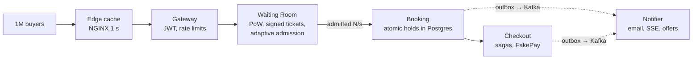

# SurgeTix

**A flash-sale ticketing backend that stays correct and responsive when demand exceeds supply by 100× or more, all at once.**

SurgeTix sells seats for one event to millions of simultaneous buyers. It **never sells a seat twice**, and it keeps the buying path fast by **letting in only as many users as the system can serve**. It is a portfolio-grade implementation in Go. Payments are simulated by **FakePay**, and no real money moves.

> **Status:** 🟢 **Phase 1 — Foundations complete** (CI green, merged 2026-11-06). There are service skeletons, local infrastructure and CI, but **no business logic yet**. Now: **Phase 2 — Naive baseline**, implemented and measured locally, awaiting CI and review. A deliberately unsafe check-then-book path, isolated behind a build tag and a runtime flag, oversold seats in every run ([results](docs/10-planning/phase-2-naive-baseline.md#8-measured-results), [how to run](loadtest/README.md)). See [PROGRESS.md](PROGRESS.md).

## Why

Flash sales break ticketing platforms. For the Eras Tour presale (Nov 2022), ~14M people (including bots) tried to buy and the general sale was cancelled. For Coldplay Mumbai (Sep 2024), 13M+ fans queued for ~1.5 lakh tickets, the platform crashed at opening, and resale hit 10–20× face value within an hour. The crowd is huge, the inventory is tiny, and the hard load is the *queue*, not the booking.

## How it works

A layered funnel. Cheap layers absorb the crowd, and only an admitted, bounded stream reaches the correctness-critical core.



**What stands out**
- Queue status served almost entirely from cache: one signed queue ticket plus one global admission counter, with clients computing their own position.
- Server-side **best-available** seat picker using `SKIP LOCKED` to cut hold conflicts.
- Low-contention **general admission** through 32 bucketed counters.
- **Cancellations with automatic refunds**; returned seats go straight to a **second-chance queue**.
- **Rotating QR codes** with replay-resistant one-time check-in.
- A **nightly audit** that checks money and seats still reconcile.

## Success criteria

| Metric | Target |
|---|---|
| Double-booked seats / oversold GA | **0 in every run** |
| Hold API p99 · Checkout API p99 | < 300 ms · < 300 ms |
| Booking confirmation p99 | < 500 ms |
| Queue status p99 · cache share | < 50 ms · ≥ 95 % |
| Postgres round trips per seat sold | ≤ 4 |
| Buyer-facing error rate vs naive baseline | ≥ 10× lower |
| Wrong refunds · paid orders without ticket or refund | 0 · 0 |

All targets are proven by the same k6 scenarios run against a **naive baseline** and against SurgeTix. Full list: [goals-and-success-metrics](docs/00-overview/goals-and-success-metrics.md).

## Tech stack

Go 1.27 · PostgreSQL 17 · Redis 7 · Kafka (KRaft) · gRPC/Protobuf · REST + SSE · NGINX · React + TypeScript · Prometheus/Grafana/OpenTelemetry/Tempo · k6 · Docker Compose · Kubernetes (kind/k3d) · GitHub Actions. Details and rejected alternatives: [technology-choices](docs/02-architecture/technology-choices.md).

## Repository layout

```
SurgeTix/
├── cmd/                         one binary per service (ADR-021, ADR-033)
│   ├── gateway/  identity/  catalog/  waitingroom/
│   └── booking/  checkout/  notifier/
├── internal/platform/           shared infrastructure only, no business code
│   ├── app/       common entry point: config → logger → deps → serve → shutdown
│   ├── config/    environment variables (+ optional local .env)
│   ├── logging/   slog JSON logger
│   ├── service/   /healthz, /readyz, graceful shutdown
│   ├── postgres/  pgx pool for the service's own database
│   ├── redisx/    go-redis client
│   └── kafka/     franz-go client (acks=all)
├── deploy/compose/postgres-init/   creates one database + role per owning service
├── compose.yaml                 PostgreSQL 17, Redis 7, Kafka 4 (KRaft)
├── .env.example                 local settings template (copy to .env)
├── .github/workflows/ci.yml     gofmt, vet, race tests, build, integration, compose
├── docs/                        engineering documentation (index: docs/README.md)
├── reference/                   source PDF (single source of truth)
└── CLAUDE.md · PROGRESS.md · TASKS.md · ARCHITECTURE_DECISIONS.md · ARCHITECTURE_REVIEW.md · DOCUMENTATION_AUDIT.md
```

## Documentation map

| Section | Contents |
|---|---|
| [00-overview](docs/00-overview/) | product, goals & metrics, users & journeys, glossary |
| [01-requirements](docs/01-requirements/) | FR-1…FR-23 with traceability, NFRs, capacity |
| [02-architecture](docs/02-architecture/) | system architecture, data flow, tech stack |
| [03-services](docs/03-services/) | Gateway, Identity, Catalog, Waiting Room, Booking, Checkout, Notifier, FakePay |
| [04-data](docs/04-data/) | Postgres DDL, state machines, Redis keys, Kafka topics |
| [05-api](docs/05-api/) | conventions, public REST, internal gRPC |
| [06-flows](docs/06-flows/) | the seven key flows |
| [07-correctness](docs/07-correctness/) | guarantees, failure scenarios |
| [08-operations](docs/08-operations/) | observability, deployment |
| [09-testing](docs/09-testing/) | T1…T13 and the baseline comparison |
| [10-planning](docs/10-planning/) | build phases, open questions, **ambiguities awaiting approval**, phase 2 plan |

**Start the review at [ARCHITECTURE_REVIEW.md](ARCHITECTURE_REVIEW.md).** It lists every decision awaiting approval, in build order.

## Local development

### Prerequisites

| Tool | Version | Check |
|---|---|---|
| Go | **1.27** (from `go.mod`) | `go version` |
| Docker with Compose v2 | On Windows, Docker Desktop needs a working **WSL 2** backend | `docker compose version` |
| Git | any recent version | `git --version` |

### 1. Configure

```sh
cp .env.example .env        # PowerShell: Copy-Item .env.example .env
```

Replace every `change-me-…` value in `.env`. The password inside each `*_DATABASE_URL` must match the corresponding `*_DB_PASSWORD`. `.env` is git-ignored. Never commit it.

### 2. Start the infrastructure

```sh
docker compose up -d --wait   # starts postgres, redis, kafka; returns when all are healthy
docker compose ps             # STATUS should show (healthy) for all three
```

| Container | Image | Host port (127.0.0.1 only; non-default so a local Postgres or Redis cannot clash) | Purpose |
|---|---|---|---|
| postgres | `postgres:17.11` | 15432 | `identity_db`, `catalog_db`, `booking_db`, `checkout_db`, each owned by its own role |
| redis | `redis:7.4.12` | 16379 | password-protected, AOF persistence |
| kafka | `apache/kafka:4.4.0` | 29092 | single KRaft broker, topic auto-creation **off** |

Data lives in the named volumes `postgres-data`, `redis-data` and `kafka-data`.

### 3. Run a service

Services run on the host and read `.env` from the repository root:

```sh
go run ./cmd/booking          # or gateway, identity, catalog, waitingroom, checkout, notifier
curl localhost:18084/healthz   # liveness:  200 while the process runs
curl localhost:18084/readyz    # readiness: 200 when its own dependencies answer, else 503 + per-check detail
```

| Service | Port | Dependencies checked by `/readyz` |
|---|---|---|
| gateway | 18080 | Redis |
| identity | 18081 | Postgres (`identity_db`) |
| catalog | 18082 | Postgres (`catalog_db`), Redis |
| waitingroom | 18083 | Redis, Kafka |
| booking | 18084 | Postgres (`booking_db`), Redis, Kafka |
| checkout | 18085 | Postgres (`checkout_db`), Kafka |
| notifier | 18086 | Kafka |

Stop a service with `Ctrl+C`. It stops accepting traffic (`/readyz` → 503), waits up to `SHUTDOWN_TIMEOUT` for in-flight requests, then exits.

### 4. Checks (the same as CI)

```sh
gofmt -l .                              # must print nothing
go vet ./... && go vet -tags=integration ./...
go test ./...                           # unit tests; CI adds -race (needs a 64-bit C compiler locally)
go test -tags=integration ./...         # starts real containers via testcontainers-go; needs Docker
go build -o bin/ ./cmd/...              # bin/ is git-ignored
```

### 5. Stop

```sh
docker compose down        # stop containers, keep data
docker compose down -v     # also delete volumes (full reset; databases are re-created on next start)
```

### Environment variables

Every variable, with a safe placeholder, is in [`.env.example`](.env.example).

| Variable | Used by | Notes |
|---|---|---|
| `POSTGRES_USER`, `POSTGRES_PASSWORD` | postgres container | Admin account. Services never use it |
| `IDENTITY_/CATALOG_/BOOKING_/CHECKOUT_DB_PASSWORD` | postgres init script | Per-service role passwords |
| `<SERVICE>_DATABASE_URL` | identity, catalog, booking, checkout | Each service gets only its own DSN (ADR-008) |
| `REDIS_ADDR`, `REDIS_PASSWORD` | redis container; gateway, catalog, waitingroom, booking | |
| `KAFKA_BROKERS` | waitingroom, booking, checkout, notifier | Comma-separated |
| `KAFKA_CLUSTER_ID` | kafka container | KRaft cluster ID. Not a secret |
| `<SERVICE>_HTTP_ADDR` | each service | Listen address for the health endpoints |
| `LOG_LEVEL`, `SHUTDOWN_TIMEOUT` | all services | `debug` / `info` / `warn` / `error`; a Go duration such as `10s` |

### Troubleshooting

| Symptom | Cause and fix |
|---|---|
| Compose: `required variable … is missing a value` | There is no `.env`, or a value in it is empty. Copy `.env.example` to `.env` |
| Service: `invalid configuration … X is required`, exit code 1 | The service could not find a variable. Run it from the repo root (where `.env` is), or export the variable |
| `/readyz` returns 503 with `connection refused` | The infrastructure isn't running. Check `docker compose ps`, then run `docker compose up -d --wait` |
| Postgres `password authentication failed` or role missing after editing `.env` | Databases and roles are created **only the first time** an empty volume starts. Reset with `docker compose down -v`, then `docker compose up -d --wait` |
| `permission denied for database …` (SQLSTATE 42501) | Working as designed: a service role can open only its own database. Check the database name in the DSN |
| Port 15432 / 16379 / 29092 already in use | Another local server is running. Stop it, or change `POSTGRES_PORT` / `REDIS_PORT` / `KAFKA_PORT` (and the matching URLs) in `.env` |
| Kafka unhealthy for the first ~30 s | The JVM is still starting. `--wait` allows for this; see `docker compose logs kafka` |
| Kafka fails after `KAFKA_CLUSTER_ID` changes | The stored data belongs to the old ID. Run `docker compose down -v` |
| Docker Desktop (Windows) quits on start; its log shows `Wsl/…/HCS/ERROR_NOT_SUPPORTED` | WSL 2 cannot create its VM. Run `wsl --update`, reboot, and check that *Virtual Machine Platform* is enabled. `wsl -d Ubuntu -e echo ok` must work before Docker can |
| `go test -race` fails with `64-bit mode not compiled in` | Your C compiler is 32-bit. Install a 64-bit MinGW-w64 toolchain, or rely on CI, which runs `-race` on Linux |
| Integration tests fail with `reaper: … No such container` (Ryuk) | The testcontainers reaper cannot start on some Docker Desktop setups. Run with `TESTCONTAINERS_RYUK_DISABLED=true`, then remove leftovers with `docker ps -a` if a run crashes. CI keeps Ryuk enabled |

> **Verification status (Phase 1).** On the development machine (Windows 11): gofmt, vet, build, unit tests, integration tests against real Postgres/Redis/Kafka, `docker compose up --wait` (all three healthy), and all 7 services answering `/healthz` 200 and `/readyz` 200 against the stack. `/readyz` turns 503 when a dependency stops. A service role cannot connect to another service's database. Graceful shutdown is verified by a unit test (`service.TestServeShutsDownGracefully`), not by a manual Ctrl+C. `-race` could not run there (32-bit C compiler), but it passed in CI. All three CI jobs (`checks`, `integration`, `compose`) passed on [run 42148048247](https://github.com/Varsh1l01/SurgeTix/actions/runs/42148048247). See [PROGRESS.md](PROGRESS.md).

## Load-test report

*Placeholder, required by the PDF (p.36) as the phase 9 deliverable:* side-by-side charts of error rate, p99, oversold seats and DB queries per second for the naive baseline vs SurgeTix, plus the exact setup (machines, replica counts, versions). **No results exist yet.**
