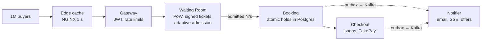

# SurgeTix

**A flash-sale ticketing backend that stays correct and responsive when demand exceeds supply by 100× or more, all at once.**

SurgeTix sells seats for one event to millions of simultaneous buyers. It **never sells a seat twice**, and it keeps the buying path fast by **letting in only as many users as the system can serve**. It is a portfolio-grade implementation in Go. Payments are simulated by **FakePay**, and no real money moves.

> **Status:** 📄 **Documentation phase (phase 0).** No application code exists yet. The engineering documentation is complete and **awaiting owner approval**. See [PROGRESS.md](PROGRESS.md).

## Why

Flash sales break ticketing platforms. For the Eras Tour presale (Nov 2022), ~14M people (including bots) tried to buy and the general sale was cancelled. For Coldplay Mumbai (Sep 2024), 13M+ fans queued for ~1.5 lakh tickets, the platform crashed at opening, and resale hit 10–20× face value within an hour. The crowd is huge, the inventory is tiny, and the hard load is the *queue*, not the booking.

## How it works

A layered funnel. Cheap layers absorb the crowd, and only an admitted, bounded stream reaches the correctness-critical core.



**What stands out**
- Queue status served almost entirely from cache: one signed queue ticket plus one global admission counter, with clients computing their own position.
- Server-side **best-available** seat picker using `SKIP LOCKED` to cut hold conflicts.
- Low-contention **general admission** through 32 bucketed counters.
- **Cancellations with automatic refunds**; returned seats go straight to a **second-chance queue**.
- **Rotating QR codes** with replay-resistant one-time check-in.
- A **nightly audit** that checks money and seats still reconcile.

## Success criteria

| Metric | Target |
|---|---|
| Double-booked seats / oversold GA | **0 in every run** |
| Hold API p99 · Checkout API p99 | < 300 ms · < 300 ms |
| Booking confirmation p99 | < 500 ms |
| Queue status p99 · cache share | < 50 ms · ≥ 95 % |
| Postgres round trips per seat sold | ≤ 4 |
| Buyer-facing error rate vs naive baseline | ≥ 10× lower |
| Wrong refunds · paid orders without ticket or refund | 0 · 0 |

All targets are proven by the same k6 scenarios run against a **naive baseline** and against SurgeTix. Full list: [goals-and-success-metrics](docs/00-overview/goals-and-success-metrics.md).

## Tech stack

Go 1.27 · PostgreSQL 17 · Redis 7 · Kafka (KRaft) · gRPC/Protobuf · REST + SSE · NGINX · React + TypeScript · Prometheus/Grafana/OpenTelemetry/Tempo · k6 · Docker Compose · Kubernetes (kind/k3d) · GitHub Actions. Details and rejected alternatives: [technology-choices](docs/02-architecture/technology-choices.md).

## Repository layout (current)

```
SurgeTix/
├── CLAUDE.md                    working rules and invariants
├── README.md                    this file (will also hold the load-test report)
├── PROGRESS.md                  phase status
├── ARCHITECTURE_DECISIONS.md    ADR-001…032
├── ARCHITECTURE_REVIEW.md       decisions needing approval, PDF inconsistencies, risks
├── TASKS.md                     backlog by phase and gate
├── DOCUMENTATION_AUDIT.md       validation of the doc set
├── .gitignore
├── reference/                   source PDF (single source of truth)
└── docs/                        engineering documentation (index: docs/README.md)
```

The code layout is **not yet decided** ([AMB-34](docs/10-planning/ambiguities.md#amb-34)).

## Documentation map

| Section | Contents |
|---|---|
| [00-overview](docs/00-overview/) | product, goals & metrics, users & journeys, glossary |
| [01-requirements](docs/01-requirements/) | FR-1…FR-23 with traceability, NFRs, capacity |
| [02-architecture](docs/02-architecture/) | system architecture, data flow, tech stack |
| [03-services](docs/03-services/) | Gateway, Identity, Catalog, Waiting Room, Booking, Checkout, Notifier, FakePay |
| [04-data](docs/04-data/) | Postgres DDL, state machines, Redis keys, Kafka topics |
| [05-api](docs/05-api/) | conventions, public REST, internal gRPC |
| [06-flows](docs/06-flows/) | the seven key flows |
| [07-correctness](docs/07-correctness/) | guarantees, failure scenarios |
| [08-operations](docs/08-operations/) | observability, deployment |
| [09-testing](docs/09-testing/) | T1…T13 and the baseline comparison |
| [10-planning](docs/10-planning/) | build phases, open questions, **ambiguities awaiting approval** |

**Start the review at [ARCHITECTURE_REVIEW.md](ARCHITECTURE_REVIEW.md).** It lists every decision awaiting approval, in build order.

## Running it

Not applicable yet. When built, the PDF requires a **one-command local run via Docker Compose** ([deployment-and-operability](docs/08-operations/deployment-and-operability.md)).

## Load-test report

*Placeholder, required by the PDF (p.36) as the phase 9 deliverable:* side-by-side charts of error rate, p99, oversold seats and DB queries per second for the naive baseline vs SurgeTix, plus the exact setup (machines, replica counts, versions). **No results exist yet.**
