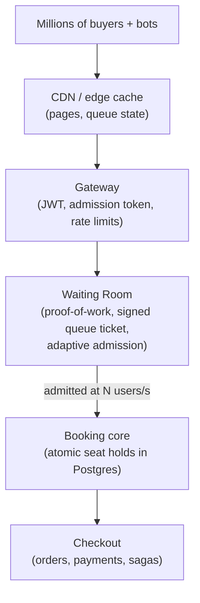

# Product Overview

*Source: PDF p.1 (Overview), p.2 (Goals), p.10 (Architecture overview).*

## What SurgeTix is

SurgeTix is a **flash-sale ticketing backend**. It sells seats for **one event** to **millions of simultaneous buyers** and has to:

1. **Never sell a seat twice.** This covers reserved seats and general-admission (GA) tickets.
2. **Keep the buying path fast** by letting in only as many users as the system can serve.
3. **Stay correct and responsive** when demand exceeds supply by **100× or more, all at once**.

It is a **portfolio-grade implementation in Go**. Payments are simulated by **FakePay**, a fake provider that behaves like a real one. No real money moves.

## The problem it addresses

The PDF cites two real-world flash-sale failures as motivation:

| Incident | What happened |
|---|---|
| Taylor Swift *Eras Tour* presale, Nov 2022 | 3.5M fans registered and ~14M people (including bots) tried to buy. Ticketmaster cancelled the general sale. |
| Coldplay Mumbai, Sep 2024 | More than 13M fans queued for ~1.5 lakh (150,000) tickets. BookMyShow crashed at opening, and resale listings reached 10–20× face value within an hour. |

The lesson: the hard part is not the size of the inventory, which is tiny. It is the **crowd**, and the bots inside it.

## The approach: a layered funnel

Cheap layers absorb the crowd. Only an **admitted, bounded stream** reaches the correctness-critical core.

- **CDN, rate limits and the virtual waiting room** handle volume.
- The **booking core** handles correctness. A seat hold is an **atomic database operation**.

## What makes it stand out

These differentiators are listed on PDF p.1. Each one maps to a requirement and a flow:

| Differentiator | Requirement(s) | Flow / doc |
|---|---|---|
| Queue status served almost entirely from cache (signed queue ticket + one global admission counter) | FR-4, FR-5 | [01-queue-join-and-admission](../06-flows/01-queue-join-and-admission.md) |
| Server-side best-available seat picker that cuts hold conflicts | FR-7 | [02-hold-seats](../06-flows/02-hold-seats.md) |
| Low-contention general admission through bucketed counters | FR-8 | [02-hold-seats](../06-flows/02-hold-seats.md) |
| Cancellations with automatic refunds; returned seats go straight to a second-chance queue | FR-13, FR-14, FR-15 | [05-cancel-and-refund-saga](../06-flows/05-cancel-and-refund-saga.md), [06-second-chance-offers](../06-flows/06-second-chance-offers.md) |
| Short-lived rotating QR codes with replay-resistant one-time check-in | FR-11, FR-17 | [07-transfer-and-gate-scan](../06-flows/07-transfer-and-gate-scan.md) |
| Nightly audit that checks money and seats still reconcile | FR-22 | [checkout service](../03-services/checkout.md) |

## Scope of the documentation and of v1

The PDF covers product requirements, capacity targets, architecture, data model, APIs, key flows, failure handling, the test plan and build phases.

**In scope (v1):** everything in FR-1 … FR-23 ([functional requirements](../01-requirements/functional-requirements.md)). P0 proves the core claim. P1 completes the ticket lifecycle and the efficiency features.

**Explicitly out of scope:** see [Non-goals](goals-and-success-metrics.md#non-goals). Notable exclusions are real payments/PCI, multi-region, dynamic pricing, a paid resale marketplace, a polished consumer frontend, ML bot detection, offline gate scanning and partitioned per-event queues.

## System at a glance

- **6 Go services + 1 worker:** Gateway, Identity, Catalog, Waiting Room, Booking, Checkout, plus the Notifier worker. A **FakePay simulator** plays the external payment provider.
- **PostgreSQL** (one database per service) for strongly consistent state. **Redis** for the queue, caches and rate limits. **Kafka** as the event backbone, fed by a transactional **outbox** in every writing service.
- **REST + SSE** at the public edge and **gRPC** between services.
- **Docker Compose** for a one-command local run. **Kubernetes** manifests for the scaled deployment.

See [system-architecture.md](../02-architecture/system-architecture.md) for details.

## How success is proven

Every headline claim comes from **one comparison**: the same k6 scenarios run against a **naive baseline** and against SurgeTix, with the Grafana *Surge Control Room* dashboard recording both (PDF p.34). The deliverable is a short report in the root `README.md` with side-by-side charts and the exact setup (PDF p.36). See [test-plan.md](../09-testing/test-plan.md).
