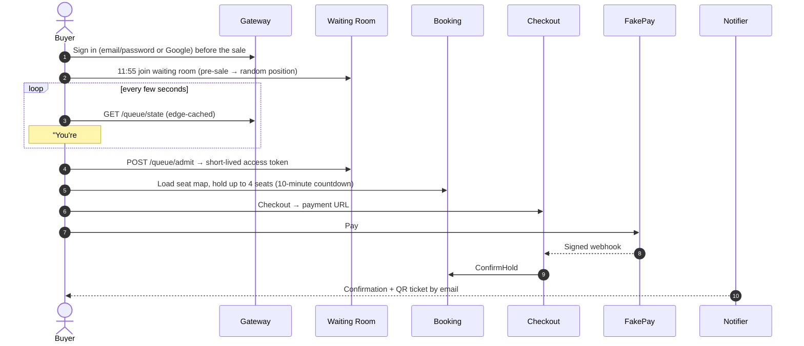

# Users and Key Journeys

*Source: PDF p.3–4.*

Three actors shape the design: the **buyer** we serve, the **organizer** who runs a sale, and the **bot** we must keep out. **Gate staff** are a fourth operational actor.

## Actors

| Actor | Wants | Design consequence |
|---|---|---|
| **Buyer** | A fair shot at seats, clear status, no double charge, easy cancellation | Waiting room with position and ETA, best-available picker, atomic holds, idempotent checkout, self-serve cancel and refund |
| **Organizer / admin** | Create an event, set sale time, limits and refund policy, watch and control the sale live | Admin API, per-event config, pause and resume, live control-room dashboard |
| **Gate staff** | Validate tickets quickly at entry | Online scan endpoint (gates need venue connectivity; offline mode is out of scope), rotating QR codes, one-time check-in |
| **Bot / scalper** | Grab inventory faster than humans and resell screenshots | Proof-of-work on queue join, one queue spot per verified account, purchase caps, rotating QR codes, transfer limits |

> The role model for *admin* and *staff* (how roles are stored and issued in JWTs) is not specified. See [AMB-14](../10-planning/ambiguities.md#amb-14).

## Buyer journey: happy path

1. **Signs in** (email/password or Google) before the sale.
2. **Opens the event page at 11:55 and joins the waiting room.** Users who join **before 12:00** (sale start) get a **random position**. Later arrivals queue **in order**.
3. **Sees "You're #18,342, about 6 minutes"**, updating every few seconds.
4. **Gets admitted** with a short-lived access token, and the seat map loads.
5. **Picks up to 4 seats.** They are **held for 10 minutes** with a visible countdown.
6. **Pays through the fake provider** and receives a confirmation and a QR ticket by email.

## Unhappy paths that must feel clean

| Situation | Required behaviour | Where handled |
|---|---|---|
| **Seat taken while choosing** | `409` with **nearby alternatives**, or one tap for **best-available** | [02-hold-seats](../06-flows/02-hold-seats.md) |
| **Hold expires during payment** | Seats released; **any late payment refunded automatically** | [03-checkout-and-payment-saga](../06-flows/03-checkout-and-payment-saga.md), [04-hold-expiry](../06-flows/04-hold-expiry.md) |
| **Sold out while waiting** | **Everyone in line is told at once** (via `sold_out` in the cached state) and can join the **second-chance queue** | [01-queue-join-and-admission](../06-flows/01-queue-join-and-admission.md), [06-second-chance-offers](../06-flows/06-second-chance-offers.md) |
| **Change of plans** | Cancel before the cutoff, **refund within a minute**, ticket invalidated, seat re-offered | [05-cancel-and-refund-saga](../06-flows/05-cancel-and-refund-saga.md) |

## Organizer journey

*Derived from FR-2 and FR-20 and the admin endpoints on PDF p.26:*

1. Creates an event (`POST /v1/admin/events`) with a venue, reserved sections (rows, seats, price tiers), GA sections, sale start time, per-user limit and refund policy.
2. Configures the sale (`PUT …/sale`). Publishing a sale copies the static seat layout from Catalog into Booking's `seats` table (`catalog.v1.PublishSale`, PDF p.22, p.26).
3. Watches the live sale in the **admin control room**: queue length, admission rate, seats left, errors.
4. Controls the sale with **pause**, **resume** and a per-sale **kill switch**.

> The exact semantics of pause and the kill switch (what stops, what continues, who is notified) are not specified. See [AMB-15](../10-planning/ambiguities.md#amb-15).

## Gate staff journey

1. The ticket holder's app shows a **rotating QR code** derived from the per-ticket secret and the current 30-second window.
2. The staff app posts the payload to `POST /v1/scan` (staff JWT).
3. The response is `200 {valid, seat}` on the first scan and `409` if the ticket was already used. The first scan wins.

## Bot / scalper: how each tactic is countered

| Bot tactic | Counter |
|---|---|
| Thousands of queue joins | Proof-of-work (~1 s of CPU each) on join; nonce burned after use |
| Many accounts / one queue spot each | One active queue entry per **verified** account (`SET NX` on `wr:{event}:user:{user}`) |
| Many requests from few IPs | Per-account and per-IP rate limits (token buckets in Redis) |
| Buying in bulk | Purchase caps per account and payment method |
| Reselling screenshots of tickets | Rotating QR codes; a screenshot goes stale in about a minute |
| Flipping tickets through transfers | Max 1 transfer per ticket; transfers disabled within 24 h of the event |
| Sniping returned seats | Second-chance seats are **reserved by a hold created for the offered user** |

The PDF is candid (p.31) that rotating QR codes **reduce** screenshot resale but **do not prevent** live sharing inside the window.
