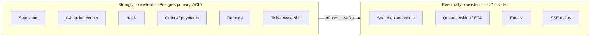

# Non-Functional Requirements

*Source: PDF p.7–8.*

> **Governing principle (PDF p.7):** *Correctness of seat state and money beats availability. Everything else (seat maps, queue position, emails) may be eventually consistent.*

## NFR table

| ID | Area | Requirement (verbatim intent) | Design response |
|---|---|---|---|
| NFR-CONS | **Consistency** | Seat state, GA counts, holds, orders, refunds and ticket ownership are **strongly consistent** (single Postgres primary, ACID). Seat map and queue position are **eventually consistent, ≤ 2 s stale**. | Postgres for all money/inventory state. Redis snapshots with TTL 2 s + jitter. Edge cache 1 s. |
| NFR-LAT | **Latency** | Per-step targets as in [Success metrics](../00-overview/goals-and-success-metrics.md#success-metrics). **Seat-map read p99 < 100 ms**, **online gate scan p99 < 150 ms**. Provider-dependent steps have an SLO for a healthy provider and a recovery objective for an unavailable one. | Admission bounds load. Cached snapshots. Single conditional `UPDATE` for scan. |
| NFR-THR | **Throughput** | Booking core sized for a configured admitted rate (**target 1,000 holds/s on a laptop-class cluster**). Waiting room handles the full crowd. | Funnel. Admission controller. |
| NFR-EFF | **Efficiency** | **≤ 4 Postgres round trips per seat sold**. **One Redis call per queue join**. **≥ 95 % of queue polls answered by cache**. Seat-map pushes as **deltas, not full maps**. **All services built with PGO and allocation-checked hot paths.** | One transaction per hold mode, edge cache, SSE deltas, pprof. See [AMB-28](../10-planning/ambiguities.md#amb-28), [AMB-29](../10-planning/ambiguities.md#amb-29). |
| NFR-AVL | **Availability** | **No single point of failure in the request path on Kubernetes (≥ 2 replicas per stateless service)**. Graceful degradation if notifications, analytics or SSE fail. | Stateless replicas. Kafka decouples side effects. |
| NFR-DUR | **Durability** | No confirmed booking, refund or captured payment lost. **Kafka `acks=all`**, **outbox for every event**. | Transactional outbox. Durable saga steps. |
| NFR-IDEM | **Idempotency** | Retries of hold, checkout, cancel, refund, transfer, payment webhook and event consumption produce **exactly one effect**. | `idempotency_keys`, `processed_events`, business unique keys. |
| NFR-FAIR | **Fairness** | Pre-sale arrivals **randomized**. Post-start **FIFO**. **One active queue entry per account**. Second-chance offers **strictly in queue order**. | `wr:{event}:presale` shuffle, `INCR` seq, `SET NX` user key, sorted set by ticket number. |
| NFR-SEC | **Security** | **JWT on all buyer endpoints**. **Signed queue tickets and admission tokens bound to user and event**. **Proof-of-work on join**. **Per-user and per-IP rate limits**. **Webhook signatures**. **Rotating QR secrets never sent in plain form**. **Parameterized SQL**. | Gateway verification, HMAC webhooks, `qr_secret_enc`. See [AMB-19](../10-planning/ambiguities.md#amb-19). |
| NFR-OBS | **Observability** | **RED metrics per service**. **Traces across gateway → services → DB → Kafka**. **Structured logs with trace IDs**. **Efficiency metrics** (DB round trips per sale, cache hit ratio). | Prometheus, OpenTelemetry, `slog` JSON. See [observability](../08-operations/observability.md). |
| NFR-OPS | **Operability** | **One-command local run (Docker Compose)**. **Kubernetes manifests with probes, HPA, PodDisruptionBudgets and graceful shutdown**. **Per-sale kill switch**. | See [deployment-and-operability](../08-operations/deployment-and-operability.md). |

## Consistency boundaries

**Rule for implementers:** a value in the *eventual* box must never be used to make a correctness decision. For example, the `seatbits` bitmap may **reject** a seat early but may never **grant** it. Only the Postgres conditional update grants (PDF p.23, p.28).

## Latency budget and deadlines

- The Gateway gives every request a **1 s deadline budget**. Internal gRPC calls inherit the remainder (PDF p.27).
- Only gRPC `UNAVAILABLE` is retried at the transport level, with jittered backoff (PDF p.27). Saga-level retries are a separate mechanism (see [AMB-33](../10-planning/ambiguities.md#amb-33)).

## Degradation matrix

*Derived from NFR-AVL and the failure table on PDF p.32–34.*

| Dependency down | Must keep working | May degrade |
|---|---|---|
| Notifier / email | Holds, checkout, confirmation | Emails delayed (Kafka retains events) |
| SSE | Seat-map snapshot reads | Live deltas |
| Analytics | Everything | Analytics |
| Redis | Admitted users with signed tokens can continue; holds (without bitmap pre-filter) | **Admissions pause (fail closed)**; seat map falls back to throttled DB reads |
| Kafka | All synchronous paths (outbox buffers events) | Second-chance offers and emails delayed, never lost |
| CDN / edge cache | Queue state via Gateway in-process 1 s cache | Clients back off on 429 |
| FakePay | Holds; refunds stay queued, tickets stay void | Checkout latency; breaker opens |
| Postgres primary | — (standby promoted) | Holds, checkouts, refunds fail briefly; admission rate → 0 |
