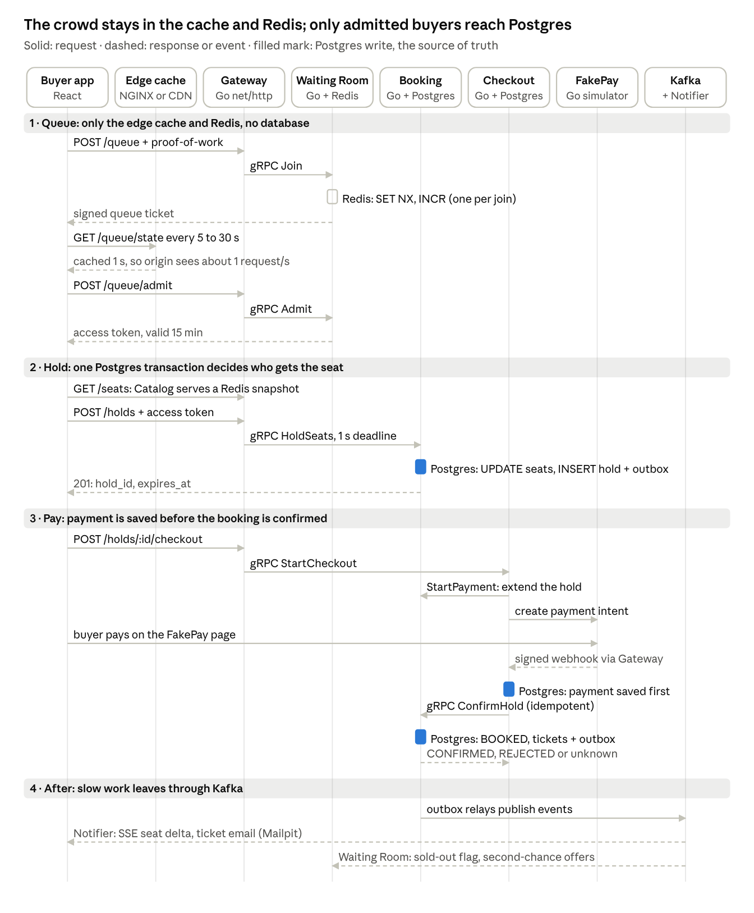
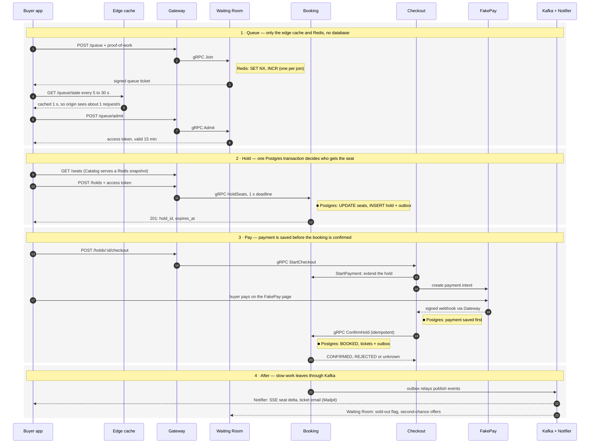

# Data Flow of One Purchase

*Source: PDF p.11–12 ("Data flow" section and diagram).*

> *A buyer reaches Postgres only after admission: the queue runs on the edge cache and Redis, one transaction decides each hold, and everything slow travels through Kafka.* (PDF p.11)

## Original diagram

**Legend (from the diagram):** solid arrow = request · dashed arrow = response or event · filled mark = **Postgres write, the source of truth**.

The PDF notes that **Identity** (JWT keys, **cached by the Gateway**) and **Catalog** (seat maps) sit behind the Gateway. They are left out of the picture to keep it readable.

## Participants

| Lane | Technology (per diagram) |
|---|---|
| Buyer app | React |
| Edge cache | NGINX or CDN |
| Gateway | Go `net/http` |
| Waiting Room | Go + Redis |
| Booking | Go + Postgres |
| Checkout | Go + Postgres |
| FakePay | Go simulator |
| Kafka + Notifier | — |

## Mermaid transcription

## Phase-by-phase notes

### Phase 1 — Queue (no database)
- The join path touches only **Redis**: `SET NX` claims the one-active-entry key, and `INCR` assigns the post-start number.
- The diagram labels this "one per join", which matches NFR-EFF "one Redis call per queue join". How `SET NX` + `INCR` (+ the nonce burn) become a single call is not stated; see [AMB-29](../10-planning/ambiguities.md#amb-29).
- Status polls (every **5–30 s**, adaptive) hit the **edge cache** (TTL 1 s), so the origin sees about **1 request/s** per edge location.
- `POST /queue/admit` returns a **15-minute** access token.
- Detail: [01-queue-join-and-admission](../06-flows/01-queue-join-and-admission.md).

### Phase 2 — Hold (one Postgres transaction)
- The seat map is a **Catalog-served Redis snapshot**. No Postgres read on page load.
- `HoldSeats` is called with a **1 s deadline**.
- **Postgres write (filled mark in the diagram):** conditional `UPDATE seats` + `INSERT holds` + `outbox` rows, all in one transaction.
- Detail: [02-hold-seats](../06-flows/02-hold-seats.md).

### Phase 3 — Pay (payment durable before confirm)
- `StartCheckout` → `StartPayment` extends the hold → Checkout creates the FakePay payment intent.
- The buyer pays **on the FakePay page**. The signed webhook returns **via the Gateway**.
- **Postgres write (filled mark):** Checkout saves the payment **first**, before any confirmation attempt.
- **Postgres write (filled mark):** `ConfirmHold` (idempotent) sets seats `BOOKED`, inserts tickets + outbox.
- **Not marked in the diagram but required by flow 3 (p.29):** `StartPayment` updates the hold and seat mirrors in `booking_db`, and Checkout inserts the order `PENDING_PAYMENT` in `checkout_db`. The diagram shows only three filled marks, so it should not be read as a complete count of writes.
- Three outcomes: **CONFIRMED, REJECTED or unknown**, handled as in [03-checkout-and-payment-saga](../06-flows/03-checkout-and-payment-saga.md).

### Phase 4 — After (Kafka)
- Outbox relays publish. Notifier sends **SSE seat deltas** and the **ticket email via Mailpit**. Waiting Room consumes the **sold-out flag** and drives **second-chance offers**.

## What the diagram establishes (useful for implementers)

| Fact | Consequence |
|---|---|
| The diagram marks three source-of-truth writes (hold, payment saved, confirm). Flow 3 adds at least two more (`StartPayment`, order insert) | Whether this fits "≤ 4 Postgres round trips per seat sold" depends on how round trips are counted ([AMB-28](../10-planning/ambiguities.md#amb-28)) |
| Gateway → Checkout uses **`StartCheckout`**; Checkout → Booking uses **`StartPayment`** and **`ConfirmHold`** | Confirms the RPC names in [internal-grpc-api](../05-api/internal-grpc-api.md) |
| The Gateway **caches Identity's JWT keys** | No Identity call on the hot path |
| Notifier delivers **SSE seat deltas** | Supports reading AMB-08 as "Notifier serves SSE", but Booking's `WatchSeats` stream remains unexplained ([AMB-08](../10-planning/ambiguities.md#amb-08)) |
