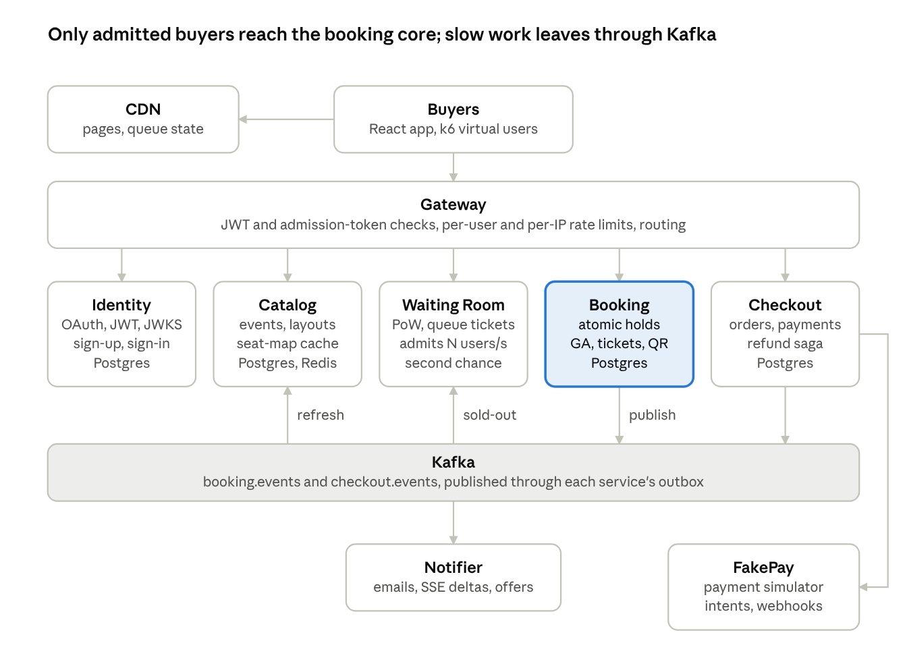
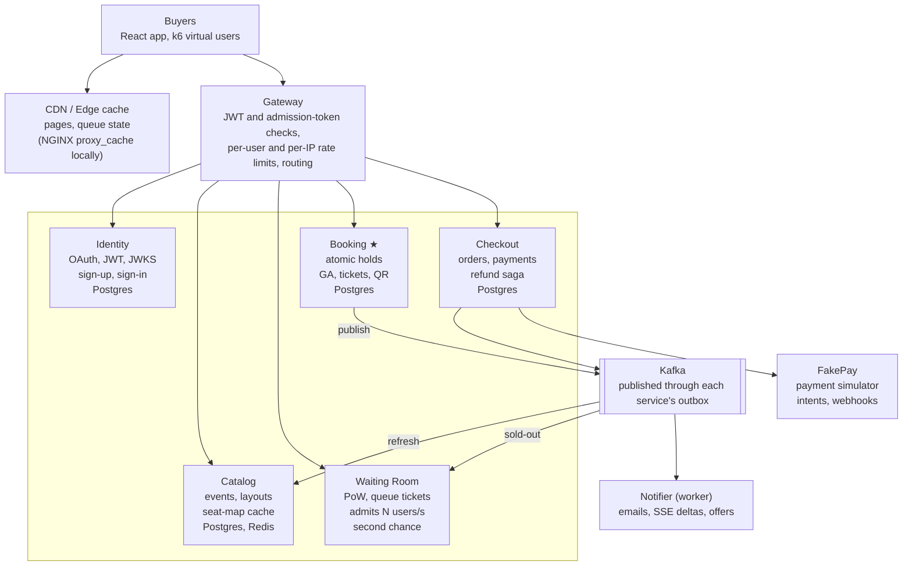
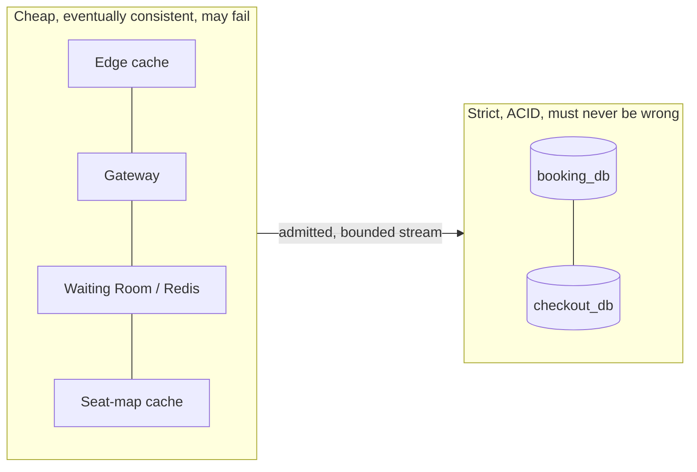

# System Architecture

*Source: PDF p.10–11 (overview, diagram), p.11–12 (data flow), p.15–17 (services and responsibilities, data ownership), p.22 (owned tables), p.24–27 (APIs).*

> *The system is a funnel: the CDN, gateway and waiting room absorb the crowd, and only admitted buyers reach Booking, the one service that must be strictly correct.* (PDF p.10)

## Original diagram

*"Only admitted buyers reach the booking core; slow work leaves through Kafka."* (PDF p.10)

## Mermaid transcription

> The diagram labels the Kafka topics `booking.events` and `checkout.events`, while the topic table (PDF p.24) lists `booking.holds`, `booking.inventory`, `booking.tickets` and `checkout.orders`. This doc set follows the **table**. See [AMB-03](../10-planning/ambiguities.md#amb-03). **Decided 2026-11-06:** the table is authoritative (`booking.holds`, `booking.inventory`; [ADR-036](../../ARCHITECTURE_DECISIONS.md#adr-036)).

For the step-by-step path of a single purchase, see [data-flow.md](data-flow.md).

## Communication model

| Path | Protocol | Notes |
|---|---|---|
| Browser → system | **REST** (+ **SSE** for live updates) via the **Gateway** | Every browser request enters through the gateway. `GET /queue/state` and static assets are served from the **edge cache** (NGINX `proxy_cache`, 1 s microcache). |
| Service → service | **gRPC + Protobuf**, one proto package per service | Typed contracts. Deadlines propagate (1 s total budget from the gateway). Only `UNAVAILABLE` is retried, with jittered backoff. The Gateway translates REST → gRPC. |
| Slow or fan-out work | **Kafka** events, published from each service's **outbox** by a relay | Emails, seat-map refresh, sold-out signals, second-chance triggers. |
| FakePay → system | Signed **webhooks** (HMAC) **through the Gateway to Checkout** | `POST /v1/webhooks/fakepay`. |
| Checkout → FakePay | Payment intents, refunds, status polling by the reconciler | See [fakepay-simulator](../03-services/fakepay-simulator.md). |

Sagas call Booking **directly over gRPC**, not through Kafka (PDF p.24, `checkout.orders` row: *"sagas call Booking directly"*).

## Services and responsibilities

Six Go services plus one worker. Each was split out for a stated reason: different scaling needs, a separate failure domain, or separate data ownership. **New lifecycle features land inside existing services rather than adding more boxes** (PDF p.15).

| Service | Owns | Why it is separate | Scales on | Doc |
|---|---|---|---|---|
| **Gateway** (HTTP) | Routing, JWT and admission-token verification, rate limits, request IDs, cacheable queue-status route | Single public entry; stateless edge logic | Request rate | [gateway](../03-services/gateway.md) |
| **Identity** | Users, credentials, email verification, OAuth (Google, PKCE), JWT signing keys, JWKS | Security boundary; keys never leave it | Sign-ins (low) | [identity](../03-services/identity.md) |
| **Catalog** | Events, venues, seat maps, sale and refund policy config; seat-map snapshots in Redis | Read-heavy; cached aggressively | Seat-map reads | [catalog](../03-services/catalog.md) |
| **Waiting Room** | Proof-of-work challenges, signed queue tickets, admission controller, access tokens, second-chance queue | Faces the whole crowd; must scale independently of booking | Queue joins | [waiting-room](../03-services/waiting-room.md) |
| **Booking** | Seat and GA inventory, best-available picker, holds, expiry, tickets, rotating QR secrets, transfers, gate check-in | Correctness core for inventory and ticket ownership | Admitted rate | [booking](../03-services/booking.md) |
| **Checkout** | Orders, checkout and refund sagas, cancellations, payments, FakePay webhooks, nightly audit | Money path isolated from inventory failures | Orders | [checkout](../03-services/checkout.md) |
| **Notifier** (worker) | Ticket and refund emails, SSE seat-map deltas, second-chance offers | Slow side effects off the critical path | Kafka lag | [notifier](../03-services/notifier.md) |
| **FakePay** (simulator, Go) | Payment intents, delays, failures, signed webhooks, refunds, idempotency keys | Plays the external payment provider | — | [fakepay-simulator](../03-services/fakepay-simulator.md) |

Supporting runtime components (not services): **NGINX** edge cache, **PostgreSQL 17**, **Redis 7**, **Kafka (KRaft)**, **Mailpit**, **Prometheus/Grafana**, **OpenTelemetry Collector + Tempo**, optional **Loki** (PDF p.13–15).

## Data ownership

- **Each service owns its schema.** Locally these are separate Postgres databases on one instance.
- **No service reads another's tables.** Cross-service needs go through **gRPC or Kafka events** (PDF p.17).

| Service | Owned stores (from the PDF) |
|---|---|
| Identity | `users`, `credentials`, `oauth_accounts`, `signing_keys` (PDF p.22). Columns not specified ([AMB-13](../10-planning/ambiguities.md#amb-13)). |
| Catalog | `events`, `venues`, `seat_layouts` (PDF p.22). Redis `seatmap:{event}:{section}` snapshots. Columns not specified ([AMB-13](../10-planning/ambiguities.md#amb-13)). |
| Waiting Room | Redis `wr:{event}:*`, `pow:{nonce}`. Whether it has a Postgres schema is not specified ([AMB-13](../10-planning/ambiguities.md#amb-13)). |
| Booking | `booking_db`: `seats`, `ga_buckets`, `holds`, `hold_seats`, `hold_ga_allocations`, `bookings`, `tickets`, `ticket_transfers`, plus `idempotency_keys`, `outbox`, `processed_events`. Redis `seatbits:{event}:{section}`. |
| Checkout | `checkout_db`: `orders`, `payments`, `refunds`, `refund_items`, `sagas`, `saga_steps`, plus `idempotency_keys`, `outbox`, `processed_events`. |
| Gateway | Redis `rl:{scope}:{key}` token buckets. |

Full DDL: [postgres-schema.md](../04-data/postgres-schema.md). Redis: [redis-keys.md](../04-data/redis-keys.md). Kafka: [kafka-topics.md](../04-data/kafka-topics.md).

## Where correctness lives

Four mechanisms carry every correctness guarantee: **atomic conditional updates**, **unique constraints**, **idempotency keys** and the **outbox**. Redis and Kafka can fail without ever corrupting seat or money state (PDF p.31). See [correctness-guarantees.md](../07-correctness/correctness-guarantees.md).

## Deployment shape

- **Local:** one command via **Docker Compose**. Separate Postgres databases on one instance, 1 Kafka broker (PDF p.8–9, p.15).
- **Kubernetes (kind or k3d):** **CloudNativePG** (Postgres), **Strimzi** (Kafka, 3 brokers), **Redis Sentinel**; ≥ 2 replicas per stateless service, probes, HPA, PodDisruptionBudgets, graceful shutdown (PDF p.8, p.15).
- **CI:** GitHub Actions (PDF p.15).

See [deployment-and-operability.md](../08-operations/deployment-and-operability.md).
