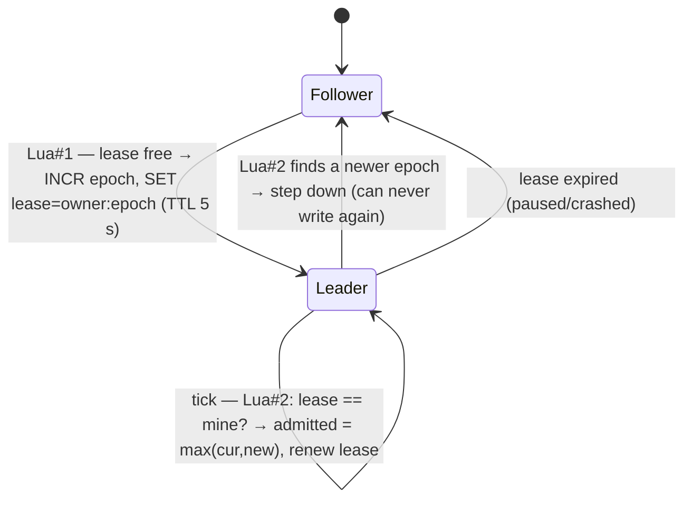

# Waiting Room Service

*Source: PDF p.5–6 (FR-4, FR-5, FR-15, FR-18), p.8 (fairness), p.9–10 (capacity, hot spot), p.12 (data flow), p.15 (responsibilities), p.23 (Redis keys), p.24 (Kafka consumer), p.25–27 (REST, gRPC), p.27–28 (flow 1), p.30–31 (flow 6), p.33 (failures).*

## Purpose

The Waiting Room **faces the whole crowd** and meters it into the booking path at a rate the system can serve. It *"must scale independently of booking"* and **scales on queue joins** (p.15). The design goal is **no per-user server work for status**: everyone reads the same cached counter.

## Responsibilities

| Responsibility | Detail |
|---|---|
| **Proof-of-work challenges** | Issues `{nonce, difficulty}`. The client spends ~1 s of CPU solving it. Spent nonces are stored in `pow:{nonce}` (TTL 2 min) so they cannot be replayed. Difficulty tuning is [OQ-2](../10-planning/open-questions.md). |
| **Signed queue tickets** | `{user, event, number, exp}`, signed. One active entry per user via `SET NX` on `wr:{event}:user:{user}`. |
| **Pre-sale shuffle** | Joins before sale start go into `wr:{event}:presale` (sorted set, random score). At start, everyone in it gets a **random ticket number**. Afterwards, numbers come from `INCR wr:{event}:seq` (FIFO). |
| **Admission controller** | Leader with an **epoch-fenced lease** raises `wr:{event}:admitted` at an **AIMD** rate. Starts at **500/s** (p.9). |
| **Access tokens** | `POST /queue/admit` exchanges an admitted queue ticket for a **15-minute** token bound to user and event. |
| **Sold-out signal** | Consumes `SoldOut` and flips `sold_out` in the public cached state. |
| **Second-chance queue** | `wr:{event}:second_chance` (sorted set by ticket number). Consumes `InventoryReturned`, pops the next user, and issues a **5-minute section-scoped** access token. |

## Redis keys owned

All use the `{event}` hash tag so Lua can touch them atomically (p.23–24):

| Key | Type | Purpose |
|---|---|---|
| `wr:{event}:presale` | Sorted set (random score) | Pre-sale arrivals; shuffled into ticket numbers at sale start |
| `wr:{event}:seq` | Counter | Next queue ticket number after sale start |
| `wr:{event}:admitted` | Counter (public) | Highest admitted ticket number; **only increases**; cached at the edge for 1 s |
| `wr:{event}:user:{user}` | String, TTL | One active queue entry per user |
| `wr:{event}:epoch` | Counter | Leadership epoch; incremented every time the lease is acquired (fencing token) |
| `wr:{event}:lease` | String `owner:epoch`, TTL 5 s | Admission-controller lease; renewed only by the owner of the current epoch |
| `wr:{event}:second_chance` | Sorted set (ticket number) | Users waiting after sell-out |
| `pow:{nonce}` | String, TTL 2 min | Spent PoW nonces |

## Admission controller

- **Leadership (Lua #1):** increments `wr:{event}:epoch` and sets `wr:{event}:lease = owner:epoch` **only if the lease is free**.
- **Every tick (Lua #2), atomically:** (a) checks the lease still equals its own `owner:epoch`, (b) raises `wr:{event}:admitted` to `max(current, new)`, (c) renews the lease.
- A controller that paused past its lease finds a newer epoch and stops. **It can never move the counter again** (test T13).
- **Rate control (AIMD):** the rate rises while **booking p99** and **DB pool wait** stay healthy, and **halves** when they don't. Increment size, thresholds and tick interval are unspecified ([AMB-12](../10-planning/ambiguities.md#amb-12)).
- **Postgres primary failure:** the admission rate **drops to zero** until healthy (p.33).

## Client-side position computation

`GET /queue/state` returns `{admitted_upto, rate, sold_out}`, identical for everyone, with `Cache-Control: max-age=1`.

- **Position** = `my_number − admitted_upto`
- **ETA** = `position ÷ rate`
- Poll interval: **5 s near the front, 30 s far back** (p.9).

## Public API (via Gateway)

| Method and path | Auth | Purpose | Responses |
|---|---|---|---|
| `GET /v1/events/{eventID}/queue/challenge` | JWT | PoW challenge (nonce, difficulty) | `200` |
| `POST /v1/events/{eventID}/queue` | JWT | Join with a solved challenge; returns a signed queue ticket | `201 {ticket, number}`, `409` already queued |
| `GET /v1/events/{eventID}/queue/state` | none | Public, cacheable `{admitted_upto, rate, sold_out}` | `200`, `Cache-Control: max-age=1` |
| `POST /v1/events/{eventID}/queue/admit` | JWT + queue ticket | Exchange an admitted ticket for an access token | `200` token, `425` not yet |
| `POST /v1/events/{eventID}/second-chance` | JWT + queue ticket | Stay in line after sell-out | `201` |

## Internal gRPC — `waitingroom.v1`

`Join`, `GetState`, `Admit`, `VerifyAccessToken`, `OfferSecondChance`.

## Events consumed

| Topic | Event | Action |
|---|---|---|
| `booking.inventory` | `SoldOut` (keyed by `event_id`) | Set `sold_out` |
| `booking.inventory` | `InventoryReturned` | Second-chance offer to the next user |

## Capacity

- Joins ≈ **3,300/s** (1M in 5 min); stretch 33,000/s at 10M on a single shard, *measure before claiming*.
- Polls ≈ **40,000/s** from clients, absorbed by the edge cache.
- Queue of 1M entries ≈ **100 MB** in Redis.
- **Single-shard hot spot accepted in v1** and benchmarked (T2): see [capacity-estimates](../01-requirements/capacity-estimates.md#the-per-event-redis-hot-spot).

## Failure behaviour

| Failure | Behaviour |
|---|---|
| Redis down | **Admissions pause (fail closed)**. Admitted users continue with signed tokens |
| Shard saturated | Joins shed with `429` + `Retry-After` |
| Stale leader | Epoch fencing; the stale controller's next write fails the Lua check |
| Bot floods joins | PoW, one entry per verified account, per-IP limits (T10) |
| Kafka down | Second-chance offers **delayed but never lost** (outbox) |

## Open items

[AMB-07](../10-planning/ambiguities.md#amb-07) (offer hold creation) · [AMB-12](../10-planning/ambiguities.md#amb-12) (AIMD, ticket `exp`, `wr:…:user` TTL) · [AMB-13](../10-planning/ambiguities.md#amb-13) (any Postgres schema) · [AMB-15](../10-planning/ambiguities.md#amb-15) (pause/kill) · [AMB-20](../10-planning/ambiguities.md#amb-20) (Sentinel vs Cluster) · [AMB-22](../10-planning/ambiguities.md#amb-22) (pre-sale window, numbering) · [AMB-29](../10-planning/ambiguities.md#amb-29) (one Redis call per join) · [OQ-2](../10-planning/open-questions.md) · [OQ-4](../10-planning/open-questions.md)
