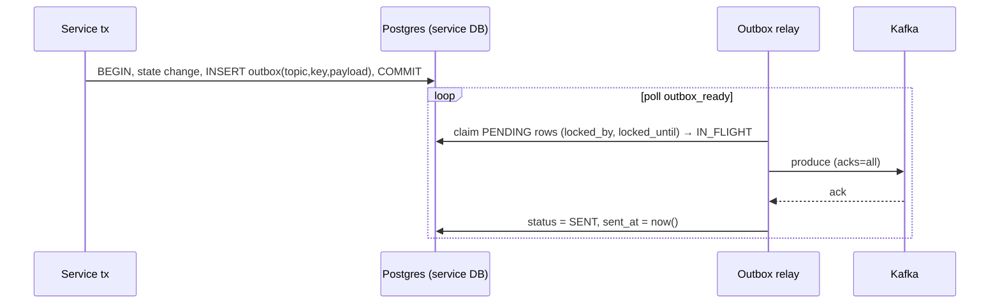
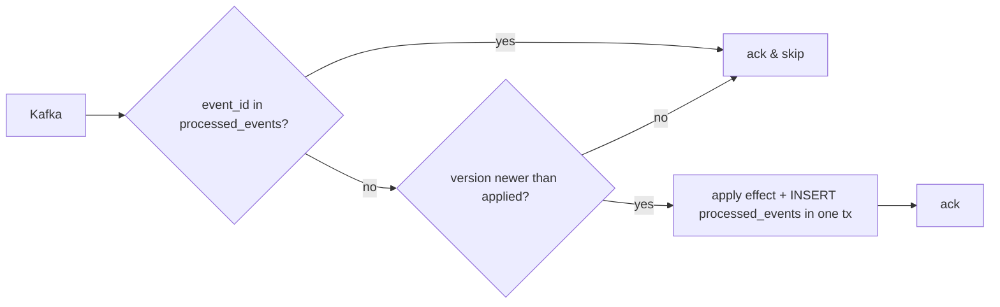

# Kafka Topics

*Source: PDF p.24 (topic table and ordering rules), p.8 (`acks=all`, outbox), p.9 (volume, brokers), p.14 (Kafka KRaft + franz-go), p.15 (Strimzi), p.21 (outbox, processed_events DDL), p.33 (Kafka down).*

Apache Kafka in **KRaft mode**, client **`franz-go`**. **1 broker locally, 3 on Kubernetes** (Strimzi). Producers use **`acks=all`**. Peak ≈ **2,000 events/s** (holds, expiries, confirmations, refunds).

> *Each topic is keyed by the entity whose event order matters; consumers stay idempotent regardless.* (p.24)

## Topic catalogue

| Topic | Key | Events | Ordered per | Consumers |
|---|---|---|---|---|
| `booking.holds` | `hold_id` | HoldCreated, HoldExtended, HoldReleased, HoldExpired, HoldConfirmed | Hold | Notifier, analytics |
| `booking.inventory` | `event_id:section` (**SoldOut keyed by `event_id`**) | InventoryChanged (seat or bucket deltas), InventoryReturned, SoldOut | Section | Catalog (snapshots), Notifier (SSE deltas), Waiting Room (second chance, sold out) |
| `booking.tickets` | `ticket_id` | TicketsIssued, TicketCancelled, TicketTransferred, TicketCheckedIn | Ticket | Notifier, analytics |
| `checkout.orders` | `order_id` | OrderCreated, PaymentSucceeded, PaymentFailed, OrderConfirmed, RefundRequested, RefundIssued, RefundFailed | Order | Notifier, analytics (**sagas call Booking directly**) |

> The architecture diagram (p.10) instead labels the Kafka bus *"booking.events and checkout.events"*. This document follows the **topic table** above ([AMB-03](../10-planning/ambiguities.md#amb-03)). **Decided 2026-11-06:** the table is authoritative (`booking.holds`, `booking.inventory`; [ADR-036](../../ARCHITECTURE_DECISIONS.md#adr-036)).

## Event envelope rules (p.24)

- Every event carries a **unique `event_id`** and the **aggregate's version**. *(Open: the schema and envelope v1 have no aggregate version yet. See [AMB-54](../10-planning/ambiguities.md#amb-54), which blocks the relay.)*
- Consumers **drop duplicates** (via `processed_events`) and **ignore stale versions**.
- A hold that spans two sections publishes its lifecycle **once** on `booking.holds` (one partition, in order) and **one `InventoryChanged` per section** on `booking.inventory`.

The PDF does not define the payload schema or serialisation (Protobuf is used for gRPC; for Kafka payloads `outbox.payload` is `BYTEA`) ([AMB-12](../10-planning/ambiguities.md#amb-12)).

## Producer path: transactional outbox

- **No event is published outside the outbox** (NFR-DUR: *"outbox for every event"*).
- **Kafka down:** outbox rows stay `PENDING` with retry backoff, and the relay publishes on recovery. Second-chance offers are delayed **but never lost** (p.33).
- Which process runs the relay (in each service, or a separate process) is not specified. Phase 4 names an "outbox relay" deliverable (p.36).

## Consumer path

Consumers that keep no Postgres state (for example, a Notifier SSE fan-out) still need a dedup strategy. The PDF does not say where the Notifier's `processed_events` lives ([AMB-13](../10-planning/ambiguities.md#amb-13)).

## Who produces what

| Producer | Topics |
|---|---|
| Booking | `booking.holds`, `booking.inventory`, `booking.tickets` |
| Checkout | `checkout.orders` |
| Identity, Catalog, Waiting Room, Notifier | none in the table |

"Analytics" appears as a consumer, but no analytics component is defined ([AMB-16](../10-planning/ambiguities.md#amb-16)).
