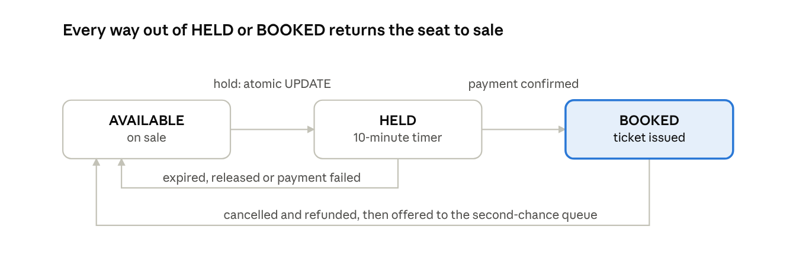
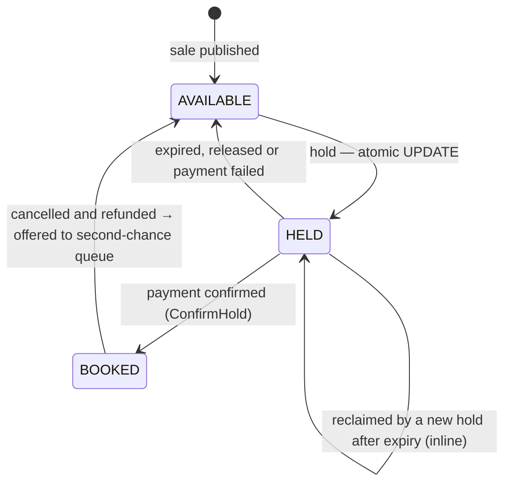
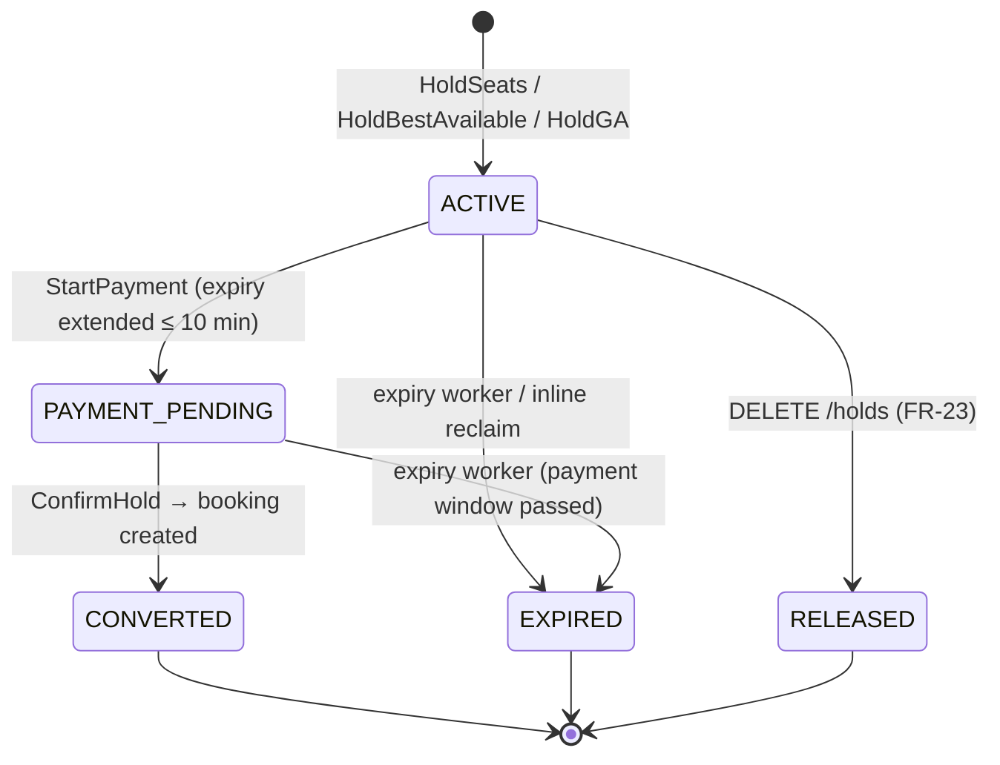
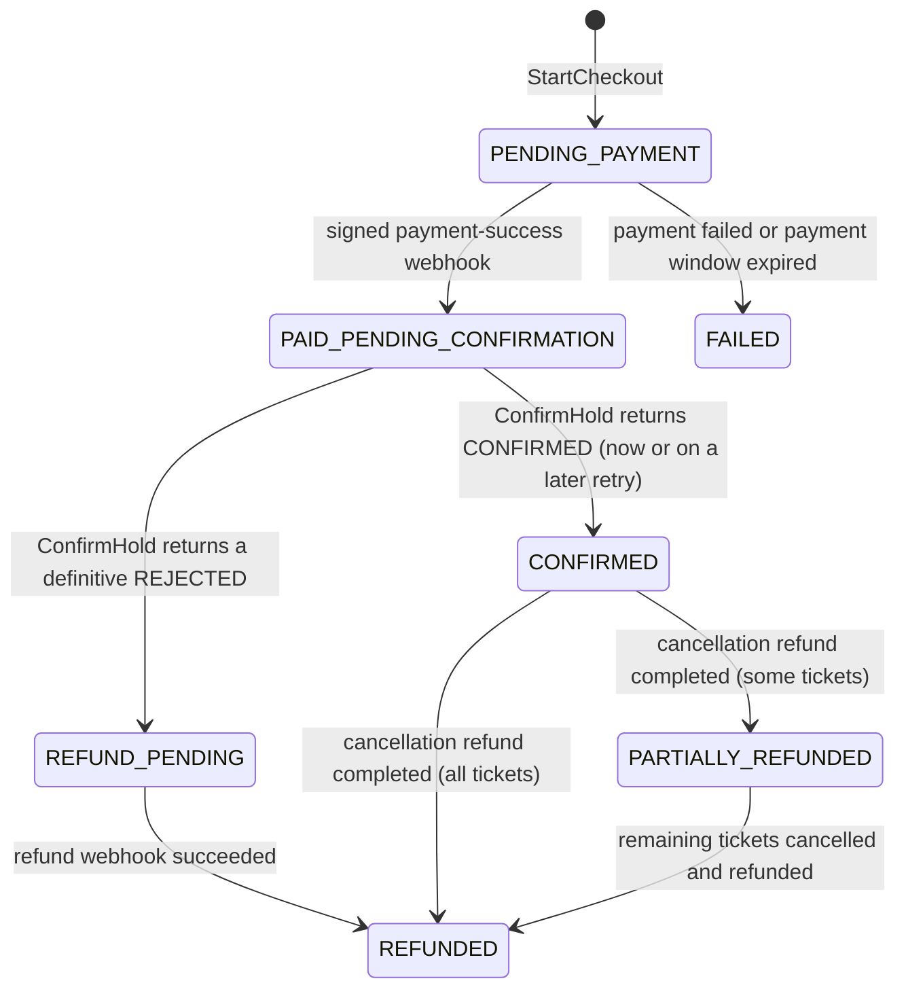
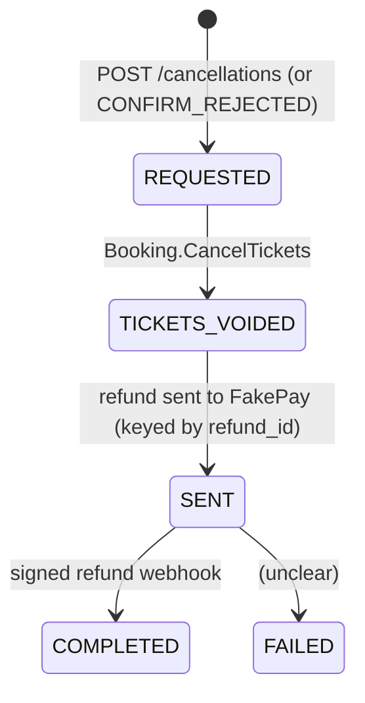
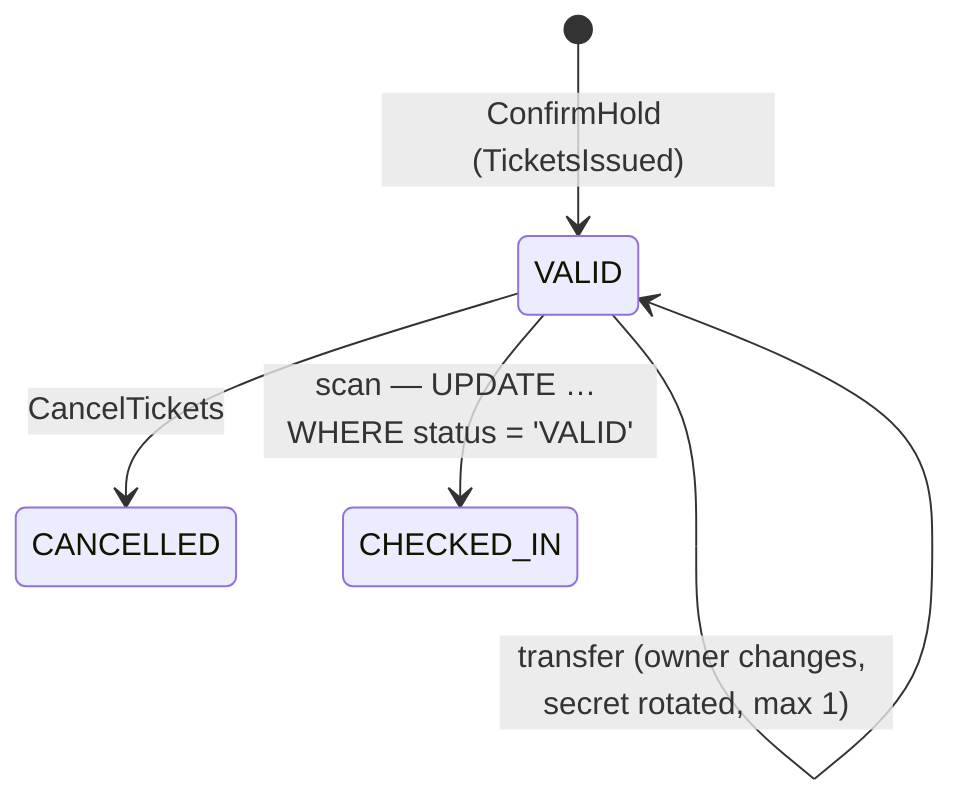
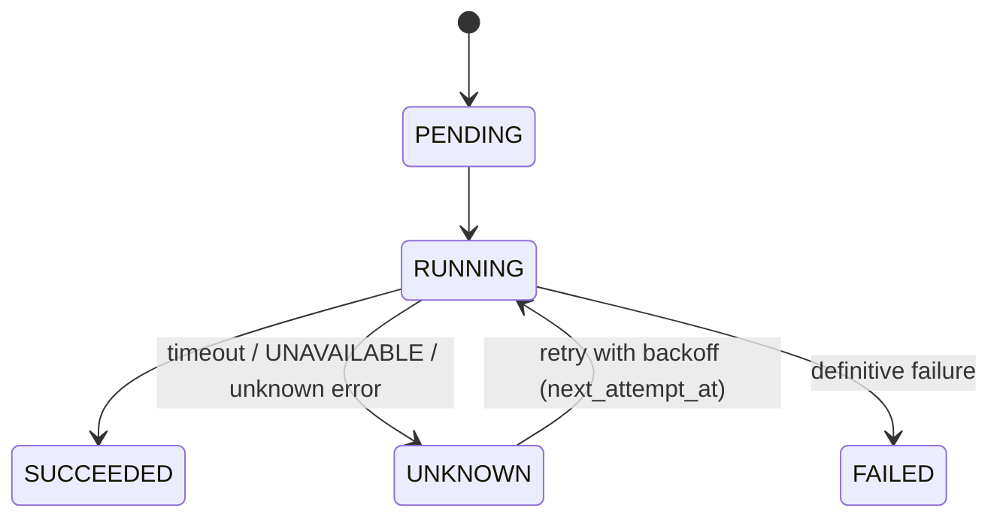

# State Machines

*Source: PDF p.22 (order state machine), p.27 (seat lifecycle diagram), p.17–21 (status enums in DDL), p.28–31 (flows).*

Every state change in SurgeTix is a **conditional update**: it succeeds only if the row is still in the expected *from* state. **Any other transition is rejected** (p.22).

Legend: **Spec** = transition stated in the PDF. **Derived** = implied by a flow or schema constraint but not drawn as a transition in the PDF. Gaps are tracked as `AMB-xx`.

---

## 1. Seat (`seats.status`)



*"Every way out of HELD or BOOKED returns the seat to sale"* (p.27).



| From | To | Trigger | Column effects (per CHECK constraints) | Status |
|---|---|---|---|---|
| AVAILABLE | HELD | Hold (any mode) | `hold_id` set, `hold_expires_at` set | Spec |
| HELD (expired) | HELD | Inline reclaim by a new hold; old hold → `EXPIRED` in the same tx | `hold_id`/`hold_expires_at` replaced | Spec (p.28, p.31) |
| HELD | HELD | `StartPayment` extends the expiry mirror | `hold_expires_at` extended | Spec (p.29) |
| HELD | BOOKED | `ConfirmHold` | `hold_expires_at` → NULL; `hold_id` kept | Spec / Derived columns |
| HELD | AVAILABLE | Expiry, release, payment failed | both NULL | Spec |
| BOOKED | AVAILABLE | `CancelTickets` | `hold_id` → NULL | Spec |

---

## 2. Hold (`holds.status`)

States: `ACTIVE`, `PAYMENT_PENDING`, `CONVERTED`, `EXPIRED`, `RELEASED`.



| From | To | Trigger | Status |
|---|---|---|---|
| — | ACTIVE | Hold created | Spec (p.28) |
| ACTIVE | PAYMENT_PENDING | `StartPayment` | Spec (p.29) |
| ACTIVE / PAYMENT_PENDING | EXPIRED | Expiry worker; inline reclaim | Spec (p.30) |
| ACTIVE | RELEASED | Early release | Derived from FR-23 |
| PAYMENT_PENDING | CONVERTED | `ConfirmHold` | Derived (enum + flow) |
| PAYMENT_PENDING | RELEASED | Payment failed: "failures release seats" (p.34) | **Unclear** ([AMB-27](../10-planning/ambiguities.md#amb-27)) |

**`ConfirmHold` REJECTED condition:** *"the hold is no longer this order's (expired and released)"* (p.29).

---

## 3. Order (`orders.status`) — Spec (p.22)

Every change is:
```sql
UPDATE orders SET status = $to, version = version + 1
 WHERE order_id = $1 AND status = $from;
```



| From | To | Trigger |
|---|---|---|
| PENDING_PAYMENT | PAID_PENDING_CONFIRMATION | Signed payment-success webhook |
| PENDING_PAYMENT | FAILED | Payment failed or payment window expired |
| PAID_PENDING_CONFIRMATION | CONFIRMED | `ConfirmHold` returns CONFIRMED (now or on a later retry) |
| PAID_PENDING_CONFIRMATION | REFUND_PENDING | `ConfirmHold` returns a definitive REJECTED |
| REFUND_PENDING | REFUNDED | Refund webhook succeeded |
| CONFIRMED | PARTIALLY_REFUNDED or REFUNDED | Cancellation refund completed |
| PARTIALLY_REFUNDED | REFUNDED | Remaining tickets cancelled and refunded |

**Not covered by the table** ([AMB-04](../10-planning/ambiguities.md#amb-04)): a second partial cancellation (PARTIALLY_REFUNDED → PARTIALLY_REFUNDED); a refund that permanently fails from REFUND_PENDING; an order's status while a cancellation refund is in flight; a 0 % policy refund (amount 0); `EVENT_CANCELLED` refunds ([AMB-05](../10-planning/ambiguities.md#amb-05)).

---

## 4. Payment (`payments.status`)

`CREATED` → `SUCCEEDED` (signed webhook, deduped on `provider_ref`) or `FAILED`. **Derived** from the enum and flow 3. The PDF draws no table.

---

## 5. Refund (`refunds.status`)

States: `REQUESTED`, `TICKETS_VOIDED`, `SENT`, `COMPLETED`, `FAILED`.



- REQUESTED → TICKETS_VOIDED → (send) → COMPLETED is **Spec** (p.30). The `SENT` step between voiding and completion is **Derived** from the enum.
- When `FAILED` is entered, given that the saga *"retries with backoff and alerts after 1 hour"*, is unclear ([AMB-04](../10-planning/ambiguities.md#amb-04)).
- For `CONFIRM_REJECTED` refunds there are no tickets to void. Whether such a refund passes through `TICKETS_VOIDED` is unclear ([AMB-04](../10-planning/ambiguities.md#amb-04)).

---

## 6. Ticket (`tickets.status`)



| From | To | Trigger | Status |
|---|---|---|---|
| — | VALID | Booking confirmed | Spec |
| VALID | VALID (new owner) | Transfer (≤ 1, not within 24 h of the event) | Spec |
| VALID | CANCELLED | Cancellation saga | Spec |
| VALID | CHECKED_IN | Gate scan; zero rows → already used or cancelled | Spec |

Whether a ticket can be transferred after a cancellation request, or cancelled after check-in, is not stated ([AMB-30](../10-planning/ambiguities.md#amb-30)). The scan's `WHERE status = 'VALID'` and the cancellation cutoff make both unlikely, but the rules are not written down.

---

## 7. Saga step (`saga_steps.status`)



**Derived** from the enum and flow 3. `UNKNOWN` is the key state: **it is retried and never triggers a refund.**

---

## 8. Outbox row (`outbox.status`)

`PENDING` → `IN_FLIGHT` (claimed: `locked_by`, `locked_until`) → `SENT` (`sent_at`), or `DEAD` after repeated failure. **Derived.** Thresholds: [AMB-12](../10-planning/ambiguities.md#amb-12).

## 9. Idempotency record (`idempotency_keys.status`)

`IN_PROGRESS` → `COMPLETED` (response stored). A retry of a `COMPLETED` key returns the stored response. A retry of an `IN_PROGRESS` key gets **409, retry later**. The same key with a different body gets **422** (p.28).
