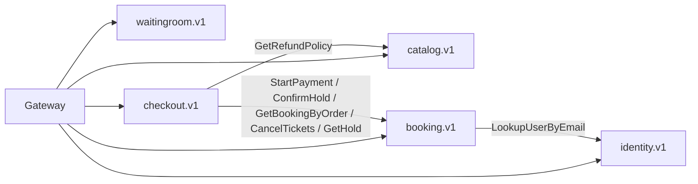

# Internal gRPC API

*Source: PDF p.26–27 (Internal gRPC table), p.12 (data-flow diagram), p.27 (deadlines), p.29–31 (flows).*

gRPC + Protobuf, **one proto package per service**, linted with **`buf`** (lint and breaking-change checks). Deadlines propagate from the Gateway's 1 s budget. Only `UNAVAILABLE` is retried at the RPC layer, with jittered backoff.

## Packages and RPCs

### `identity.v1`

| RPC | Caller | Purpose |
|---|---|---|
| `GetJWKS` | Gateway | Public signing keys (cached by the Gateway) |
| `VerifyToken` | Gateway | Verify a JWT |
| `LookupUserByEmail` | Booking | Resolve a transfer recipient |

### `catalog.v1`

| RPC | Caller | Purpose |
|---|---|---|
| `GetEvent` | Gateway; Booking/Checkout (event time for cutoffs; derived) | Event details |
| `GetSeatMap` | Gateway | Seat-map snapshot |
| `GetRefundPolicy` | Checkout | Cancellation quote |
| `PublishSale` | Admin path | Publish a sale: layout copied into Booking `seats` |

### `waitingroom.v1`

| RPC | Caller | Purpose |
|---|---|---|
| `Join` | Gateway | Verify PoW, claim the user slot, issue a queue ticket |
| `GetState` | Gateway | `{admitted_upto, rate, sold_out}` |
| `Admit` | Gateway | Queue ticket → access token |
| `VerifyAccessToken` | Gateway | Validate the access token for event/user (and section) |
| `OfferSecondChance` | ? | Second-chance offer ([AMB-07](../10-planning/ambiguities.md#amb-07)) |

### `booking.v1`

| RPC | Caller | Purpose / contract |
|---|---|---|
| `HoldSeats` | Gateway | Chosen seats, all or nothing. Called with a **1 s deadline** (p.12) |
| `HoldBestAvailable` | Gateway | N adjacent seats in a section/tier |
| `HoldGA` | Gateway | N GA tickets across buckets |
| `ReleaseHold` | Gateway | Early release |
| `GetHold` | Checkout | Read a hold (amount, status) |
| `StartPayment` | Checkout | `(hold_id, order_id)` → hold `PAYMENT_PENDING`, expiry extended ≤ 10 more min |
| `ConfirmHold` | Checkout saga | `(hold_id, order_id)`, **idempotent by order** → CONFIRMED / definitive REJECTED |
| `GetBookingByOrder` | Checkout reconciler | `order_id` → booking, definitive rejection, or unreachable |
| `CancelTickets` | Checkout refund saga | Void tickets, return inventory, revoke QR secrets, outbox. One transaction |
| `TransferTicket` | Gateway | Ownership change + QR rotation |
| `CheckIn` | Gateway | One-time check-in |
| `WatchSeats` | (server-stream) | Live seat changes ([AMB-08](../10-planning/ambiguities.md#amb-08)) |

### `checkout.v1`

| RPC | Caller | Purpose |
|---|---|---|
| `StartCheckout` | Gateway | Create order + payment intent (shown in the data-flow diagram, p.12) |
| `GetOrder` | Gateway | Order, tickets, refunds |
| `QuoteCancellation` | Gateway | Refund under the policy |
| `Cancel` | Gateway | Start the refund saga |

## Call graph

## Contract rules that matter most

1. **`ConfirmHold` has exactly three outcomes from the caller's view:** CONFIRMED, REJECTED (definitive) and *unknown* (timeout / `UNAVAILABLE` / any other error). **Only REJECTED may lead to a refund** (p.29). The proto should therefore make "REJECTED" an explicit response value, **not** an error status, so it cannot be confused with a transport failure. This is a derived recommendation.
2. **`ConfirmHold` and `GetBookingByOrder` must agree.** Both answer "does a booking exist for `order_id`?", from the same `bookings.order_id UNIQUE` row.
3. **Hold RPCs carry the client's `Idempotency-Key`** through to Booking, which owns the `idempotency_keys` claim (p.28).

## Not specified

Message definitions (fields, enums), error-detail payloads, and the status codes used for business conflicts (409/422 equivalents) are not in the PDF. They are defined in phase 4, subject to approval ([AMB-12](../10-planning/ambiguities.md#amb-12)).
