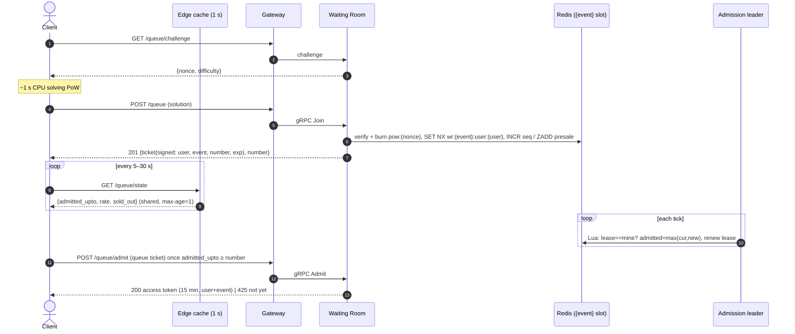

# Flow 1 — Join the Queue and Get Admitted

*Source: PDF p.27–28 (flow 1), p.12 (data flow phase 1), p.9 (capacity), p.23 (Redis keys), p.25 (REST). Requirements: FR-4, FR-5, FR-18 (PoW). Tests: T2, T10, T13.*

## Goal

Absorb the crowd with **no database work** and **no per-user server work for status**, while admitting buyers fairly at a rate the booking core can serve.

## Sequence

## Steps (PDF p.27–28)

1. **Proof-of-work.** The client fetches a challenge and spends roughly **1 second of CPU** solving it. This is *cheap for one human, expensive for a bot farm joining thousands of times.*
2. **`POST /queue`.** The Waiting Room verifies the solution, **burns the nonce**, claims `wr:{event}:user:{user}` with **`SET NX`**, and returns a **signed queue ticket `{user, event, number, exp}`**.
   - **Before sale start:** the user lands in a **shuffle set** (`wr:{event}:presale`). At start, **everyone in it gets a random ticket number**.
   - **After start:** numbers come from **`INCR`** (`wr:{event}:seq`).
3. **Polling.** The client polls `GET /queue/state`. The response `{admitted_upto, rate, sold_out}` is **identical for everyone** and **cached at the edge for 1 s**. Position = `my number − admitted_upto`; ETA = `position ÷ rate`. **No per-user server work at all.**
4. **Admission controller with fencing.**
   - An instance becomes leader by running **one Lua script** that increments `wr:{event}:epoch` and sets `wr:{event}:lease = owner:epoch` **only if the lease is free**.
   - Every admission tick runs a **second Lua script** that (a) checks the lease still equals its own `owner:epoch`, (b) raises `wr:{event}:admitted` to `max(current, new)`, and (c) renews the lease, **all atomically**.
   - A controller that paused past its lease finds a newer epoch and stops. **It can never move the counter again.**
5. **AIMD rate.** The admission rate **rises** while booking p99 and DB pool wait stay healthy and **halves** when they don't (additive increase, multiplicative decrease). It starts at **500/s** (p.9).
6. **Admit.** When `admitted_upto ≥ my number`, the client calls `POST /queue/admit` **once** and receives a **15-minute access token bound to user and event**.
7. **Sell-out.** `sold_out` flips **in the same cached response**. Users can opt into the second-chance queue in one tap (`POST /second-chance`).

## Invariants

| Invariant | Mechanism |
|---|---|
| One active queue entry per account | `SET NX wr:{event}:user:{user}` |
| Nonces cannot be replayed | `pow:{nonce}` with TTL 2 min |
| `admitted` never decreases | `max(current, new)` inside Lua |
| Only the current leader can write `admitted` | Epoch check in the same Lua script (fencing) |
| Pre-sale fairness | Random ordering of the pre-sale set |
| Post-start fairness | FIFO via `INCR` |
| Only verified accounts can join | FR-1 |

## Failure handling

| Failure | Behaviour |
|---|---|
| Redis down | Admissions **pause (fail closed)**; already-admitted users continue with signed tokens |
| Shard saturated | Joins shed with `429` + `Retry-After`; status stays at the edge |
| Edge cache down | Gateway serves state from an in-process 1 s cache |
| Leader paused (SIGSTOP) past its lease | New leader takes over; 0 writes from the old epoch (T13) |
| Postgres primary fails | Admission rate drops to zero until healthy |

## Efficiency targets

- **One Redis call per queue join** ([AMB-29](../10-planning/ambiguities.md#amb-29)).
- **≥ 95 %** of polls answered by cache; status **p99 < 50 ms**.

## Open items

[AMB-12](../10-planning/ambiguities.md#amb-12) (AIMD steps, ticket `exp`, tick interval) · [AMB-22](../10-planning/ambiguities.md#amb-22) (pre-sale window; how shuffled numbers relate to `seq`) · [AMB-29](../10-planning/ambiguities.md#amb-29) · [OQ-2](../10-planning/open-questions.md) (PoW difficulty)
