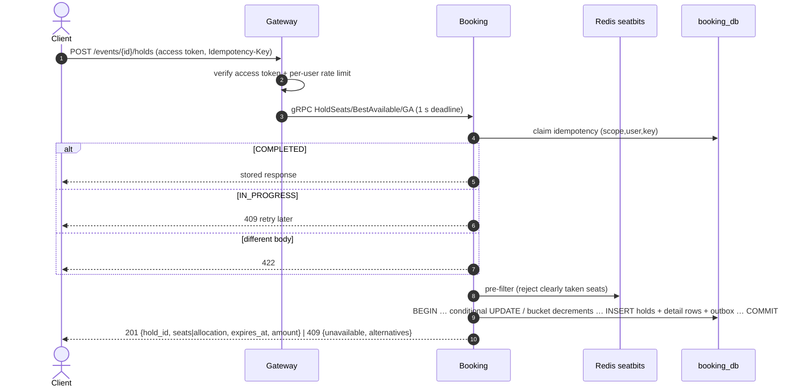

# Flow 2 — Hold Seats

*Source: PDF p.28–29 (flow 2), p.31–32 (double-booking guarantees), p.12 (data flow phase 2), p.17–18 (DDL). Requirements: FR-6, FR-7, FR-8, FR-12, FR-23. Tests: T1, T7, T8.*

## Goal

**One Postgres transaction decides who gets the seat** (p.12). All or nothing, never double-sold, with hold p99 < 300 ms and a conflict rate < 5 % with best-available.

## Sequence



## Steps (PDF p.28–29)

1. **Gateway** verifies the access token and the per-user rate limit.
2. **Idempotency claim** on `(scope, user_id, key)`: completed → return the stored response; in progress → `409` retry later; same key with a different body → `422`.
3. **Pre-filter.** `seatbits` in Redis rejects seats already shown as taken. This is *one in-memory check instead of a doomed transaction*. (It can only reject. Postgres stays the truth.)
4. **One transaction per mode.** Each ends with `INSERT holds`, the hold's detail rows, and outbox events (**HoldCreated** on `booking.holds`, **InventoryChanged** per section on `booking.inventory`).

### 4a. Chosen seats

```sql
UPDATE seats ...
 WHERE event_id = $1 AND seat_id = ANY($2)
   AND (status = 'AVAILABLE' OR (status = 'HELD' AND hold_expires_at < now()));
```

- If **rows affected ≠ seats requested**, the transaction **rolls back**: all or nothing (p.31).
- Insert the `hold_seats` rows.
- **A seat reclaimed from an expired hold also marks that old hold `EXPIRED` in the same transaction.**
- Postgres row locks serialise competing updates. The loser re-checks the `WHERE` against the new row and matches nothing.

### 4b. Best-available

```sql
SELECT ... WHERE status = 'AVAILABLE'
 ORDER BY row_label, seat_number
 FOR UPDATE SKIP LOCKED LIMIT 40;
```

- Pick the **first run of N adjacent seats in memory**, then apply **the same conditional update** as 4a.
- *Concurrent buyers skip each other's locked rows instead of colliding.*
- `SKIP LOCKED` only **chooses candidates**. The conditional update still **decides** (p.31).
- What happens if no run of N adjacent seats exists among the 40 candidates is not specified ([AMB-26](../10-planning/ambiguities.md#amb-26)).

### 4c. General admission, across buckets

```sql
SELECT ... FROM ga_buckets
 WHERE remaining > 0
 ORDER BY (bucket - r + 32) % 32      -- r random: spreads contention
 FOR UPDATE SKIP LOCKED;
```

- **Take greedily from each bucket** until N is covered. Write **one `hold_ga_allocations` row per bucket used** (e.g. 2 from bucket 1 and 2 from bucket 2).
- Each decrement only `WHERE remaining >= quantity`. `CHECK (remaining >= 0)` makes a negative count impossible (p.32).
- **If the unlocked buckets hold fewer than N:** retry **once**, taking plain `FOR UPDATE` locks in **ascending bucket order**. This *waits instead of skipping and cannot deadlock*.
- **If total stock is still short:** `409`.

5. **Response.** `201` with the seats or allocation and `expires_at`, or **`409` listing unavailable seats with suggested alternatives**.

## Hold rules

| Rule | Value |
|---|---|
| Seats per hold | 1–4 (FR-6) |
| Hold duration | 10 minutes |
| Canonical expiry | `holds.expires_at`; `seats.hold_expires_at` is a same-transaction mirror |
| GA buckets | 32 per section (`bucket` 0..31) |
| Early release | `DELETE /v1/holds/{id}` → `204` (FR-23) |

## Release (FR-23) — derived

Release returns inventory exactly as expiry does ([flow 4](04-hold-expiry.md)): seats → `AVAILABLE` (mirror cleared), GA allocations restored once (`released_at`), hold → `RELEASED`, and outbox `HoldReleased` plus `InventoryReturned`. The PDF does not spell out the release transaction. This is a reading of the shared mechanism ([AMB-27](../10-planning/ambiguities.md#amb-27)).

## Tests

- **T1:** 5,000 concurrent buyers on the same 500 seats, run 100 times → 0 double-booked; holds granted ≤ 500.
- **T7:** 10,000 buyers on a 2,000-ticket GA section, including fragmented stock → 0 oversold; multi-bucket orders succeed; exact restoration; lock wait with 32 buckets vs 1 measured.
- **T8:** best-available vs manual picking → conflict rate and holds/s compared.

## Open items

[AMB-09](../10-planning/ambiguities.md#amb-09) (tier) · [AMB-10](../10-planning/ambiguities.md#amb-10) (per-user limit vs 4) · [AMB-26](../10-planning/ambiguities.md#amb-26) (alternatives; no adjacent run) · [AMB-27](../10-planning/ambiguities.md#amb-27)
