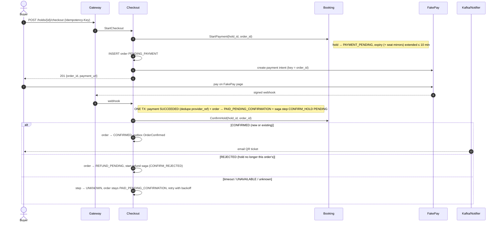

# Flow 3 — Checkout and Payment (Saga)

*Source: PDF p.29–30 (flow 3), p.12 (data flow phase 3), p.22 (order state machine), p.32–34 (failures). Requirements: FR-10, FR-11, FR-12, FR-21. Tests: T3, T5, T12.*

## Goal

Take money exactly once, **persist payment success before attempting confirmation**, and **never refund on a timeout**. Refund only on a **definitive rejection**.

## Sequence

## Steps (PDF p.29–30)

1. **`POST /holds/{id}/checkout`.** Checkout calls **`Booking.StartPayment(hold_id, order_id)`**, which moves the hold to `PAYMENT_PENDING` and **extends its canonical expiry (and the seat mirrors) to cover the payment window, at most 10 more minutes**. Checkout then inserts the order `PENDING_PAYMENT` and **creates a FakePay payment intent keyed by `order_id`**.
2. **The buyer pays on FakePay.** FakePay sends a **signed webhook to the gateway**.
3. **Checkout verifies the signature** and, **in one transaction**, records the payment `SUCCEEDED` (**deduped on `provider_ref`**), moves the order to `PAID_PENDING_CONFIRMATION` and creates a pending `CONFIRM_HOLD` saga step. **Payment success is durable before any confirmation attempt.**
4. **Checkout calls `Booking.ConfirmHold(hold_id, order_id)`.** It is **idempotent**: if a booking already exists for that `order_id`, Booking returns it unchanged.

   | Booking response | Checkout action |
   |---|---|
   | **CONFIRMED** (new or already existing) | Order → `CONFIRMED`; outbox **OrderConfirmed** |
   | **REJECTED** — the hold is no longer this order's (expired and released) | Order → `REFUND_PENDING`; start the refund saga with reason **`CONFIRM_REJECTED`** |
   | **Timeout, `UNAVAILABLE`, or any unknown error** | Step → **`UNKNOWN`**; order stays `PAID_PENDING_CONFIRMATION`; **retry with backoff. Never refund on a timeout** |

5. **Reconciler.** It scans orders stuck in `PAID_PENDING_CONFIRMATION` for **more than 1 minute** and calls **`Booking.GetBookingByOrder(order_id)`**. A booking found → confirm the order. A definitive rejection → refund. Still unreachable → keep retrying and **alert after 15 minutes**.
6. **Notifier** consumes **OrderConfirmed** and **TicketsIssued** and emails the QR ticket (via Mailpit).

## What `ConfirmHold` does inside Booking (derived)

The PDF gives the result (seats `BOOKED`, tickets + outbox, p.12) and the guards (idempotent by `order_id`; succeeds only while the hold belongs to that order, p.32). Inside one transaction:
- If `bookings.order_id` exists → return it (CONFIRMED).
- Else, verify the hold is still `PAYMENT_PENDING` for this `order_id`. Otherwise → REJECTED.
- Seats `HELD → BOOKED` (clear `hold_expires_at`), hold → `CONVERTED`, insert the `bookings` row, insert `tickets` (with encrypted QR secrets), outbox **HoldConfirmed**, **TicketsIssued**.

**GA confirmation:** issue N tickets with `seat_id NULL`. No bucket change is needed (stock was already decremented at hold time).

## Guarantees

| Guarantee | Mechanism |
|---|---|
| No double charge | `payments.order_id UNIQUE` (one capture per order), `provider_ref UNIQUE` |
| Paid buyer never left without a ticket or refund | Payment persisted first; `UNKNOWN` retried; reconciler; nightly audit |
| Confirmed order never refunded by mistake | Refund only on REJECTED; `GetBookingByOrder` before deciding; T12 |
| Late payment after hold expiry | `ConfirmHold` → REJECTED → refund with `CONFIRM_REJECTED`; at most one such refund per order (partial unique index) |

## Failure handling

| Failure | Handling |
|---|---|
| `ConfirmHold` committed, response lost (T12) | Step `UNKNOWN`; the idempotent retry returns the existing booking; reconciler by `order_id`. Order ends `CONFIRMED`, 0 refunds, resolved within 2 min |
| Webhook lost or duplicated | Reconciler **polls FakePay for anything pending > 2 min**; `provider_ref` unique dedupes |
| Checkout worker crashes mid-saga | Steps are durable; another replica resumes from the last completed step |
| FakePay slow/failing (T5) | Timeout + **circuit breaker**; hold extended for the payment window; **failures release seats** |
| Payment failed / window expired | Order `PENDING_PAYMENT → FAILED`. How the hold is released (expiry vs explicit release) is unclear ([AMB-11](../10-planning/ambiguities.md#amb-11), [AMB-27](../10-planning/ambiguities.md#amb-27)) |

## Latency targets

Checkout API p99 < 300 ms · Payment completion p99 < 2 s (healthy FakePay) · Confirmation (webhook → `CONFIRMED` with tickets) p99 < 500 ms.

## Open items

[AMB-11](../10-planning/ambiguities.md#amb-11) · [AMB-25](../10-planning/ambiguities.md#amb-25) · [AMB-31](../10-planning/ambiguities.md#amb-31) · [AMB-33](../10-planning/ambiguities.md#amb-33)
