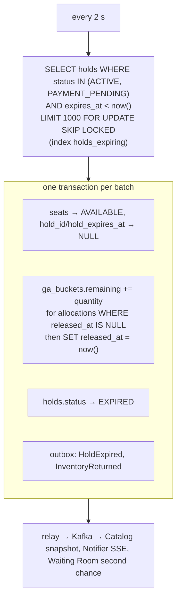

# Flow 4 — Expire Holds

*Source: PDF p.30 (flow 4), p.28 (inline reclaim), p.33 (expiry worker stops). Requirement: FR-9. Tests: T1, T3.*

## Goal

Return abandoned inventory to sale automatically, **without ever restoring anything twice**, and **without inventory ever getting stuck** if the worker stalls.

## Steps (PDF p.30)

1. **Every 2 s**, the expiry worker claims holds in `ACTIVE` or `PAYMENT_PENDING` whose `expires_at` has passed, **in batches of 1,000** with **`FOR UPDATE SKIP LOCKED`**, *so several replicas never fight*.
2. **In one transaction per batch:**
   - seats return to `AVAILABLE` (**mirror cleared**);
   - GA quantities are added back from `hold_ga_allocations` rows **whose `released_at` is NULL** (**then stamped**, so nothing is restored twice);
   - holds become `EXPIRED`;
   - **HoldExpired** and **InventoryReturned** events are written to the outbox.
3. **The hold path also reclaims expired seats inline**, so a stalled worker never blocks inventory (see [flow 2a](02-hold-seats.md#4a-chosen-seats)).
4. **A payment that succeeds after its hold expired** is caught by step 4 of the checkout saga: `ConfirmHold` returns REJECTED, and the buyer is refunded.

## Invariants

- **Canonical expiry** is `holds.expires_at`. The seat mirror is cleared in the same transaction.
- **Exactly-once GA restore**: guarded by `released_at`.
- **`PAYMENT_PENDING` holds expire too**, after the extended payment window. A late payment is then refunded via `CONFIRM_REJECTED`.
- **Replica safety**: `SKIP LOCKED` means concurrent workers take disjoint batches.

## Interaction with inline reclaim

Inline reclaim (in the hold transaction) can take over a seat whose hold has expired before the worker reaches it. In the same transaction it returns the old hold's other seats that it can lock (only seats the old hold still owns), and marks the old hold `EXPIRED` **only if that leaves it with no `HELD` seat** ([AMB-50](../10-planning/ambiguities.md#amb-50) ✅, drained-only rule). Otherwise the old hold stays `ACTIVE` with an expired `expires_at`, and the worker's next batch finishes it. A hold already `EXPIRED` is skipped by the worker (it is no longer `ACTIVE`/`PAYMENT_PENDING`). *Implemented in phase 3 M1 (T9 inline reclaim, T11 worker).* **Derived:** for an old **GA** hold, inline reclaim is not described, because GA holds take bucket counts rather than seats, so GA stock only returns via the worker or release.

## Downstream

`InventoryReturned` feeds **second-chance offers** ([flow 6](06-second-chance-offers.md)). `InventoryChanged`/`InventoryReturned` refresh Catalog's snapshot and Notifier's SSE deltas.

## Failure

| Failure | Effect | Handling |
|---|---|---|
| Expiry worker stops | Expired holds linger | Holds reclaim expired seats inline, so inventory is never stuck (p.33) |
| Kafka down | Events delayed | Outbox keeps them `PENDING` |
