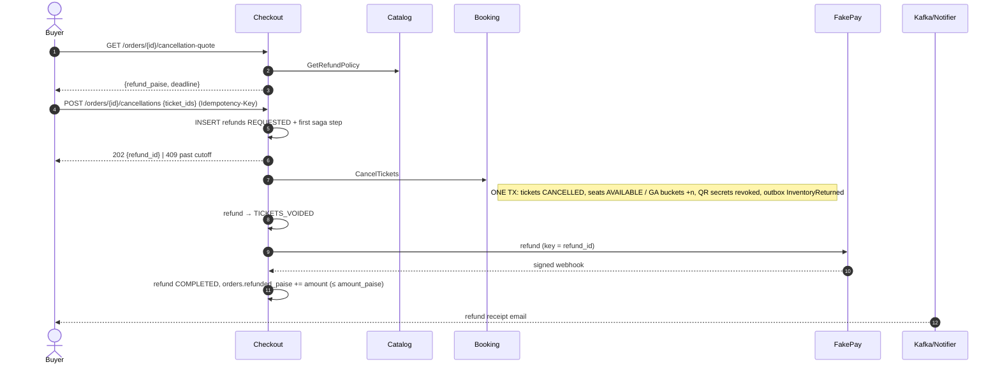

# Flow 5 — Cancel and Refund (Saga)

*Source: PDF p.30 (flow 5), p.6 (FR-13, FR-14), p.20 (refund tables), p.22 (order states), p.33 (provider unavailable), p.35 (T9). Tests: T5, T9.*

## Goal

Let a buyer cancel all or some tickets before the cutoff, refund per policy **exactly once**, invalidate the tickets **immediately**, and put the seats back on sale (and into the second-chance queue).

## Sequence

## Steps (PDF p.30)

1. **Quote.** Checkout applies the event's policy (for example **100 % until 7 days out, 50 % until 24 hours**) and returns the amount and deadline.
2. **`POST /cancellations`** with an `Idempotency-Key` creates a refund row **`REQUESTED`** and the saga's first step.
3. **`Booking.CancelTickets`**: tickets become `CANCELLED`, seats return to `AVAILABLE` (or GA buckets are incremented), **QR secrets are revoked**, and an **InventoryReturned** event is written to the outbox, **all in one transaction**. Refund status moves to **`TICKETS_VOIDED`**.
4. **Checkout sends the refund to FakePay keyed by `refund_id`.** The signed webhook marks it **`COMPLETED`** and adds to `orders.refunded_paise` (**checked never to exceed the amount paid**).
5. **Notifier emails the refund receipt.** If FakePay keeps failing, the saga **retries with backoff and alerts after 1 hour**. **Tickets stay void, so no one can use them meanwhile.**

## Guarantees

| Guarantee | Mechanism |
|---|---|
| A ticket is refunded at most once | `refund_items.ticket_id` primary key |
| Refunds never exceed payment | `CHECK (refunded_paise BETWEEN 0 AND amount_paise)` |
| Retried cancel request → one refund | `Idempotency-Key` + `refunds.idempotency_key UNIQUE` |
| Duplicate refund webhook | `refunds.provider_ref UNIQUE` |
| Voided tickets cannot be used | `CANCELLED` status; scan requires `VALID`; QR secret revoked |
| Seat is resellable after cancel | Partial unique index excludes `CANCELLED` tickets |

## Order status effects (p.22)

- `CONFIRMED → PARTIALLY_REFUNDED` or `REFUNDED` when the cancellation refund completes.
- `PARTIALLY_REFUNDED → REFUNDED` when the remaining tickets are cancelled and refunded.
- Gaps (a second partial cancel, permanent failure, the status while in flight, 0 % refunds): [AMB-04](../10-planning/ambiguities.md#amb-04).

## Timing targets

- Healthy provider: cancellation accepted → refund `COMPLETED` **p99 < 60 s**. The journey promises a *"refund within a minute"* (p.4).
- Provider down: tickets voided **immediately**; refund completes **within 15 min of provider recovery**.
- **T9 refund storm:** 10 % of orders cancel within 2 minutes while sales continue → every refund completes **exactly once**; returned seats reach second-chance users **within 5 s**.

## Refund reasons

| Reason | Origin |
|---|---|
| `CANCELLED` | This flow |
| `CONFIRM_REJECTED` | [Flow 3](03-checkout-and-payment-saga.md), late payment after hold expiry |
| `EVENT_CANCELLED` | Defined in the schema; **no flow in the PDF** ([AMB-05](../10-planning/ambiguities.md#amb-05)) |

## Open items

[AMB-04](../10-planning/ambiguities.md#amb-04) · [AMB-05](../10-planning/ambiguities.md#amb-05) · [AMB-06](../10-planning/ambiguities.md#amb-06) (which GA bucket to increment on partial cancel) · [AMB-23](../10-planning/ambiguities.md#amb-23) · [AMB-32](../10-planning/ambiguities.md#amb-32) (per-ticket amount and rounding) · [OQ-1](../10-planning/open-questions.md)
