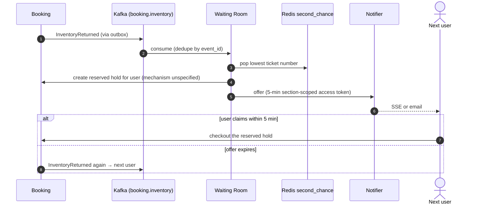

# Flow 6 — Second-Chance Offers

*Source: PDF p.30–31 (flow 6), p.6 (FR-15), p.8 (fairness), p.23 (`wr:{event}:second_chance`), p.25 (REST), p.35 (T9).*

## Goal

After sell-out, inventory that comes back (**expiry, failed payment or cancellation**) goes to the people still waiting, **strictly in queue order**, and **a faster bot cannot snatch it**.

## Steps (PDF p.30–31)

1. **Opt in.** After `sold_out` flips in the cached queue state, users call `POST /v1/events/{eventID}/second-chance` (JWT + queue ticket) → `201`. They are added to `wr:{event}:second_chance` (sorted set, scored by **ticket number**).
2. **The Waiting Room consumes `InventoryReturned` events** (from expiry, failed payment or cancellation) on `booking.inventory`.
3. **It pops the next user** from `wr:{event}:second_chance` and **issues a 5-minute access token scoped to that section**. **Notifier pushes the offer** (SSE or email).
4. **The returned seats are reserved for that user with a hold created by the offer**, so a faster bot cannot snatch them. **Unclaimed offers expire and move to the next person.**

## Fairness rules

- Offers go **strictly in queue order** (NFR-FAIR), ordered by the user's original ticket number.
- One active queue entry per account still applies.

## Targets

- **T9:** returned seats reach second-chance users **within 5 s**.
- Kafka down: offers **delay but are never lost** (outbox).

## What the PDF does not specify ([AMB-07](../10-planning/ambiguities.md#amb-07))

- **Which RPC creates the reserved hold.** `waitingroom.v1.OfferSecondChance` exists, but no Booking RPC for "hold on behalf of user X" is listed, and Booking's hold RPCs are Gateway-facing.
- **The reserved hold's duration** (5 min to match the token, or the standard 10 min).
- **Granularity**: one offer per returned seat, per returned batch, or per section; and how N returned seats are matched to users who may want up to 4.
- **How the Notifier learns of the offer.** No Waiting Room topic exists.
- **How expiry of an unclaimed offer moves to the next person**: via normal hold expiry → `InventoryReturned`, or by a Waiting Room timer.
- Whether a second-chance ticket is transferable ([OQ-4](../10-planning/open-questions.md)).
