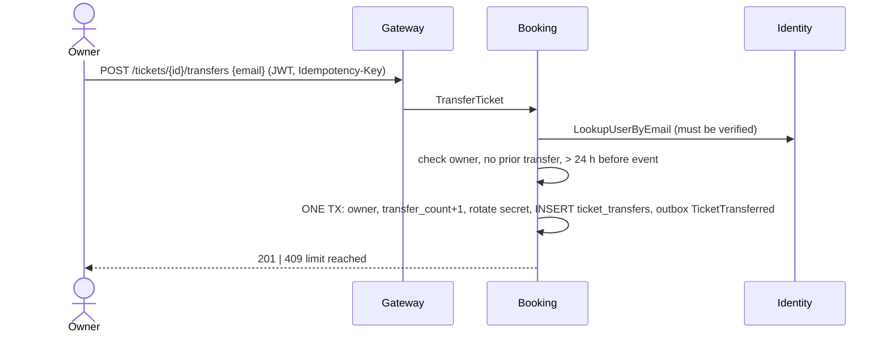
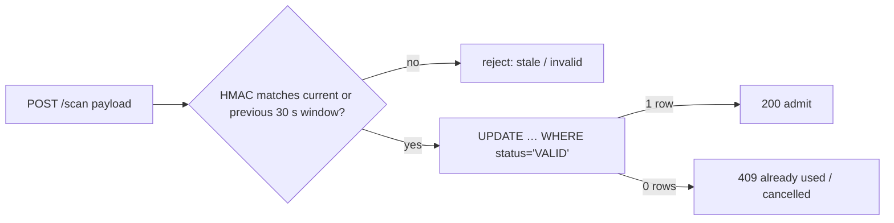

# Flow 7 — Transfer and Gate Scan

*Source: PDF p.31 (flow 7), p.6 (FR-11, FR-16, FR-17), p.18 (tickets, ticket_transfers DDL), p.26 (REST), p.34 (QR / gate failures), p.35 (T11).*

## 7a. Ticket transfer (FR-16)

**Rules:** the recipient is **another verified account**; **max 1 transfer per ticket**; **disabled within 24 hours of the event**; **the old QR secret is revoked**.

**Steps (p.31):** Booking checks **ownership**, that **no transfer exists yet**, and the **24-hour cutoff**. Then, **in one transaction**, it:
- changes `owner_user_id`;
- increments `transfer_count` (`CHECK BETWEEN 0 AND 1`);
- **rotates the QR secret** (`qr_secret_enc`);
- inserts the `ticket_transfers` row (`ticket_id UNIQUE`, `to_user <> from_user`).

**The old owner's QR codes stop working immediately.**



**Double enforcement of "max 1":** `transfer_count ≤ 1` **and** `ticket_transfers.ticket_id UNIQUE`.

**Open:** the event start time is in Catalog, not Booking. Where Booking reads it for the cutoff is not stated ([AMB-23](../10-planning/ambiguities.md#amb-23)). Transferability of second-chance tickets is [OQ-4](../10-planning/open-questions.md).

## 7b. Rotating QR codes (FR-11)

- The app shows a code derived from the **ticket secret** and the **current 30-second window**: a **TOTP-style HMAC** (p.31).
- *A screenshot goes stale within about a minute, but a code shared live can still be scanned by someone else inside that window.* **This reduces screenshot resale; it does not prevent sharing.**
- Secrets are stored **encrypted** (`qr_secret_enc BYTEA`) and **never sent in plain form** (NFR-SEC). `GET /v1/tickets/{id}/qr` returns the current *payload*, never the secret.
- Key management for encrypting secrets: [AMB-19](../10-planning/ambiguities.md#amb-19). The QR payload format: [AMB-12](../10-planning/ambiguities.md#amb-12).

## 7c. Gate scan (FR-17)

**Online only.** Gates need venue connectivity, and offline scanning is **out of scope** (documented known limitation, p.34).

**Steps (p.31):** `POST /scan` (staff JWT) **recomputes the code for the current and the previous window**, then runs:

```sql
UPDATE tickets SET status = 'CHECKED_IN', checked_in_at = now()
 WHERE ticket_id = $1 AND status = 'VALID';
```

- **One row → admit.** Returns `200 {valid, seat}`.
- **Zero rows → already used or cancelled** → `409`.
- A replayed or duplicated code gets in **at most once (first scan wins)**.



**Target:** online gate scan **p99 < 150 ms**. Peak ~**30 scans/s** (50,000 entries over 2 hours).

**Test T11:** replay a 2-minute-old QR → rejected; scan the same ticket twice concurrently → exactly one check-in succeeds.

**Failure table (p.34):**

| Failure | Effect | Handling |
|---|---|---|
| QR code shared live or replayed | Someone else tries to enter | Code expires within about a minute; one-time check-in lets only the first scan in |
| Gate loses connectivity | Scans fail | Out of scope for v1; documented as a known limitation |

**UI:** the gate scanner is a page in the React + TypeScript app (p.13).
