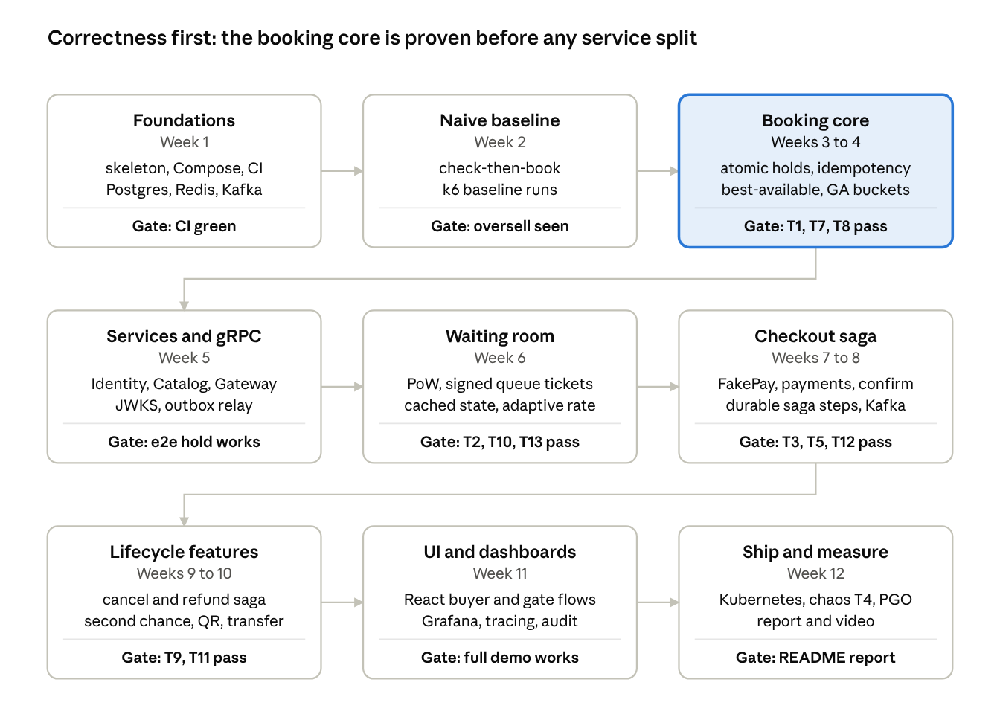
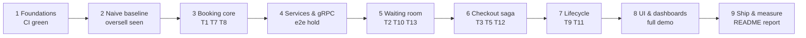

# Build Phases

*Source: PDF p.36 (Build phases, build-plan diagram), p.37 (timeline note).*

> *The plan builds the broken version first, proves the booking core correct, and only then splits services and adds the waiting room; each phase ends at a test gate from the scenarios above.* (p.36)

*"Correctness first: the booking core is proven before any service split."*

## Phases

| # | Phase | Weeks | Scope (verbatim from diagram) | Gate |
|---|---|---|---|---|
| 1 | **Foundations** | Week 1 | skeleton, Compose, CI; Postgres, Redis, Kafka | **CI green** |
| 2 | **Naive baseline** | Week 2 | check-then-book; k6 baseline runs | **Oversell seen** |
| 3 | **Booking core** | Weeks 3–4 | atomic holds, idempotency; best-available, GA buckets | **T1, T7, T8 pass** |
| 4 | **Services and gRPC** | Week 5 | Identity, Catalog, Gateway; JWKS, outbox relay | **e2e hold works** |
| 5 | **Waiting room** | Week 6 | PoW, signed queue tickets; cached state, adaptive rate | **T2, T10, T13 pass** |
| 6 | **Checkout saga** | Weeks 7–8 | FakePay, payments, confirm; durable saga steps, Kafka | **T3, T5, T12 pass** |
| 7 | **Lifecycle features** | Weeks 9–10 | cancel and refund saga; second chance, QR, transfer | **T9, T11 pass** |
| 8 | **UI and dashboards** | Week 11 | React buyer and gate flows; Grafana, tracing, audit | **Full demo works** |
| 9 | **Ship and measure** | Week 12 | Kubernetes, chaos T4, PGO; report and video | **README report** |

## Gate rule

> *Week counts assume part-time work alongside classes; a phase moves on only when its gate passes, so the timeline stretches rather than skipping correctness work.* (p.37)

**Rule:** a phase is **not started** until the previous phase's gate is green and recorded in [`/PROGRESS.md`](../../PROGRESS.md).

## Phase → requirement map

*Derived from the phase scope text above. Items marked † are not named in any phase and are placed by best fit, pending approval ([AMB-02](ambiguities.md#amb-02)).*

| Phase | FRs | Tests |
|---|---|---|
| 1 | — (infrastructure) | — |
| 2 | — (baseline only) | T6 (baseline runs) |
| 3 | FR-6, FR-7, FR-8, FR-9, FR-12, FR-23 † | T1, T7, T8 |
| 4 | FR-1, FR-2, FR-3 | e2e hold |
| 5 | FR-4, FR-5, FR-18 | T2, T10, T13 |
| 6 | FR-10, FR-11 (tickets issued on confirm), FR-21 † | T3, T5, T12 |
| 7 | FR-13, FR-14, FR-15, FR-16, FR-17, FR-11 (rotating QR) | T9, T11 |
| 8 | FR-19 †, FR-20, FR-22 ("audit") | full demo |
| 9 | NFR-OPS (K8s), NFR-EFF (PGO) | T4, report |

## Pre-phase: documentation (current)

This documentation initialisation is **phase 0**. It precedes phase 1 and does not appear in the PDF. Its gate is **owner approval of the documentation set and of the ambiguities register**. Status: [`/PROGRESS.md`](../../PROGRESS.md).
