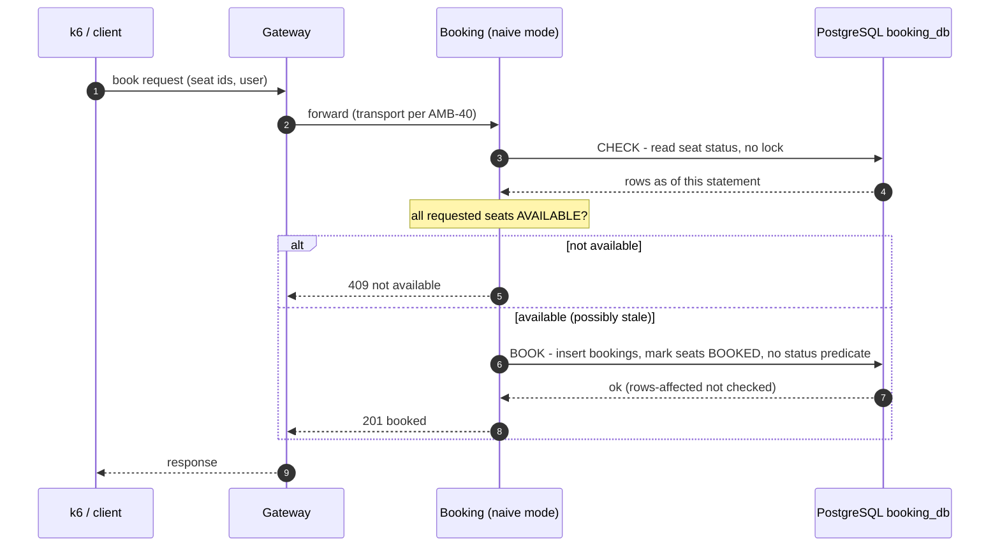
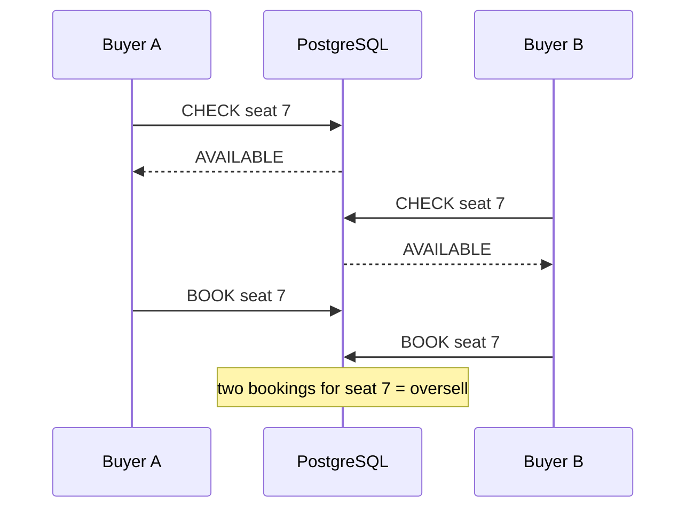

# Phase 2 — Naive Baseline: Plan

*Source: PDF p.36 (build phase 2: "check-then-book; k6 baseline runs", gate "oversell seen"), p.35–36 (T1, T6), p.34 (one comparison for every claim), p.10 (load scale), p.15 (testing and load tooling), p.37 (OQ-7). Owner decision [ADR-034](../../ARCHITECTURE_DECISIONS.md#adr-034) (2026-11-06).*

**Status:** 📝 **Plan only. No Phase 2 application code exists.** Implementation starts after the owner approves this plan and the open items in [§9](#9-open-items-blocking-implementation).

---

## 1. Decision (OQ-7 → Option B)

The naive baseline is **the same seven-component architecture without the protections** ([ADR-034](../../ARCHITECTURE_DECISIONS.md#adr-034)). It is not a monolith.

| Kept from Phase 1 | Gateway, Identity, Catalog, Waiting Room, Booking, Checkout, Notifier; PostgreSQL 17, Redis 7, Kafka; Compose, CI, health and readiness |
|---|---|
| **Deliberately absent** | Waiting-room admission and queue protection · atomic seat reservation · atomic check-and-book · conditional `UPDATE … WHERE status = $from` with a rows-affected check · `SKIP LOCKED`, `FOR UPDATE` or advisory locks · `SERIALIZABLE` / `REPEATABLE READ` isolation · uniqueness constraints that would stop a double booking · idempotency keys · later-phase optimisations (best-available, GA buckets, `seatbits`, caches) |
| **Phase 2 focus** | The booking and inventory path only: client → Gateway → Booking → PostgreSQL → response |

The other five components keep their Phase 1 skeletons. Phase 2 does not change them beyond what [AMB-40](ambiguities.md#amb-40) requires of the Gateway.

## 2. Purpose and gate

- **PDF gate:** *oversell seen* (p.36).
- **Why the baseline exists:** every SurgeTix claim is measured against it under an identical k6 profile (p.34, T6). The baseline must be **unprotected but credible**: a plausible implementation without the mechanisms, not a sabotaged one ([R-12](../../ARCHITECTURE_REVIEW.md)).
- **Owner acceptance criteria (2026-11-06).** Phase 2 is complete only when all of these hold:
  1. The naive booking flow works end to end.
  2. The seven-service architecture is intact.
  3. The baseline has a reproducible concurrency test.
  4. The oversell race is demonstrated **and** documented, with test evidence.
  5. The k6 load tests run successfully.
  6. Baseline latency, throughput and error-rate metrics are recorded.
  7. The benchmark results are reproducible.
  8. Documentation contains the architecture, the test method and the measured results.
  9. No Phase 1 functionality is broken.

## 3. Architecture of the baseline path

**Derived** from ADR-034. The transport between Gateway and Booking, the route and the contract are open ([AMB-39](ambiguities.md#amb-39), [AMB-40](ambiguities.md#amb-40)).



**The race (by design).** Two buyers both run CHECK before either runs BOOK. Both see `AVAILABLE`, both BOOK, both receive `201`. One seat now has two bookings.



## 4. Database behaviour (proposed, pending AMB-38)

The tables, their location and the migration method are open ([AMB-38](ambiguities.md#amb-38)). Whatever is chosen must satisfy these rules, which are what make the baseline unsafe **on purpose and visibly**:

| Rule | Why |
|---|---|
| Baseline tables are **separate** from the real `booking_db` schema (phase 3) and never shared with it | The real schema's constraints (`one_live_ticket_per_seat`, `bookings.hold_id UNIQUE`, the seat `CHECK`s) would stop the oversell. They must **never** be weakened (invariant 4), so the baseline cannot use them |
| The bookings table has **no** uniqueness on `(event_id, seat_id)` | Otherwise Postgres would reject the second booking and the race would be hidden |
| Isolation level **`READ COMMITTED`**, set **explicitly** (`BEGIN ISOLATION LEVEL READ COMMITTED`), and asserted in a test with `SHOW transaction_isolation` | It is the Postgres default, but setting it explicitly means a changed server default cannot silently protect the baseline. Under `REPEATABLE READ` or `SERIALIZABLE`, concurrent updates of the same row fail with SQLSTATE `40001`, which would partly protect it |
| CHECK is a plain `SELECT` with **no** `FOR UPDATE`, `FOR SHARE`, `SKIP LOCKED` or advisory lock | A lock would serialise the buyers |
| BOOK updates seats **without** `AND status = 'AVAILABLE'` and **without** a rows-affected check | That predicate and check are exactly the SurgeTix protection (invariant 1) |
| Parameterised SQL only; money as integer paise | Invariants 12 and 14 still apply to the baseline ([ADR-034](../../ARCHITECTURE_DECISIONS.md#adr-034)) |

Illustrative SQL only. Names and columns are placeholders until AMB-38 is decided:

```sql
-- CHECK (READ COMMITTED, no lock)
SELECT id, status FROM <baseline_seats> WHERE event_id = $1 AND id = ANY($2);
-- application: every row AVAILABLE and count = len($2)?  else 409

-- BOOK (same READ COMMITTED transaction, deliberately unconditional)
INSERT INTO <baseline_bookings> (id, event_id, seat_id, user_id, booked_at) SELECT ...;
UPDATE <baseline_seats> SET status = 'BOOKED' WHERE id = ANY($2);  -- no status predicate, rows affected ignored
```

### Oversell audit (baseline variant)

The PDF audit metrics `double_booked_seats` and `oversold_ga` (p.34) are defined on the real schema. The baseline needs equivalents over its own tables, run **after every k6 run**:

| Measure | Definition (derived) |
|---|---|
| Double-booked seats | Seats with more than one booking row |
| Excess bookings | Booking rows minus distinct booked seats |
| Oversold (GA, only if GA is in scope per AMB-38) | Tickets booked minus capacity, when positive |

## 5. Concurrency tests (deterministic)

Real Postgres through `testcontainers-go` (ADR-029). **The race is forced by a barrier, not by timing.**

**Mechanism (derived).** The naive repository calls an optional checkpoint between CHECK and BOOK. In production builds it is `nil` and costs nothing. Tests set it to a barrier that releases only when all *N* buyers have finished CHECK. Every buyer has then seen `AVAILABLE`, so every buyer books. The outcome is exact, not probabilistic.

| Test | Setup | Expected (asserted exactly) |
|---|---|---|
| Two buyers, one seat | Barrier *N* = 2 | 2 × `201`, 2 bookings for 1 seat, double-booked seats = 1 |
| *k* buyers, one seat | Barrier *N* = *k* (e.g. 50) | *k* bookings for 1 seat |
| Demand ≫ inventory | 10 seats, 200 buyers in barrier groups | Bookings > 10. Exact count derived from the group layout |
| Conflicting multi-seat requests | Overlapping seat sets `{1,2}`, `{2,3}` behind the barrier | Both succeed, seat 2 double-booked |
| Sequential control | Same buyers, no concurrency | Exactly one booking per seat, extra buyers get `409`. Shows the bug is concurrency only |
| Isolation guard | Inside the naive transaction | `SHOW transaction_isolation` = `read committed` |
| Natural race (no barrier) | Many goroutines, real timing | Reported, not asserted. The barrier tests are the evidence |

These are database races, not Go data races: the tests must also pass `go test -race` (in CI).

## 6. Load tests (k6)

k6 with **arrival-rate executors** (p.15). Scenario parameters are open ([AMB-43](ambiguities.md#amb-43)). The structure below is proposed:

| Dimension | Proposed values (for approval) |
|---|---|
| Shape | T1-style contention (many buyers, one event, few seats) and demand ≫ inventory |
| Inventory sizes | 50 · 500 (T1) · 5,000 seats |
| Arrival rates | Stepped, e.g. 100 → 2,000 requests/s |
| Duration | Fixed per step, e.g. 60 s |
| Repetitions | Each configuration run several times; report median and spread |
| Per run | Reset dataset → run k6 → **run the audit** → archive the k6 summary, audit output and environment |

**Measured per run:** requests/s · successful bookings · failed bookings (409, other 4xx, 5xx, timeouts) · error rate · p50, p95, p99 latency · double-booked seats and excess bookings · CPU and memory where measurable ([AMB-42](ambiguities.md#amb-42)).

**Environment recorded with every result:** CPU, cores, RAM, OS, Docker version, Go version, service versions (commit), Postgres/Redis/Kafka versions, pool sizes, whether k6 ran on the same machine, dataset, duration and executor settings. The current development machine is an Intel i5-1235U (12 logical CPUs) with 7.7 GB RAM on Windows 11. Running 5,000 virtual users there may distort results ([AMB-43](ambiguities.md#amb-43), [R-10](../../ARCHITECTURE_REVIEW.md)).

## 7. Observability

**There is no Prometheus or Grafana in the repository yet.** Phase 1 has no `/metrics` endpoint, and the PDF places Grafana in phase 8 (p.36). Whether Phase 2 adds them is open ([AMB-42](ambiguities.md#amb-42)). The signals needed:

| Signal | PDF name, where one exists |
|---|---|
| Incoming booking requests, successes, failures by reason | `holds_total{mode,result}` (closest PDF metric) + RED per route |
| Inventory left | `seats_remaining` |
| Oversell | `double_booked_seats` (baseline variant, §4) |
| Request latency and error rate | RED (NFR-OBS) |

## 8. Measured results

**None yet.** This section will hold the k6 summaries, audit results and the environment of each run. Nothing here may be estimated or carried over from another system.

## 9. Open items blocking implementation

| ID | Question | Blocks |
|---|---|---|
| [AMB-38](ambiguities.md#amb-38) | Inventory model (seats only, or also GA), baseline tables, where they live, migration method, dataset | Schema, tests, audit |
| [AMB-39](ambiguities.md#amb-39) | Request contract: route, body, user identity without Identity, idempotency, response codes | Endpoint, k6 |
| [AMB-40](ambiguities.md#amb-40) | Gateway → Booking transport before gRPC (phase 4) | Gateway routing, e2e |
| [AMB-41](ambiguities.md#amb-41) | How the unsafe path is isolated (build tag, runtime flag, both), and where the baseline code, k6 scripts and results live | Endpoint, safety |
| [AMB-42](ambiguities.md#amb-42) | Metrics in phase 2: Prometheus/Grafana now, `/metrics` only, or k6 + audit + OS counters | Observability |
| [AMB-43](ambiguities.md#amb-43) | T6 scope in phase 2 (T1 only?), scale on one laptop, k6 install method, scenario matrix, repetitions | Benchmarks |

## 10. Implementation sequence (after approval)

Each step lands with its tests and docs (P5). No step adds an atomic protection to the naive path.

| # | Step | Evidence it produces | Task |
|---|---|---|---|
| 0 | Owner decides AMB-38 … AMB-43 | Register entries ✅ | P2-6 |
| 1 | Baseline tables, seed and reset (per AMB-38) | Migration/seed applies on a fresh Compose stack | P2-7 |
| 2 | `naive` repository: CHECK and BOOK SQL, explicit `READ COMMITTED`, nil-by-default checkpoint | Unit tests | P2-2 |
| 3 | Deterministic concurrency tests (§5), real Postgres | **First oversell evidence**, exact counts, passes `-race` | P2-8 |
| 4 | Audit queries (§4) | Audit returns > 0 after step 3 tests, 0 after the sequential control | P2-4 |
| 5 | Booking HTTP endpoint behind the isolation guard (AMB-39, AMB-41) | Handler tests. The guard refuses the route when the baseline is not enabled | P2-9 |
| 6 | Gateway routing to Booking (AMB-40) | End-to-end test through Gateway against Compose | P2-10 |
| 7 | Metrics (AMB-42) | Signals of §7 visible during a run | P2-11 |
| 8 | k6 scripts and the reset → run → audit wrapper | Smoke run completes | P2-3 |
| 9 | Benchmark matrix, repeated runs, environment captured | Archived k6 summaries + audits | P2-5, P2-12 |
| 10 | Write up method and measured results (§8), update `PROGRESS.md` | Docs | P2-13 |
| 11 | Regression: Phase 1 checks, Compose health, CI on the PR | Green CI run | P2-14 |
| 12 | Owner gate review | Gate recorded in `PROGRESS.md` | P2-15 |

## 11. Later phases

Phase 3 builds the real booking core in the real schema. The baseline stays frozen and isolated so that T6 can be re-run against it with the same k6 profile. The README comparison (phase 9) must state the exact topology of both runs. Under Option B the baseline should run through the same service topology as SurgeTix at measurement time ([ADR-034](../../ARCHITECTURE_DECISIONS.md#adr-034)).
