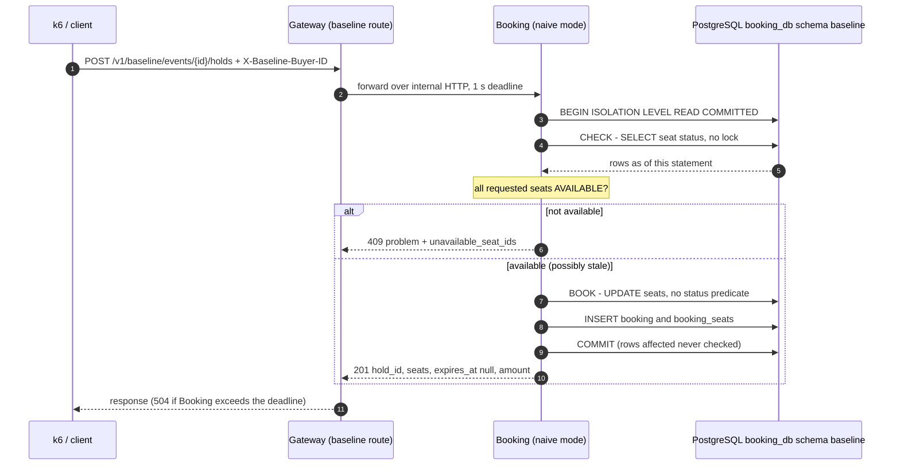
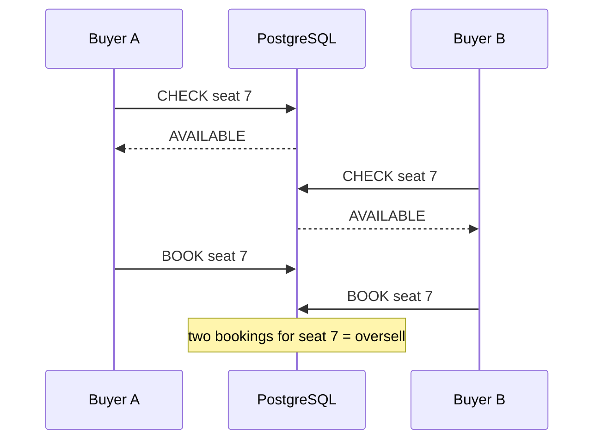

# Phase 2 — Naive Baseline

*Source: PDF p.36 (build phase 2: "check-then-book; k6 baseline runs", gate "oversell seen"), p.35–36 (T1, T6), p.34 (one comparison for every claim), p.27 (gateway deadline), p.10 (load scale), p.15 (testing and load tooling), p.37 (OQ-7). Owner decisions [ADR-034](../../ARCHITECTURE_DECISIONS.md#adr-034) and [ADR-035](../../ARCHITECTURE_DECISIONS.md#adr-035) (2026-11-06).*

**Status:** 🟢 **Complete. Gate passed 2026-11-06** (PR #2 merged into `develop`, CI run [42159920841](https://github.com/Varsh1l01/SurgeTix/actions/runs/42159920841) green on all three jobs, including both `-race` steps). The gate (*oversell seen*) is met by deterministic test evidence (§5) and by every benchmark run (§8). **The baseline is frozen** for future comparisons ([ADR-034](../../ARCHITECTURE_DECISIONS.md#adr-034)).

> ⚠️ The baseline **deliberately oversells**. It is for testing and benchmarking only and is never a booking flow. How to build and run it: [`loadtest/README.md`](../../loadtest/README.md).

---

## 1. Decision (OQ-7 → Option B)

The naive baseline is **the same seven-component architecture without the protections** ([ADR-034](../../ARCHITECTURE_DECISIONS.md#adr-034)). It is not a monolith.

| Kept from Phase 1 | Gateway, Identity, Catalog, Waiting Room, Booking, Checkout, Notifier; PostgreSQL 17, Redis 7, Kafka; Compose, CI, health and readiness |
|---|---|
| **Deliberately absent** | Waiting-room admission and queue protection · atomic seat reservation · atomic check-and-book · conditional `UPDATE … WHERE status = $from` with a rows-affected check · `SKIP LOCKED`, `FOR UPDATE` or advisory locks · `SERIALIZABLE` / `REPEATABLE READ` isolation · uniqueness constraints that would stop a double booking · idempotency keys · later-phase optimisations (best-available, GA buckets, `seatbits`, caches) |
| **Phase 2 path** | client → Gateway → Booking → PostgreSQL → response |

All seven services still build and run. Only Booking and Gateway gained code, and only in files compiled with the `unsafe_baseline` tag. The other five are unchanged apart from now serving `/metrics`.

## 2. Purpose and gate

- **PDF gate:** *oversell seen* (p.36).
- **Why the baseline exists:** every SurgeTix claim is measured against it under an identical k6 profile (p.34, T6). It must be **unprotected but not sabotaged** (owner, 2026-11-06).
- **Owner acceptance criteria (2026-11-06)** and their state:

| # | Criterion | State |
|---|---|---|
| 1 | The naive flow works end to end | ✅ `test/e2e` (client → Gateway → Booking → Postgres) and every benchmark run |
| 2 | The seven-service architecture is intact | ✅ All 7 binaries build, start and answer `/healthz` and `/readyz` 200 (regression, §10) |
| 3 | A reproducible concurrency test exists | ✅ Barrier tests with exact counts (§5) |
| 4 | Oversell demonstrated and documented with evidence | ✅ §5 (deterministic) and §8 (every run) |
| 5 | k6 load tests run | ✅ 9 recorded runs and 3 warm-ups completed (§8) |
| 6 | Latency, throughput and error rate recorded | ✅ §8 |
| 7 | Results reproducible | ✅ for correctness and outcome counts. ⚠️ Throughput and latency vary a lot between repetitions on this laptop (§8.3) |
| 8 | Docs contain the architecture, method and measured results | ✅ This document, `loadtest/README.md`, ADR-034/035 |
| 9 | No Phase 1 function broken | ✅ Phase 1 tests and runtime checks pass locally (§10) and in CI run 42159920841 |

## 3. Architecture of the baseline path

**The race (by design).** Two buyers both run CHECK before either runs BOOK. Both see `AVAILABLE`, both BOOK, and both receive `201`.

| Component | Where | Notes |
|---|---|---|
| Two-key guard | `internal/platform/unsafebaseline` | Build tag `unsafe_baseline` **and** `SURGETIX_ENABLE_UNSAFE_BASELINE=true`. On a normal build the flag makes the process **refuse to start** (fail closed, owner-approved) |
| Booking route, store, metrics | `internal/booking/baseline` (tag only), `cmd/booking/baseline_on.go` | `cmd/booking/baseline_off.go` is the normal-build stub |
| Gateway route | `internal/gateway/baseline` (tag only), `cmd/gateway/baseline_on.go` | Internal HTTP reverse proxy, 1 s deadline, 1,024 idle connections (Go's default of 2 would throttle the baseline) |
| End-to-end test | `test/e2e` | Imports both sides, so neither service imports the other (ADR-033) |

### Request contract (baseline only)

`POST /v1/baseline/events/{eventID}/holds`, header `X-Baseline-Buyer-ID` (1–128 characters), body `{"seat_ids": [...]}` with 1–4 distinct UUIDs.

| Response | Meaning |
|---|---|
| `201 {hold_id, seats, expires_at, amount}` | Booked. **Baseline-only limitations (owner-approved):** `hold_id` is the *booking* id, `expires_at` is always `null` (a baseline booking never expires), and `amount` is integer paise. In SurgeTix the same shape describes a 10-minute **hold**, not a booking |
| `409` problem + `unavailable_seat_ids` | The CHECK saw a taken seat. No alternatives are suggested (AMB-26 applies only to SurgeTix) |
| `422` problem | Invalid event or seat ids, unknown seats, or `best_available` / `ga` bodies |
| `400` problem | Missing or oversized `X-Baseline-Buyer-ID` |
| `503` / `504` problem | Booking's request context ended / the Gateway's 1 s deadline expired |

There is no `Idempotency-Key`. The booking may still commit after the client sees a 504 (§8.2).

## 4. Database behaviour

| Rule | Implementation |
|---|---|
| Separate from the real schema | Postgres schema `baseline` in `booking_db`: `events`, `seats`, `bookings`, `booking_seats`. Goose migrations in `internal/booking/baseline/migrations/`, version table `public.baseline_goose_db_version`. A test asserts nothing else is created |
| No protection against double booking | `booking_seats` has no uniqueness on `seat_id` (its primary key is `(booking_id, seat_id)`). Asserted by a test |
| Seed | One event `5e1f0000-0000-4000-8000-000000000001`, 500 seats `00000000-0000-4000-8000-000000000001` … `…000000000500`, section A, rows R01–R20 × 25, 100,000 paise each |
| Isolation | **`READ COMMITTED`, set explicitly** (`pgx.TxOptions{IsoLevel: ReadCommitted}` → `BEGIN ISOLATION LEVEL READ COMMITTED`). Proven by a test that switches the database default to `SERIALIZABLE`: the baseline transaction still reports `read committed` and still oversells |
| CHECK | `SELECT … FROM baseline.seats WHERE event_id = $1 AND id = ANY($2::uuid[])` with no `FOR UPDATE`/`FOR SHARE`/`SKIP LOCKED` and no advisory lock |
| BOOK | `UPDATE baseline.seats SET status = 'BOOKED' … WHERE id = ANY($1::uuid[])` with **no** `AND status = 'AVAILABLE'` and **no** rows-affected check, then `INSERT` the booking and its seats, then `COMMIT` |
| Row locks | Postgres still row-locks each updated seat, as every `UPDATE` does. A second writer waits for the first to commit, then (READ COMMITTED) re-evaluates only `id = ANY(…)`, which still matches, and proceeds. The lock orders the writes but does not prevent the double booking |
| Invariants kept | Parameterised SQL only, integer paise, no Kafka, only Booking's own database |

**Audit** (`internal/booking/baseline/sql/audit.sql`). The Go tests embed it and `run.sh` runs it through `psql`, so both use one definition: `seats_total`, `seats_booked`, `seats_available`, `bookings`, `booked_seat_rows`, `distinct_seats_sold`, **`double_booked_seats`** (seats with more than one booking), **`excess_seat_bookings`** (`booked_seat_rows − distinct_seats_sold`), `max_bookings_per_seat`, and `status_mismatches` (expected 0).

## 5. Deterministic concurrency evidence

Real PostgreSQL 17.11 through `testcontainers-go`, connecting as `booking_svc` (`internal/booking/baseline/race_integration_test.go`). A **barrier** in the store's checkpoint, which is `nil` outside tests, releases only when all *N* buyers have finished CHECK. The oversell is forced by ordering, not timing, so the counts are exact.

| Test | Asserted (exact), and passing |
|---|---|
| 2 buyers, 1 seat | 2 × booked · `double_booked_seats` 1 · `excess_seat_bookings` 1 |
| 50 buyers, 1 seat | 50 bookings for one seat · excess 49 · max bookings per seat 50 |
| 200 buyers, 10 seats (20 per seat) | 200 bookings · 10 double-booked · excess 190 · 490 seats left |
| Overlapping `{1,2}` and `{2,3}` | Both booked · seat 2 double-booked · 4 seat rows over 3 seats |
| Sequential control (same 200 requests, one at a time) | 10 booked, 190 × unavailable, **0 oversell**, so the bug needs concurrency |
| Server default `SERIALIZABLE` | Transaction reports `read committed`, and it still oversells |
| Through the Gateway over HTTP (`test/e2e`) | 10 buyers × seat 250 → 10 × `201` · 10 bookings for 1 seat · the `double_booked_seats` gauge reads 1 |
| Natural race, no barrier (reported, not asserted) | Run on 2026-11-06: 40 buyers on 1 seat → 1 booked. Timing alone did not trigger it, which is why the barrier tests are the evidence |

The tests also pass with `-race` in CI (they are database races, not Go data races). `-race` cannot run on the development machine (§10).

## 6. Load-test method (k6)

`loadtest/k6/baseline-t1.js`, run by `loadtest/baseline/run.sh` and `matrix.sh` ([how to run](../../loadtest/README.md)).

| Item | Value |
|---|---|
| Shape | T1-style contention: *B* concurrent buyers on the same 500 seats. Demand far exceeds supply |
| Executor | `constant-arrival-rate` configured to **saturate**: 20,000 offered arrivals/s, `preAllocatedVUs = maxVUs = B`. At most *B* requests are in flight, so each run measures *B* concurrent buyers. Unstarted arrivals are counted as `dropped_iterations` |
| Request | 2 adjacent seats `(n, n+1)`, where `n` is a deterministic function of `(SEED = 20261106, iteration)`. Unique `X-Baseline-Buyer-ID` = run id + iteration. No retries |
| Outcomes | `201` = booked, `409` = rejected (seats taken). **Error rate** = everything else (k6 `http_req_failed` with 201/409 expected) |
| Matrix (AMB-43) | *B* = 50, 100, 250. Per level, one 10 s warm-up (not evidence) and 3 recorded 30 s runs, each preceded by a reset and followed by the audit |
| Not run | *B* = 500 (§8.4). The 5,000-buyer T1 scale is a future distributed run |
| Captured per run | k6 summary, audit before and after, Booking and Gateway `/metrics` before and after, CPU/RSS/Postgres sampling, `env.txt`. Raw output is in `loadtest/results/` and is **not committed** |
| Summary | `go run ./loadtest/baseline/summarize loadtest/results`. The tables in §8 are its output, unedited |

### Environment of the recorded runs (from `env.txt`)

| Item | Value |
|---|---|
| Machine | Intel Core i5-1235U, 12 logical CPUs, 7.7 GB RAM, Windows 11 Home Single Language |
| Docker | Docker Desktop, Engine 29.2.1. VM: 12 CPUs, 3.68 GiB memory (`docker_vm_mem_bytes` 3,956,068,352) |
| Placement | Postgres, Redis and Kafka in Docker. **All 7 services run natively on Windows** (Phase 1 layout). k6 runs in Docker (`grafana/k6:2.3.0`) and targets `host.docker.internal:18080` |
| Software | Go 1.27.3, PostgreSQL 17.11 (Debian build), commit `ead84d6` for all 12 runs |
| PostgreSQL | `max_connections` 100, `shared_buffers` 128 MB, `work_mem` 4 MB, `synchronous_commit` on, `fsync` on, `default_transaction_isolation` read committed, `max_wal_size` 1 GB, `effective_cache_size` 5,242,888 kB. Image defaults, untuned |
| Booking pool | `pgxpool_max_conns` **12** (pgx default `max(4, NumCPU)`, not reduced) |
| Gateway | Up to 1,024 idle connections to Booking, 1 s deadline |
| Limits | No CPU or memory limits on any container or process beyond the Docker Desktop VM size |

## 7. Observability

Every service now serves Prometheus-format `GET /metrics`: Go runtime and process CPU/RSS, plus RED metrics for application routes (`http_requests_total{route,method,code}`, `http_request_duration_seconds`). Booking adds pgx pool statistics (`pgxpool_*`, including acquire waits). The baseline adds `holds_total{build="unsafe_baseline",mode="seats",result}`, `seats_remaining`, `double_booked_seats` and `baseline_excess_seat_bookings` (one audit query per scrape). Prometheus and Grafana are **not deployed** until phase 8. k6 and the SQL audit are the primary evidence ([ADR-035](../../ARCHITECTURE_DECISIONS.md#adr-035)).

## 8. Measured results

Measured on 2026-11-06 between 03:21 and 03:30 UTC, in the environment of §6. Everything in §8.1 is generated by the summarizer from the run directories. Nothing is estimated or carried over.

### 8.1 Generated summary

<!-- BEGIN GENERATED SUMMARY -->

#### Recorded runs

| Run | Buyers | Requests | Req/s | 201 booked | 409 rejected | Other errors | Error rate | p50 ms | p95 ms | p99 ms | Max ms | Double-booked seats | Excess seat bookings | Max bookings/seat | Seats left | Gateway mean ms (server) | Booking mean ms (server) | Pool acquires that waited | Mean pool wait ms | Booking CPU s | Booking peak RSS MiB | Gateway CPU s | Postgres peak CPU % | Samples |
|---|---|---|---|---|---|---|---|---|---|---|---|---|---|---|---|---|---|---|---|---|---|---|---|---|
| `20261106T032215Z-b50-r1` | 50 | 23432 | 779 | 226 | 23206 | 0 | 0.0000 | 57.0 | 107.7 | 154.8 | 304.6 | 14 | 14 | 2 | 62 | 57.9 | 56.7 | 99.9% | 41.3 | 18.6 | 35 | 18.5 | 140 | 10 |
| `20261106T032300Z-b50-r2` | 50 | 17573 | 584 | 226 | 17347 | 0 | 0.0000 | 74.9 | 155.3 | 211.6 | 328.9 | 15 | 15 | 2 | 63 | 77.1 | 75.2 | 99.9% | 54.7 | 15.2 | 35 | 13.7 | 153 | 10 |
| `20261106T032345Z-b50-r3` | 50 | 20390 | 679 | 225 | 20165 | 0 | 0.0000 | 64.1 | 129.7 | 172.5 | 274.7 | 14 | 14 | 2 | 64 | 66.4 | 64.9 | 99.9% | 47.3 | 15.8 | 35 | 13.1 | 132 | 10 |
| `20261106T032459Z-b100-r1` | 100 | 11339 | 367 | 229 | 11104 | 6 | 0.0005 | 224.7 | 514.0 | 815.3 | 1070.6 | 16 | 16 | 2 | 58 | 251.6 | 247.5 | 99.8% | 215.3 | 11.6 | 33 | 9.7 | 192 | 9 |
| `20261106T032557Z-b100-r2` | 100 | 14573 | 484 | 223 | 14350 | 0 | 0.0000 | 181.6 | 421.3 | 566.3 | 763.5 | 16 | 16 | 2 | 70 | 195.0 | 191.9 | 99.9% | 167.4 | 13.9 | 26 | 11.6 | 157 | 9 |
| `20261106T032645Z-b100-r3` | 100 | 21468 | 713 | 224 | 21244 | 0 | 0.0000 | 122.7 | 250.9 | 329.7 | 487.5 | 19 | 19 | 2 | 71 | 133.1 | 131.0 | 99.9% | 114.2 | 18.0 | 26 | 16.2 | 132 | 10 |
| `20261106T032756Z-b250-r1` | 250 | 25185 | 833 | 216 | 24558 | 411 | 0.0163 | 248.2 | 541.5 | 1021.4 | 1305.9 | 10 | 10 | 2 | 66 | 289.7 | 285.6 | 99.9% | 264.0 | – | – | – | – | 1 |
| `20261106T032845Z-b250-r2` | 250 | 17156 | 560 | 224 | 16932 | 0 | 0.0000 | 414.6 | 730.5 | 783.4 | 825.3 | 11 | 13 | 4 | 65 | 429.0 | 426.5 | 99.9% | 405.1 | 15.6 | 31 | 14.1 | 177 | 9 |
| `20261106T032932Z-b250-r3` | 250 | 15067 | 486 | 225 | 14589 | 253 | 0.0168 | 477.4 | 829.8 | 1018.7 | 1053.0 | 20 | 20 | 2 | 70 | 492.0 | 489.2 | 99.9% | 458.2 | 12.4 | 29 | 11.2 | 127 | 8 |

#### Per concurrency level: median [min – max] across recorded runs

| Buyers | Runs | Req/s | 201 booked | Error rate | p50 ms | p95 ms | p99 ms | Double-booked seats | Excess seat bookings |
|---|---|---|---|---|---|---|---|---|---|
| 50 | 3 | 679 [584 – 779] | 226 [225 – 226] | 0.0000 [0.0000 – 0.0000] | 64.1 [57.0 – 74.9] | 129.7 [107.7 – 155.3] | 172.5 [154.8 – 211.6] | 14 [14 – 15] | 14 [14 – 15] |
| 100 | 3 | 484 [367 – 713] | 224 [223 – 229] | 0.0000 [0.0000 – 0.0005] | 181.6 [122.7 – 224.7] | 421.3 [250.9 – 514.0] | 566.3 [329.7 – 815.3] | 16 [16 – 19] | 16 [16 – 19] |
| 250 | 3 | 560 [486 – 833] | 224 [216 – 225] | 0.0163 [0.0000 – 0.0168] | 414.6 [248.2 – 477.4] | 730.5 [541.5 – 829.8] | 1018.7 [783.4 – 1021.4] | 11 [10 – 20] | 13 [10 – 20] |

#### Warm-up runs (not evidence)

| Run | Buyers | Requests | Req/s | 201 booked | 409 rejected | Other errors | Error rate | p50 ms | p95 ms | p99 ms | Max ms | Double-booked seats | Excess seat bookings | Max bookings/seat | Seats left | Gateway mean ms (server) | Booking mean ms (server) | Pool acquires that waited | Mean pool wait ms | Booking CPU s | Booking peak RSS MiB | Gateway CPU s | Postgres peak CPU % | Samples |
|---|---|---|---|---|---|---|---|---|---|---|---|---|---|---|---|---|---|---|---|---|---|---|---|---|
| `20261106T032150Z-b50-warmup` | 50 | 9927 | 984 | 223 | 9704 | 0 | 0.0000 | 46.5 | 84.2 | 109.1 | 171.2 | 12 | 12 | 2 | 66 | 45.4 | 44.4 | 99.8% | 32.3 | 8.0 | 37 | 5.5 | 142 | 5 |
| `20261106T032432Z-b100-warmup` | 100 | 4044 | 394 | 227 | 3817 | 0 | 0.0000 | 231.1 | 390.5 | 524.3 | 664.0 | 19 | 20 | 3 | 66 | 236.6 | 232.8 | 99.7% | 202.6 | 3.2 | 37 | 3.2 | 80 | 4 |
| `20261106T032728Z-b250-warmup` | 250 | 5234 | 513 | 225 | 5009 | 0 | 0.0000 | 424.7 | 864.1 | 962.6 | 1014.9 | 21 | 21 | 2 | 71 | 457.3 | 453.7 | 99.7% | 430.4 | 5.2 | 32 | 4.6 | 95 | 4 |

<!-- END GENERATED SUMMARY -->

Column notes. **p50/p95/p99/Max** are k6 client-side latencies over all requests. **Gateway/Booking mean (server)** is the exact mean of the route's RED histogram over the run. **Pool acquires that waited** and **Mean pool wait** come from Booking's `pgxpool` counters (before vs after). **CPU s** is CPU-seconds used during the run. **Postgres peak CPU %** comes from `docker stats` (100 % = one vCPU). **Samples** counts resource samples per service. "–" means fewer than two samples were captured, so no figure exists.

### 8.2 What the measurements show (facts)

- **Oversell in every run.** All 9 recorded runs and all 3 warm-ups double-booked seats: 10–20 double-booked seats and 10–20 excess seat bookings per recorded run, with `status_mismatches` 0 every time. Every pre-run audit was clean (500 available, 0 bookings).
- **Outcome counts are stable.** 216–229 successful (`201`) responses per run. 429–442 seats ended `BOOKED` and 58–71 stayed `AVAILABLE`. Because each request needs 2 adjacent free seats, the leftover seats were not bookable by this workload. That is derived from the workload, not separately measured.
- **Errors appear at 250 buyers.** The error rate was 0 at 50 buyers. At 100 it was 0–0.05 % (6 × `504` in run 1). At 250 it was 0–1.7 % (411 and 253 errors in runs 1 and 3). The Gateway's metrics show these were `504` (1 s deadline). Booking recorded a matching `503` for each, because the cancelled request context ended its transaction.
- **A 504 does not mean "not booked".** In `b250-r1`, k6 counted 216 `201`s but the audit counted **222 bookings**: 6 bookings committed although their client got an error. The other 8 recorded runs match exactly. Without idempotency the buyer cannot tell what happened.
- **Throughput does not scale with concurrency.** Medians were 679, 484 and 560 req/s at 50, 100 and 250 buyers. Latency rises instead: median p50 is 64.1, 181.6 and 414.6 ms, and median p99 is 172.5, 566.3 and 1,018.7 ms. At 250, p99 reaches the 1 s Gateway deadline.
- **The Booking connection pool is the queue.** In every recorded run, 99.8–99.9 % of pool acquires had to wait. Mean pool wait is most of Booking's server time, for example 458.2 of 489.2 ms in `b250-r3` and 41.3 of 56.7 ms in `b50-r1`.
- **Most latency is server-side.** k6's mean latency (from `k6-summary.json`) exceeded the Gateway's server-side mean by 5.2–11.4 ms per recorded run. That gap is the k6 container → Windows host hop plus client overhead, a small share of means between 58 and 492 ms.
- **Resources.** Booking peak RSS was 26–35 MiB. Postgres container peak CPU was 127–192 %. Booking used 11.6–18.6 CPU-seconds per 30 s run. Host free RAM was **0.72 GB of 7.72 GB** right after the matrix.

### 8.3 Windows/Docker networking and variance caveat

**Measured (2026-11-06, after the matrix, Compose stack idle, 1 connection, 5,000 sequential `SELECT 1`):**

| Path | Client | Mean round trip |
|---|---|---|
| Windows host → Postgres in the Docker Desktop VM (`localhost:15432`), the path Booking uses | pgx | **1.348 ms** (p50 1.136, p99 3.575) |
| Inside the Postgres container over TCP to `localhost` | pgbench (`-M extended`) | **0.154 ms** |

**Measured, from §8.1:** the same configuration varied a lot between repetitions. Throughput ranged 584–779 req/s at 50 buyers, 367–713 at 100 and 486–833 at 250. Booking's mean non-wait time per request (server mean minus mean pool wait) was 15.4–32.2 ms per recorded run. The resource sampler, meant to sample every second, captured only 8–10 samples per 30 s run, and only 1 in `b250-r1`.

**Hypotheses (not verified):**
- *H1.* Each booking makes 6 round trips (BEGIN, SELECT, UPDATE, INSERT, INSERT, COMMIT) and each rejection makes 3. At ~1.35 ms per host→VM round trip, the network accounts for roughly 4–8 ms of each request's connection hold time, versus under 1 ms inside the VM. That inflates hold time and, with 12 connections, the pool queue. *This arithmetic covers only part of the 15.4–32.2 ms non-wait time, so other factors are involved.*
- *H2.* CPU contention on a power-limited laptop (12 logical CPUs shared by k6, 7 services, the Docker VM and the desktop) causes the remaining hold time and the run-to-run variance.
- *H3.* `docker stats --no-stream` is slow under load and caused the sparse samples.
- **How to test:** run Booking inside the Docker network (or on Linux) with the same matrix, record per-statement timings, and pin or isolate the load generator on a separate machine.

**Consequence for comparisons:** these absolute numbers describe this laptop. The SurgeTix comparison (T6, phase 9) must use the **same machine, placement and profile**, and both must be re-run there.

### 8.4 500 buyers: not run (recommendation)

The owner's condition was to run 500 buyers only if the machine stays stable. **Recommendation: do not run 500 on this machine now.** The facts behind it:

1. At 250 buyers p99 already reaches the 1 s Gateway deadline and 504s appear (1.6–1.7 % in 2 of 3 runs). Mean pool wait was 264–458 ms. Doubling concurrency would mostly measure deadline expiries rather than the booking path.
2. Host free RAM was 0.72 GB after the matrix.
3. Monitoring degraded under load: one 250-buyer run captured a single resource sample.
4. No process crashed, and no container restarted or was OOM-killed. The machine stayed up, but it was not comfortably stable.

The owner decides. If 500 is wanted, run it after closing other applications, with `LEVELS="500" loadtest/baseline/matrix.sh`, and treat it as a stress observation.

## 9. Decisions (formerly open items)

All six are ✅ decided on 2026-11-06 ([ADR-035](../../ARCHITECTURE_DECISIONS.md#adr-035)): [AMB-38](ambiguities.md#amb-38) data, [AMB-39](ambiguities.md#amb-39) contract, [AMB-40](ambiguities.md#amb-40) transport, [AMB-41](ambiguities.md#amb-41) isolation, [AMB-42](ambiguities.md#amb-42) metrics, [AMB-43](ambiguities.md#amb-43) load scope.

## 10. Implementation sequence and verification

| # | Step | Evidence | Task |
|---|---|---|---|
| 0 | Owner decisions AMB-38 … AMB-43 | ✅ ADR-035 | P2-6 |
| 1 | Baseline tables, seed, reset | ✅ Schema tests | P2-7 |
| 2 | Naive store (explicit READ COMMITTED, nil checkpoint) | ✅ | P2-2 |
| 3 | Deterministic concurrency tests | ✅ §5 | P2-8 |
| 4 | Audit queries | ✅ `sql/audit.sql` | P2-4 |
| 5 | Booking endpoint behind the guard | ✅ Handler and guard tests | P2-9 |
| 6 | Gateway routing + e2e | ✅ `test/e2e` | P2-10 |
| 7 | Metrics | ✅ §7 | P2-11 |
| 8 | k6 scripts + reset → run → audit | ✅ `loadtest/` | P2-3 |
| 9 | Benchmark matrix | ✅ §8 (50/100/250 × 3). 500 not run (§8.4) | P2-5, P2-12 |
| 10 | Documentation of method and results | ✅ this document | P2-13 |
| 11 | Regression | ✅ locally (below) and CI run 42159920841 | P2-14 |
| 12 | Owner gate review | ✅ approved 2026-11-06 | P2-15 |

**Local regression run on 2026-11-06, final tree, Windows 11, Go 1.27.3:** `gofmt -l .` empty · `go mod tidy` no change · `go vet` clean with tags `""`, `integration`, `unsafe_baseline`, `integration,unsafe_baseline` · unit tests pass in both builds · integration tests pass in both tag sets with `-p 1` · both builds compile · the 7 normal binaries do not contain `/v1/baseline/` and the 2 tagged ones do · `docker compose up --wait`: all 3 healthy · all 7 normal binaries answer `/healthz` and `/readyz` 200 and serve `/metrics` · the baseline route answers 404 on normal builds · normal Booking and Gateway with the flag set exit 1 with the guard message · tagged Booking without the flag answers 404 and logs "compiled in but disabled".

**Local limitations:**
- `-race` cannot run on this machine (32-bit MinGW gcc). CI runs it.
- Integration tests need `TESTCONTAINERS_RYUK_DISABLED=true`.
- Running integration packages in parallel (`go test` default) on this machine intermittently fails: `testcontainers-go` v0.45.0 panics with "rootless Docker is not supported on Windows" in `internal/core/docker_host.go`. It hit a different package in different runs. That code path is Windows-only and CI runs on Linux. Locally, use `-p 1`.

## 11. Later phases

Phase 3 builds the real booking core in the real schema. The baseline stays frozen and isolated so that T6 can be re-run against it with the same k6 profile, on the same machine and placement as SurgeTix (§8.3). The README comparison (phase 9) must state the exact topology of both runs.
