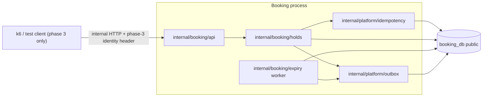

# Phase 3 — Correct Booking Core: Plan

*Source: PDF p.36–37 (phase 3: "atomic holds, idempotency; best-available, GA buckets", gate "T1, T7, T8 pass"), p.4 (unhappy paths), p.5–7 (FR-6 … FR-9, FR-12, FR-23), p.8 (1,000 holds/s; ≤ 4 round trips per seat sold; ≥ 2 replicas), p.14 (pgx, sqlc, goose), p.17–22 (booking_db and shared DDL, invariants), p.23 (`seatbits`), p.24 (Kafka topics and keys), p.25–27 (REST, gRPC), p.28–30 (flows 2 and 4), p.31–33 (guarantees, failures), p.35–36 (T1, T7, T8), p.37 (OQ-3). Decisions: [ADR-024](../../ARCHITECTURE_DECISIONS.md#adr-024), [ADR-033](../../ARCHITECTURE_DECISIONS.md#adr-033) … [ADR-036](../../ARCHITECTURE_DECISIONS.md#adr-036). Re-checked against the PDF text on 2026-11-06.*

**Status:** 📝 **Final plan, all architectural decisions recorded (owner, 2026-11-06), awaiting approval to start M1. No Phase 3 code exists.** There is **no fixed timeline**. Work proceeds one milestone at a time, and each milestone must be implemented, tested, reviewed and **approved** before the next starts.

**Tags used throughout:**
- **[PDF]** stated in the PDF.
- **[ADR]** approved owner decision (ADR-036 unless noted).
- **[Plan]** implementation detail proposed here, reviewed with its milestone.
- **[Open]** still needs an owner decision.

---

## 1. Objectives and scope

### 1.1 Phase 3 requirements traced to the PDF

| # | Requirement | PDF | Where in this plan | State |
|---|---|---|---|---|
| R1 | Hold 1–4 chosen seats, all or nothing, 10 minutes | FR-6, p.28, p.31 | §4 | M1 |
| R2 | Competing holds serialise. The loser re-checks and matches nothing | p.31 | §4, §10 | M1 |
| R3 | Inline reclaim of expired seats, marking the old hold `EXPIRED` | p.28 | §8.2 | M1 (refined under contention, §8.3) |
| R4 | Best-available: N adjacent seats in a **section or price tier**, `SKIP LOCKED LIMIT 40` | FR-7 (**P0**), p.28–29 | §5 | Section mode **M2**; **tier mode M4** (in the Phase 3 completion criteria). Tier data model to decide before M4 ([AMB-09](ambiguities.md#amb-09)) |
| R5 | GA: 32 buckets, rotated `SKIP LOCKED`, greedy, one allocation row per bucket, ordered retry once, `409` if short | FR-8, p.29 | §6 | M3 |
| R6 | GA never oversold, restored exactly once (`released_at`) | p.32 | §6, §8 | M3 |
| R7 | Idempotency claim: completed → stored; in progress → `409`; different body → `422` | FR-12, p.28 | §7 | M1 |
| R8 | Expiry every 2 s, batches of 1,000, `SKIP LOCKED`, one transaction per batch, mirror cleared | FR-9, p.30 | §8 | M1 (seats), M3 (GA) |
| R9 | Outbox events in the same transaction (HoldCreated, InventoryChanged per section, HoldReleased, HoldExpired, InventoryReturned) on `booking.holds` / `booking.inventory` | p.24, p.28, p.30, ADR-009 | §9 | M1 ([AMB-03](ambiguities.md#amb-03) ✅) |
| R10 | `seatbits` pre-filter (reject only) | p.23, p.28 step 3 | §5.4 | **M4**, booked-seats-only ([AMB-49](ambiguities.md#amb-49) ✅). In the Phase 3 completion criteria |
| R11 | `201 {hold_id, seats \| allocation, expires_at, amount}`; `409` listing unavailable seats **with suggested alternatives** | p.29, p.4 | §11 | `201`/`409` without alternatives in M1–M3; **nearby alternatives M4** (in the Phase 3 completion criteria). Algorithm to decide before M4 ([AMB-26](ambiguities.md#amb-26)) |
| R12 | Early release, `DELETE /v1/holds/{id}` → `204` | FR-23 | §8.4 | M2 |
| R13 | Full `booking_db` DDL and invariants (`CHECK`s, unique keys, partial indexes, `fillfactor = 80`) | p.17–22 | §3 | M1 |
| R14 | One database per service; nobody else reads Booking's tables | p.17, ADR-008 | §2 | All |
| R15 | T1, T7, T8 pass | p.35–36 | §15 | **M5**. Full scale on cloud VMs needs [OQ-6](open-questions.md) (does not block M1) |
| R16 | Hold p99 < 300 ms at the admitted rate; conflict rate < 5 % with best-available; ≤ 4 round trips per seat sold; 1,000 holds/s target | p.3, p.8 | §12 | Measured and reported (hold share only, AMB-28) |
| R17 | Holds work with Redis down (skip the pre-filter) | F9, p.33 | §5.4 | By design |
| R18 | A stalled expiry worker never blocks inventory | F14, p.33 | §8 | M1 |
| R19 | `SoldOut` on `booking.inventory`, keyed by `event_id` | p.24 | §9 | **M4**. Emission condition to decide before M4 ([AMB-52](ambiguities.md#amb-52)) |
| R20 | Hold limits 1–4, every mode, server-side | FR-6, p.8 | §4.2 | M1 ([AMB-10](ambiguities.md#amb-10) ✅) |

**Not in Phase 3 [PDF p.36]:**
- **Phase 4:** gRPC, JWT/JWKS, Identity, Catalog, the outbox relay and Kafka topics.
- **Phase 5:** the waiting room and access tokens.
- **Phase 6:** `StartPayment`, `ConfirmHold`, `GetBookingByOrder`, bookings and tickets.
- **Phase 7:** cancellations, transfer and scan.

Their tables are created now (P3-1), but nothing writes to them. `SoldOut` (on `booking.inventory`, p.24) **is** in Phase 3 (M4, R19), even though its consumer is the waiting room (phase 5). Its emission condition must be decided first ([AMB-52](ambiguities.md#amb-52)).

**P0 check (re-done 2026-11-06 against the PDF text):** every P0 requirement Phase 3 owns (FR-6, FR-7 incl. **tier**, FR-8, FR-9, FR-12) and every PDF-described Phase 3 mechanism (`seatbits`, nearby alternatives, outbox, `SoldOut`) has a milestone. None is dropped or weakened. Tier mode, nearby alternatives, `seatbits` and `SoldOut` are **sequenced later (M4)**, not deferred out of Phase 3.

### 1.2 The Phase 2 baseline is frozen [ADR-034/035, owner]

These paths never change: `internal/booking/baseline/**`, `internal/gateway/baseline/**`, `cmd/booking/baseline_*`, `cmd/gateway/baseline_*`, `loadtest/k6/baseline-t1.js`, `loadtest/baseline/**`, `test/e2e/baseline_e2e_test.go`.

- **Coexistence:** the baseline keeps its `baseline` schema and `baseline_goose_db_version` table. The real schema lives in `public` with goose's default table.
- **[Plan] M1 checks:**
  - a CI step fails if any baseline path differs from `develop`;
  - a coexistence test applies both migration sets to one database.

---

## 2. Architecture and service boundaries



| Package | Responsibility |
|---|---|
| `internal/booking/migrations` | goose SQL for the real schema, plus the runner with a session lock |
| `internal/booking/inventory` | Seat and GA generator, audit SQL, inventory statements |
| `internal/booking/holds` | `HoldSeats`, `HoldBestAvailable`, `HoldGA`, `ReleaseHold`, inline and partial reclaim, request validation |
| `internal/booking/expiry` | Expiry worker (`RunOnce` + ticker) |
| `internal/booking/api` | HTTP handlers, identity guard, RFC 9457 mapping (M2) |
| `internal/platform/idempotency` | Claim, fence, complete, abandon, cleanup (reused by Checkout later, FR-12) |
| `internal/platform/outbox` | Envelope v1 + insert in the caller's transaction |

- **[PDF]** Only Booking reads or writes `booking_db` (ADR-008). Nothing in Phase 3 touches another service's database.
- **[ADR]** The data access layer is hand-written `pgx` (AMB-36).
- **[Plan]** The worker is a goroutine in the Booking process, so no new service is added (ADR-021). Several replicas are safe because of `SKIP LOCKED` (p.30).
- **[ADR AMB-44]** The entry point is internal HTTP on Booking's port with a phase-3-only identity header, **never exposed publicly**. The guard is described in §11.3.

---

## 3. Database schema and migration strategy

### 3.1 Schema [PDF p.17–21]

`booking_db` exactly as transcribed in [postgres-schema](../04-data/postgres-schema.md#booking_db), which was cross-checked against the PDF text on 2026-11-06:
- **Booking tables:** `seats` (PK `(event_id, seat_id)`, the status/hold `CHECK`s, `fillfactor = 80`, `seats_held_expiry`, `seats_free_by_row`), `ga_buckets` (`CHECK (remaining >= 0 AND remaining <= capacity)`), `holds` (`order_id UNIQUE`, `holds_expiring`), `hold_seats`, `hold_ga_allocations` (PK `(hold_id, section, bucket)`, `released_at`), `bookings` (`hold_id UNIQUE`, `order_id UNIQUE`), `tickets` (`one_live_ticket_per_seat`), `ticket_transfers`.
- **Shared tables:** `idempotency_keys`, `outbox` (`outbox_ready`), `processed_events`.

| Migration | Contents |
|---|---|
| `00001_inventory_and_holds.sql` | `seats`, `ga_buckets`, `holds`, `hold_seats`, `hold_ga_allocations` + indexes |
| `00002_bookings_and_tickets.sql` | `bookings`, `tickets`, `one_live_ticket_per_seat`, `ticket_transfers` (unused until phases 6–7) |
| `00003_shared.sql` | `idempotency_keys`, `outbox`, `outbox_ready`, `processed_events` |
| `00004_idempotency_fencing.sql` | **Approved schema deviation (owner, 2026-11-06; ADR-036 amendment):** `ALTER TABLE idempotency_keys ADD COLUMN claim_generation BIGINT NOT NULL DEFAULT 1, ADD COLUMN claimed_at TIMESTAMPTZ NOT NULL DEFAULT now()`. Additive only. Every PDF column, the primary key and the `CHECK` stay unchanged |

- **[Plan]** Every migration has a working `Down`, verified by an up → down → up test.
- **[Plan] Schema-fidelity test:** compares the live catalogue (`pg_constraint`, `pg_indexes`, `pg_class.reloptions`) with an expected list derived from the PDF DDL. This turns invariant 4 (*"never weaken"*) into an automated check.

### 3.2 Migration execution [ADR AMB-51]

- **When:** goose runs at Booking start-up, before the listener opens.
- **Lock:** goose's Postgres **session-level advisory lock** (`lock.NewPostgresSessionLocker`).
- **Why it matters:** a session lock only excludes other migrators if the lock and every migration statement run on **one database session**. A pool can hand out different connections.
- **[Plan] Verification test (M1-T1):**
  1. A test-only migration blocks on a table lock held by the test.
  2. The test reads `pg_locks` (advisory lock) and `pg_stat_activity` (the blocked migration statement) and asserts that **both belong to the same backend pid**.
  3. A second, concurrent migrator is shown waiting on the advisory lock.
  4. After release, each migration is applied exactly once.
- **[Plan] Fallback:** if goose does not keep one session, the runner gives goose a dedicated `*sql.DB` with `SetMaxOpenConns(1)`, which guarantees one session. The test decides which applies.

### 3.3 Inventory provisioning [ADR AMB-45]

**Generated seats and evenly distributed GA buckets.** The deterministic generator lives in `internal/booking/inventory` and is used by tests and benchmarks. Catalog's publish step replaces it in phase 4 (p.22).

**[Plan] Details, confirmed at M1 review:**
- **Seat ids:** `'<section>-<row>-<number>'` (e.g. `'A-R01-01'`).
- **Bucket split:** capacity *C* over 32 buckets: bucket *b* gets `C/32 + (b < C mod 32 ? 1 : 0)`.
- **Layout variants** are parameters: the comparison layout (section A, R01–R20 × 25), a fragmented GA layout (each bucket < 4) and a 1-bucket GA layout (T7 lock-wait comparison).

**Implemented in M1-T3 (`internal/booking/inventory`):**
- **Bucket numbers 0–31 are enforced by the generator and by `Load`, not the database** (owner, 2026-11-06). The PDF DDL has no `CHECK` on `ga_buckets.bucket`, and none is added. A test shows Postgres itself accepts bucket 32, and that `Load` refuses it and writes nothing.
- **Exactly 32 buckets** for every even or explicit GA section. `SingleBucket` (bucket 0 only) exists solely for T7's 32-vs-1 measurement.
- **Explicit capacities** (32 values that must sum to the section capacity) express fragmented stock.
- **`SingleBucket` is benchmark/test-only.**
  - **Production** loading (`Load`, `Inventory.Validate`) requires exactly 32 buckets in every GA section and rejects a one-bucket section with an explicit "benchmark-only" error.
  - **Benchmarks** must use the separately named `LoadBenchmark` / `ValidateBenchmark`, which also accept a single section consisting of exactly bucket 0. Service code must never call them.
  - **Tests:** `TestSingleBucketIsBenchmarkOnly`, `TestProductionLoadRejectsSingleBucket` (real Postgres).
- **Layout limits**, each a validation error naming the limit:
  - **rows:** at most **99** per section (`R01`–`R99`);
  - **seats per row:** at most **999** (two digits up to 99, three above);
  - **sections:** at most **99** per event, seated and GA combined. This was raised from 64 on 2026-11-06 per the owner.
  - Section names are 1–16 letters or digits, never `-`, so a seat id always splits into exactly (section, row, number). Test: `TestSeatIDsAreUnambiguous`.
- **Seat ids** are `'<section>-R<row>-<number>'`, zero-padded (`A-R01-01`, or three digits above 99 seats per row), so text order equals row/seat order.
- **`Load` writes everything in one transaction** and refuses an event that already has inventory, so nothing is ever merged or duplicated. `VerifyLoaded` checks that Postgres holds exactly the configured rows.
- **GA has no price column** in the PDF schema (`ga_buckets` has none), and none is added (owner, 2026-11-06). Generation is independent of pricing: no GA price is invented or hardcoded. The GA hold `amount` (p.29) therefore needs [AMB-53](ambiguities.md#amb-53) decided before M3. That entry records how hold amount = checkout charge is guaranteed for seats today (Booking computes it from its own published price rows, and Checkout takes it from `GetHold`), plus the GA options.

---

## 4. Seat reservation: atomic chosen-seat holds [PDF p.28, p.31]

**Isolation [PDF, Plan]:** `READ COMMITTED` everywhere. Correctness comes from conditional updates with rows-affected checks, row locks, `CHECK`s and unique keys (p.31), not from the isolation level. `SERIALIZABLE` would add `40001` retries and no extra safety for these single-statement decisions.

### 4.1 Transaction (in lock-rank order, §10)

```sql
-- (0) idempotency fence: lock our claim row, prove we still own it (§7.3)
SELECT 1 FROM idempotency_keys
 WHERE scope = $s AND user_id = $u AND key = $k
   AND status = 'IN_PROGRESS' AND claim_generation = $gen
   FOR UPDATE;                                            -- 0 rows => lost ownership => ROLLBACK
SAVEPOINT hold_attempt;
-- (1) take the requested seats, in seat_id order, all or nothing      [PDF p.31]
WITH target AS (
  SELECT seat_id, hold_id AS old_hold FROM seats
   WHERE event_id = $e AND seat_id = ANY($ids)
     AND (status = 'AVAILABLE' OR (status = 'HELD' AND hold_expires_at < now()))
   ORDER BY seat_id
     FOR UPDATE)
UPDATE seats s SET status = 'HELD', hold_id = $new, hold_expires_at = now() + interval '10 minutes'
  FROM target t
 WHERE s.event_id = $e AND s.seat_id = t.seat_id
RETURNING s.seat_id, s.section, s.row_label, s.seat_number, s.price_paise, t.old_hold;
```

- **Not all seats taken (rows ≠ requested):** `ROLLBACK TO SAVEPOINT hold_attempt`, read the current statuses (plain `SELECT`) to list the unavailable seats, store the deterministic `409` in the idempotency row (fenced, §7) and `COMMIT`. The seats are untouched.
- **All seats taken:**
  1. `INSERT holds` (`kind 'SEATS'`, `status 'ACTIVE'`, `expires_at = now() + 10 min`, the same expression as the mirror);
  2. `INSERT hold_seats`;
  3. partial reclaim of any `old_hold`s (§8.3);
  4. outbox `HoldCreated` + one `InventoryChanged` per section (§9);
  5. fenced idempotency completion with the `201` body;
  6. `COMMIT`.
- **[Plan] Batching:** inserts are sent as one pgx batch, to keep round trips low (§12).
- **[Plan] Clocks:** all times come from the database clock (`now()`, which is fixed per transaction), so `holds.expires_at` equals the seat mirror exactly (invariant 9).
- **[Owner] Lock timeout: 500 ms** (decided 2026-11-06, D1). `SET LOCAL lock_timeout` keeps the transaction inside the 1 s `HoldSeats` deadline. A timeout is a non-deterministic failure (§7.4), never a stored `409`.

**Implemented in M1-T8 (`internal/booking/holds/seats.go`, `events.go`, `response.go`):**

**Entry point**
- **Signature:** `HoldSeats(ctx, pool, claim, req)` takes a T5 claim and a validated T7 seats request. The hold's `user_id` is the claim's user.
- **Result:** a `SeatsResult` (`Held` 201, `Unavailable` 409, `UnknownSeats` 422) only when that outcome committed together with its idempotency record.
- **Errors mean nothing was stored:** `idempotency.ErrNotOwner`, `lock_timeout` (`55P03`), `40P01` (a bug), cancellation or a database error. T10 maps these to `503`/abandon.

**Transaction order**
1. `set_config('lock_timeout', '500ms', true)` and a database `gen_random_uuid()` for the hold id. This statement takes no lock, so the timeout bounds the fence's wait too.
2. `Fence`, then `SAVEPOINT`.
3. The §4.1 take statement, with ids sorted.
4. **If rows ≠ requested:** `ROLLBACK TO SAVEPOINT`, then a stored `422` if any id does not exist for the event (unknown beats unavailable), else a stored `409` listing the ids not taken.
5. **If all were taken:**
   1. one pgx batch inserts `holds` (`expires_at = now() + 10 min`, the mirror's expression) and `hold_seats`;
   2. partial reclaim (§8.3);
   3. outbox `HoldCreated`, then `InventoryChanged` per section in section order;
   4. fenced `Complete` with the `201`;
   5. `COMMIT`.

**Bodies** (§11.2 shapes)
- `201 {hold_id, seats[{seat_id, section, row, number, price_paise}], expires_at, amount}`. `expires_at` is RFC 3339 UTC with six fractional digits (the outbox format).
- `409 {type: urn:surgetix:problem:seats-unavailable, title, status, detail, unavailable_seat_ids}`.
- `422 {type: urn:surgetix:problem:invalid-request, title, status, detail, unknown_seat_ids}`.
- The problem URIs and the extension member names are provisional until the M2 review (AMB-12).

**Test-only hooks** (unexported): the lock timeout (lengthened only by tests that force a lock schedule) and a failure hook before completion (nil in production).

**Tests (real Postgres, T4 audit after each):** created hold (two sections, mirror = `holds.expires_at`, events, stored `201`), stored `409` and replay, stored `422`, D1 (forced order, 3 rounds), D2 (80 buyers / 10 seats), D3, D4 (1,000 rounds of reversed overlapping sets, 0 `40P01`), D5 (failure after all effects), lost claim, the 500 ms timeout (fires at about 500 ms and stores nothing), outbox consistency.

### 4.2 Limits [ADR AMB-10]

- **Range:** 1–4 seats per hold, **validated server-side** before the claim, in every mode: `len(seat_ids)`, `best_available.quantity` and `ga.quantity` must be integers in [1, 4].
- **Also rejected:** duplicate `seat_ids`, empty or oversized ids, more than one mode, and unknown fields.
- **Deferred:** cumulative per-user and purchase caps.

**Implemented in M1-T7 (`internal/booking/holds/request.go`):**
- **Entry point:** `ParseRequest(eventID, body) (Request, error)` returns a typed request `{EventID, Mode, SeatIDs, Section, Quantity}` for all three modes. It is pure: no database, cache or network, so an invalid request never reaches Postgres.
- **Errors:** every failure is a `*ValidationError{Field, Reason}` matching `ErrInvalidRequest` (→ `422 invalid-request`, §11.2). A well-formed tier request also matches `ErrTierModeUnavailable` (`422` *"tier mode not available yet"*, §5.3). Errors are deterministic: keys are checked in sorted order.
- **Rules:**
  - The body is one JSON object with exactly one of `seat_ids`, `best_available`, `ga`. A `null` member counts as present (and is then invalid). Unknown fields are rejected at every level.
  - Malformed JSON, trailing data and duplicate keys are rejected with the same rules as the request hash (T5 `CanonicalJSON`).
  - `seat_ids`: 1–4 distinct non-empty strings. Ids are compared exactly (case-sensitive, after JSON unescaping) and sorted bytewise.
  - `best_available`: exactly one of `section` or `tier`, plus `quantity`. The quantity is checked before the tier rejection. The tier value itself is not validated ([AMB-09](ambiguities.md#amb-09) open).
  - `ga`: `section` and `quantity`, both required.
  - **Quantity:** a plain JSON integer in 1–4. `1.5`, `2.0` and `2e0` are all non-integer, and strings, booleans and `null` are rejected. **Owner-confirmed 2026-11-06** (Phase 3 constraint).
  - **Event id:** the path parameter must be a UUID. It is lower-cased.
- **Id limits, owner-confirmed 2026-11-06 as Phase 3 constraints** (plan "empty or oversized ids"):
  - section ≤ 16 bytes, seat id ≤ 24 bytes;
  - these are the longest the T3 generator can produce (AMB-45: Phase 3 inventory is generated), and a test pins them to it;
  - **revisit when Catalog layouts are introduced in phase 4.**
- **Canonical form (§7.1):** `Request.Canonical()` gives the hashing input for `idempotency.RequestHash`: canonical JSON with sorted keys, `seat_ids` sorted and `event_id` included. Reordered seat ids, keys, whitespace, escapes or event-id case hash equal. A different seat, section, quantity, mode or event hashes differently.

---

## 5. Best-available seat selection [PDF p.28–29, M2]

### 5.1 Algorithm

```sql
SELECT seat_id, row_label, seat_number FROM seats
 WHERE event_id = $e AND section = $sec AND status = 'AVAILABLE'
 ORDER BY row_label, seat_number
   FOR UPDATE SKIP LOCKED LIMIT 40;
```

- **[PDF]** Pick the **first run of N adjacent seats** in memory, then apply **the same conditional update** as §4.1 (the rows are already locked by this transaction, so it cannot wait). `SKIP LOCKED` chooses; the conditional update decides.
- **[Plan]** Adjacency means the same `row_label` and consecutive `seat_number`.
- **[Derived]** Expired `HELD` seats are not candidates, because the query takes only `AVAILABLE`. They return through the worker.

### 5.2 No adjacent run [ADR AMB-26]

`409` with no alternatives in M2–M3. Nearby alternatives are added in **M4** (§11.4).

### 5.3 Tier mode [ADR AMB-09]

**Section mode first (M2), tier mode in M4.** Until M4, `{best_available:{tier,…}}` returns `422` *"tier mode not available yet"*.

- FR-7 is P0 and stays in the Phase 3 completion criteria (§15.2). Phase 3 is not complete without tier mode.
- **[Open, before M4]** Tier data model ([AMB-09](ambiguities.md#amb-09)):
  - (a) a tier is a distinct `price_paise` value, with no schema change;
  - (b) a `tier` column copied from the layout (a schema deviation needing an ADR).
- **[Open, before M4]** Whether a tier spans sections. If it does, adjacency stays within one section and row.
- **[Plan]** The algorithm is the §5.1 query with `section = $sec` replaced by the tier predicate. Same `SKIP LOCKED LIMIT 40`, same conditional update.

### 5.4 `seatbits` [PDF p.23, p.28 step 3; ADR AMB-49]: M4

- **[ADR] Rules:** **booked-seats-only** bitmap semantics. PostgreSQL stays the authoritative inventory source. **Stale bitmap data must never block a valid hold or reclamation.** It is in the Phase 3 completion criteria and implemented in M4.
- **[Plan] Invariant: bits ⊆ seats whose committed status is `BOOKED`.** That is safe because a `BOOKED` seat is never holdable or reclaimable (§4.1 `WHERE`). Ordering rules:
  - a bit is **set only after** the transaction that makes the seat `BOOKED` commits;
  - a bit is **cleared before** the transaction that takes the seat out of `BOOKED` commits.

  If clearing fails, the key is deleted, or the pre-filter is disabled until a rebuild. It is never left stale.
- **[Plan] Lookup and lifecycle:**
  - Key `seatbits:{event}:{section}`. The bit offset is the seat's ordinal from the generator (§3.3).
  - It is rebuilt from Postgres at start-up and after Redis reconnects.
  - If Redis is down, the pre-filter is skipped (F9).
- **[Derived] Phase 3 limitation:** in Phase 3 nothing becomes `BOOKED`. `ConfirmHold` is phase 6 and cancellation is phase 7. So M4 delivers the mechanism and proves its safety properties (test SQL sets `BOOKED`), but the pre-filter rejects nothing in real Phase 3 traffic and cannot show a performance effect until phase 6. The phase 6 and 7 transactions must call the set and clear hooks. That is recorded as a dependency for those phases.

---

## 6. GA allocation and restoration [PDF p.29, p.32, M3]

1. **First pass (never waits).** `SELECT bucket, remaining FROM ga_buckets WHERE event_id=$e AND section=$sec AND remaining > 0 ORDER BY (bucket - r + 32) % 32 FOR UPDATE SKIP LOCKED`, with `r` random. Take greedily. For each bucket used, run `UPDATE ga_buckets SET remaining = remaining - $q WHERE … AND remaining >= $q` (exactly 1 row, or roll back) and `INSERT hold_ga_allocations (…, quantity = $q)`.
2. **Retry once (may wait).** If the unlocked stock is less than N: `ROLLBACK TO SAVEPOINT`, then lock **all** buckets of the section with plain `FOR UPDATE … ORDER BY bucket` (ascending; *"waits instead of skipping and cannot deadlock"*) and allocate greedily.
3. **Still short:** `409`, with the outcome stored (§7).

- **Restoration** happens on expiry and on release (§8.4):
  1. lock the hold's unreleased allocations;
  2. lock the target buckets **in ascending `(event_id, section, bucket)` order**;
  3. `UPDATE ga_buckets SET remaining = remaining + q`;
  4. `UPDATE hold_ga_allocations SET released_at = now() WHERE … AND released_at IS NULL`.

  All four run in one transaction. **Exactly once** is guaranteed by the `released_at IS NULL` guard. Over-restoration is also impossible, because `CHECK (remaining <= capacity)` would fail the transaction.
- **[PDF T7]** Lock wait with 32 buckets vs 1 is measured using the 1-bucket layout (§3.3). No code path differs.

---

## 7. Idempotency design [PDF p.28, ADR AMB-48]

### 7.1 Parameters

| Parameter | Value |
|---|---|
| Key | `(scope, user_id, key)`. `scope` = operation, e.g. `'POST /v1/events/{eventID}/holds'` |
| Request hash | SHA-256 of the **canonical JSON** of the *validated* request: sorted keys, no whitespace, `seat_ids` sorted, path parameters included. Reordered but identical requests hash equal |
| Stale-claim lease | **30 s** (from `claimed_at`). Far above the transaction's lock timeout, so a live claimant inside its transaction is never overtaken (§7.3) |
| Retention | **24 h** (`expires_at = now() + 24 h`). Expired rows count as absent, and a cleanup job deletes them in batches with `SKIP LOCKED` |
| Stored outcomes | `201` and **deterministic** `409` (unavailable, GA short) and `422` from the business rules. Never stored: timeouts, `5xx`, cancellations, `lock_timeout` |
| Fencing token | **(`claim_generation`, `claimed_at`)**, both approved columns (§3.1). Every claim, takeover and abandon changes the token. `claimed_at` is needed as well as the generation: if a row is ever deleted (retention cleanup) and the key reused, the fresh row restarts at generation 1 but can never carry the old `claimed_at` (M1-T5 finding) |

### 7.2 Claim (its own short transaction, holds no other lock)

1. `INSERT … (status 'IN_PROGRESS', claim_generation 1, claimed_at now(), expires_at now()+24h) ON CONFLICT DO NOTHING RETURNING claim_generation`. If a row comes back, **proceed with generation 1**.
2. Otherwise read the row and decide:

| Existing row | Result |
|---|---|
| `expires_at < now()` | Replace it in place: new hash, `IN_PROGRESS`, `claim_generation + 1`, new times. **Proceed** |
| `request_hash` differs | **`422`** |
| `COMPLETED` | **Replay** `response_code` / `response_body` |
| `IN_PROGRESS`, `claimed_at > now() − 30 s` | **`409` retry later** |
| `IN_PROGRESS`, stale | **Take over:** `UPDATE … SET claim_generation = claim_generation + 1, claimed_at = now() WHERE … AND status='IN_PROGRESS' AND claimed_at < now() - interval '30 seconds' AND request_hash = $h RETURNING claim_generation`. 0 rows means someone else took over or completed it, so re-read once |

### 7.3 Fenced completion: an old claimant can never interfere

- **Fence first.** The business transaction's **first** statement is the §4.1 fence: `SELECT … WHERE claim_generation = $gen AND status = 'IN_PROGRESS' FOR UPDATE`. If it returns 0 rows, the claimant was overtaken and **rolls back without touching inventory**.
- **Complete last.** Completion is `UPDATE … SET status='COMPLETED', response_code, response_body WHERE … AND claim_generation = $gen AND status = 'IN_PROGRESS'`, which must affect exactly 1 row, inside the same transaction as the business effect.

**Why this is safe:**
- The fence holds the row lock until commit. A takeover attempted meanwhile blocks, then sees `COMPLETED` and replays.
- A claimant overtaken *before* its transaction started fails the fence.
- An old claimant's `Abandon` (below) is also fenced, so it can never delete or overwrite a newer claim.

### 7.4 Failure handling

| Event | Outcome |
|---|---|
| Crash **before** the business commit | Transaction rolled back. Claim `IN_PROGRESS` (gen g). Retries get `409` until 30 s pass, then take over (gen g+1) and execute. **One effect** |
| Crash **after** commit | `COMPLETED` committed with the effect. Retries replay it. **No second hold** |
| Commit succeeded, response lost on the way to the client | Same as above: the retry replays the stored `201` |
| Non-deterministic failure (timeout, `5xx`) | Rollback, then a best-effort fenced **Abandon**. It does **not** delete the row: it bumps `claim_generation` and sets `claimed_at = '-infinity'` (fenced by the full token), so the retry takes over at once with a new generation. If that fails too, the lease frees it. *Changed in M1-T5 from a fenced `DELETE`:* deleting let a re-inserted row restart at generation 1, so an old claimant's token could match the new claim. After an abandon, the key stays bound to its request, so a different body is a mismatch (p.28) |
| Same key, different body | `422` per the PDF (p.28, and the DDL comment `same key + different body → 422`), no effect. **Confirmed by the owner (2026-11-06)**; business conflicts stay `409`. The `idempotency` package returns the outcome `Mismatch`; the HTTP mapping is the M2 API layer's |

**Implemented in M1-T5 (`internal/platform/idempotency`):**
- `Claim` returns `Proceed` / `Replay` / `InProgress` / `Mismatch`.
- `Fence(tx, claim)` comes first in the business transaction and takes the lock-rank-0 row lock. `Complete(tx, claim, response)` comes last, before `COMMIT`.
- `Abandon` (invalidate) and `Cleanup` (only past retention, `SKIP LOCKED`).
- `RequestHash` is SHA-256 over scope + canonical JSON: sorted keys, no whitespace, exact number normalisation, duplicate keys rejected, array order kept.
- The lease (30 s) and retention (24 h) are fixed constants, and every comparison uses the database clock.
- `response_body` is `JSONB`, so a replay returns semantically identical (not byte-identical) JSON.


**Implemented in M1-T10 (`internal/booking/holds/service.go`):** `Service.Hold(ctx, user, key, eventID, body)` returns `Response{Status, Body, Replayed, Cause}`.

| Situation | Response | Claimed / stored |
|---|---|---|
| User not a UUID, or empty `Idempotency-Key` | `400 bad-request` | No |
| Body invalid, or tier mode (T7) | `422 invalid-request` | No (see §11.2) |
| Best-available (M2) or GA (M3) request | error `ErrModeNotAvailable`, no HTTP mapping until that milestone | No |
| Key completed (same request) | the stored `201` / `409` / `422`, `Replayed = true` | — |
| Key in flight | `409 idempotency-in-progress` | No |
| Key used for a different request | `422 idempotency-key-reused` | No; the original stays |
| Executed now | `201`, `409 seats-unavailable` or `422` unknown seats from `HoldSeats` | Yes |
| Claim failed (database) | `503 service-unavailable` | Nothing claimed |
| Lock timeout, deadlock, cancellation, database error in the transaction | `503`; claim **abandoned** (best effort, detached 2 s context) so the retry proceeds at once | No |
| Lost claim (`ErrNotOwner`: taken over or completed elsewhere) | `503`; **not** abandoned (not ours). The retry replays or gets `409` | No |

- **No deadlock retry-once in M1.** T10 does not require it. A `40P01` is handled like any non-deterministic failure (abandon, `503`); `Cause` carries it for the M2 metric. The retry-once and the metric (§10.3) are still to be placed (M2, with metrics).
- **Problem URIs:** `bad-request`, `service-unavailable`, `idempotency-in-progress` and `idempotency-key-reused` are provisional until the M2 review (AMB-12).
- **Test seams** (unexported, unset in production): replace the abandon step (to simulate a crashed process), and a hook between the claim and the transaction.
- **Tests (real Postgres, T4 audit after each):**
  - I1: crash while blocked on a seat lock, with no abandon → `409` until the lease, then one hold; and the session killed while the service survives → abandon → immediate retry.
  - I2: commit, then a crash before returning → replay.
  - I3: response lost → replay of the same `hold_id`, with the body re-serialised.
  - I4: sequential replays; 50 concurrent calls while the owner is held mid-request → 49 × `409 in-progress`, 0 executions; 50 concurrent on a warmed pool → exactly 1 execution.
  - I5: after completion and while in flight.
  - I6: stale claimant after a takeover → `503` (`ErrNotOwner`), its retry replays B's hold, B's record stays `COMPLETED` at generation 2.
  - I7, I8; lock timeout → abandon → retry; cancellation; refusals never claim.

---

## 8. Expiry worker and inline reclamation [PDF p.28, p.30]

### 8.1 Worker batch (one transaction, lock-rank order)

```sql
-- (1) candidates, oldest first, skipping holds others are working on
SELECT hold_id, kind FROM holds
 WHERE status IN ('ACTIVE','PAYMENT_PENDING') AND expires_at < now()
 ORDER BY expires_at, hold_id LIMIT 1000
   FOR UPDATE SKIP LOCKED;                                        -- H
-- (2) seats still owned by those holds, skipping seats locked by in-flight holds
WITH rest AS (SELECT event_id, seat_id FROM seats
               WHERE hold_id = ANY($H) AND status = 'HELD'
               ORDER BY event_id, seat_id FOR UPDATE SKIP LOCKED)
UPDATE seats s SET status = 'AVAILABLE', hold_id = NULL, hold_expires_at = NULL
  FROM rest r WHERE s.event_id = r.event_id AND s.seat_id = r.seat_id
RETURNING s.event_id, s.section, s.seat_id;
-- (3) GA (M3): unreleased allocations of H, buckets locked ascending, restore, stamp released_at (§6)
-- (4) drained = holds in H with zero HELD seats and zero unreleased allocations left
UPDATE holds SET status = 'EXPIRED' WHERE hold_id = ANY($drained) AND status IN ('ACTIVE','PAYMENT_PENDING');
-- (5) outbox: HoldExpired per drained hold, InventoryReturned per section (§9)
COMMIT;
```

- **[PDF]** Every 2 s, batches of 1,000, `SKIP LOCKED`, one transaction per batch, mirror cleared, GA restored once, outbox written.
- **[Plan] Invariant:** a hold becomes `EXPIRED`/`RELEASED` **only** in a transaction that leaves it with **zero** `HELD` seats and **zero** unreleased allocations. **No orphaned `HELD` seats can exist under a dead hold.** The audit checks this (§13.3).
- **[Plan] Pacing:** while batches come back full, run again immediately. After an empty batch, wait 2 s. `RunOnce(ctx)` is exported, so tests drive the worker deterministically.
- **[Plan] Shutdown:** the ticker stops and the in-flight batch commits within `SHUTDOWN_TIMEOUT`.

**Implemented in M1-T11** (`internal/booking/holds/expire.go` `ExpireBatch`, `internal/booking/expiry/worker.go` `Worker`):

**The batch** (`ExpireBatch(ctx, tx, limit)`), one transaction, exactly the statements above:
1. Up to `limit` expired `ACTIVE`/`PAYMENT_PENDING` holds of kind `SEATS`, oldest first, `FOR UPDATE SKIP LOCKED`.
2. Their still-owned `HELD` seats, `SKIP LOCKED`, re-checked in the `UPDATE`.
3. Drained-only `EXPIRED`: zero `HELD` seats **and** zero unreleased GA allocations.
4. Outbox: `HoldExpired` (reason `expired`), then `InventoryReturned` (source `expired`) per event and section.

- **Where it lives:** in the `holds` package, so it reuses T9's event writers and payload types. The schema cannot drift, and no approved T8–T10 file changed.
- **GA holds:** **not** candidates until M3. The allocation guard keeps an M3 GA hold from ever being expired with unreleased stock.

**The worker**
- **Defaults** (PDF p.30): batch 1,000, interval 2 s; `SHUTDOWN_TIMEOUT` 10 s.
- **`RunOnce(ctx)`:** one committed batch.
- **`Run(ctx)`:** back-to-back while batches are full, otherwise waits the interval. A failed batch is logged and retried after the interval.
- **Stop:** when the context ends, no new batch starts. An in-flight batch runs on a detached context and may still commit for up to `ShutdownTimeout`; after that it is cancelled and rolls back.

**Metrics** (§12)
- `booking_expiry_batches_total`: committed batches.
- `booking_holds_expired_total`.
- `booking_expiry_partial_total`: locked holds left live because a seat was locked elsewhere.
- `booking_expiry_lag_seconds`: age of the oldest expired, unprocessed `SEATS` hold, refreshed after each batch.
- **Derived:** these meanings are mine; the plan names only the metrics. Registering them on Booking's registry, and starting the worker, is T12 wiring.

**Tests (real Postgres, T4 audit after each scenario):**
- due holds only, with events and metrics;
- E1 (locked hold skipped without waiting, processed next run, lag visible), E2 (locked seat → partial, no orphan, finished next run, every seat returned once);
- E4 (two workers, 150 holds, batches of 20: each hold expired once, each seat returned once, both worked), E5 (session killed before `COMMIT` → nothing changed → rerun once), E6 (reruns are no-ops);
- a seatless expired hold left by T9 is finished; GA holds are ignored;
- L1 against the real worker (a buyer waits on the worker's seat lock, then takes the seat, no deadlock);
- back-to-back pacing; graceful stop (commits within the timeout, rolls back past it).

### 8.2 Inline reclaim [PDF p.28]

The §4.1 `WHERE` takes `HELD` seats whose mirror has expired, so a stalled worker never blocks chosen-seat inventory (F14).

### 8.3 Partial reclaim [ADR AMB-50]

After step (1) of §4.1, for the distinct `old_hold` values returned:

```sql
SELECT hold_id FROM holds
 WHERE hold_id = ANY($old) AND status IN ('ACTIVE','PAYMENT_PENDING') AND expires_at < now()
   FOR UPDATE SKIP LOCKED;                                       -- L ⊆ old (others: a worker or reclaimer owns them)
WITH rest AS (SELECT event_id, seat_id FROM seats
               WHERE hold_id = ANY($L) AND status = 'HELD'       -- ONLY seats the old hold still owns
               ORDER BY event_id, seat_id FOR UPDATE SKIP LOCKED)
UPDATE seats s SET status = 'AVAILABLE', hold_id = NULL, hold_expires_at = NULL
  FROM rest r WHERE s.event_id = r.event_id AND s.seat_id = r.seat_id
RETURNING …;
-- per h in L: if no seat WHERE hold_id = h AND status = 'HELD' remains, then
--   UPDATE holds SET status = 'EXPIRED' WHERE hold_id = h AND status IN ('ACTIVE','PAYMENT_PENDING')
--   (otherwise h stays ACTIVE, already past expires_at, and the worker finishes it, §8.1)
-- outbox: HoldExpired (drained holds), InventoryReturned (released seats)
```

- **Never another hold's seat.** Seats already taken by another hold have a different `hold_id`, so the `hold_id = ANY($L)` predicate excludes them, including the ones this transaction just took.
- **A concurrent transaction's seat** is either still locked (skipped, and the old hold stays live) or committed with a new `hold_id` (excluded).
- **The count is conservative.** The remaining-seat count reads committed state. A seat being reclaimed by an uncommitted transaction still shows `hold_id = h`, so `h` is not expired too early.
- ⚠️ **Refinement of p.28**, recorded in ADR-036. Under contention, the old hold is finished by the worker instead of in this transaction.

**Implemented in M1-T9 (`internal/booking/holds/reclaim.go`)**, called at step 3 of the T8 transaction:
- **Statements:** exactly the three §8.3 statements: lock old holds (`SKIP LOCKED`, `hold_id` order); release the seats they still own (`SKIP LOCKED`, re-checked in the `UPDATE`); drained-only conditional `EXPIRED`.
- **Events:** `HoldExpired` (reason `expired`) per drained hold, then `InventoryReturned` (source `reclaimed`) per section of released seats.
- **Observed in P4** (two buyers reclaiming different seats of one old hold): in most rounds the old hold had no seats left but stayed `ACTIVE` (expired), because the drained check could not yet see the other buyer's uncommitted seat. This is the conservative behaviour above, and the T11 worker finishes such holds.
- **Also observed:** a requested seat can be released by one reclaimer just before its own buyer locks it. That buyer then takes it as `AVAILABLE`, and the event stream shows `InventoryReturned` followed by `InventoryChanged`. No buyer ever loses a seat it has locked or committed.
- **Tests (T4 audit after each):** inline reclaim, P1–P5 (P4 ×40, P5 ×60 rounds), L1 (worker owns the hold row and a seat, and worker owns the wanted seat), L2 (300 rounds of crossing partial reclaims, 0 `40P01`), and a rollback after the reclaim leaving the old hold intact.

### 8.4 Release [FR-23, ADR AMB-27]

1. Fence (rank 0).
2. Lock the hold (rank 1): `SELECT … FROM holds WHERE hold_id=$h AND user_id=$u FOR UPDATE`. The result must be `status = 'ACTIVE' AND expires_at > now()`:
   - otherwise `409 not releasable` if it exists and is the caller's;
   - `404` if it doesn't exist or belongs to someone else.
3. Lock the hold's seats (rank 2, ordered `FOR UPDATE`) and return them to `AVAILABLE`. Restore GA (rank 3, ascending).
4. Set `holds.status = 'RELEASED'` (conditional), write outbox `HoldReleased` and `InventoryReturned`, complete the idempotency row with `204`.

---

## 9. Transactional outbox [PDF p.24, p.28, ADR AMB-47]

- **[PDF]** Events are written to `outbox` **in the same transaction** as the state change. Nothing publishes to Kafka in Phase 3 (the relay is phase 4), so rows stay `PENDING` (invariant 8).
- **[ADR] Envelope v1 (JSON, UTF-8, stored in `outbox.payload`):**

```json
{
  "event_id": "8f7c…",          // = outbox.id (UUID v4), stable identity for dedupe
  "event_type": "HoldCreated",   // PDF names: HoldCreated, InventoryChanged, HoldReleased, HoldExpired, InventoryReturned
  "schema_version": 1,
  "occurred_at": "2026-…Z",      // database now() of the transaction
  "producer": "booking",
  "aggregate": {"type": "hold", "id": "<hold_id>"},
  "data": { }
}
```

| Event | `outbox.topic` ([AMB-03](ambiguities.md#amb-03) ✅) | `outbox.key` [PDF p.24] | `data` (v1, plan) |
|---|---|---|---|
| HoldCreated | `booking.holds` | `hold_id` | `hold_id, event_id, user_id, kind, expires_at, amount_paise, seats[] \| allocations[]` |
| HoldReleased / HoldExpired | `booking.holds` | `hold_id` | `hold_id, event_id, reason` |
| InventoryChanged | `booking.inventory` | `event_id:section` | `event_id, section, seats[{seat_id,status}] \| buckets[{bucket,delta}]` |
| InventoryReturned | `booking.inventory` | `event_id:section` | `event_id, section, source (expired \| released \| reclaimed), seats[] \| quantity` |
| SoldOut (M4) | `booking.inventory` | **`event_id`** (p.24) | `event_id` + per AMB-52 |

- **[PDF]** A hold spanning two sections writes its lifecycle once on `booking.holds` and one `InventoryChanged` per section (p.24).
- **[ADR AMB-03]** Topic names are the PDF table's `booking.holds` and `booking.inventory` (approved 2026-11-06). Event names are stable, and payloads are versioned JSON with event ids (AMB-47).
- **[Open, before M4]** The `SoldOut` emission condition ([AMB-52](ambiguities.md#amb-52)).
- **[Plan] Consistency tests:** a rolled-back transaction leaves no outbox rows. Every committed hold, release and expiry has exactly its events. Golden JSON tests fix the format.
- **[Open] Aggregate version.** p.24 asks every event to carry the aggregate's version. Envelope v1 has none, and the schema has nothing to derive it from ([AMB-54](ambiguities.md#amb-54)). This does not block Phase 3. It blocks the phase 4 relay (P4-5).

**Implemented in M1-T6 (`internal/platform/outbox`)**, with owner decisions on 2026-11-06 ([AMB-47](ambiguities.md#amb-47) update):

**Insert**
- **Signature:** `Insert(ctx, tx pgx.Tx, Event{Type, Key, Data}) (event_id, error)`. It runs in the caller's transaction and never commits, rolls back or touches Kafka.
- **Statements:** two parameterised statements, `SELECT gen_random_uuid()::text, now()` and then `INSERT INTO outbox (id, topic, key, payload)`, with a rows-affected = 1 check.
- **Row state:** the rows keep the schema defaults (`PENDING`, `attempts = 0`, no lock).
- **Locks:** none beyond the new, invisible row, so the §10 lock order is unchanged.

**Registry** (fixed in code; callers cannot override topic, aggregate type, producer or version)

| Type | Topic | Key form | Aggregate |
|---|---|---|---|
| HoldCreated, HoldReleased, HoldExpired | `booking.holds` | lower-case hold UUID | `{"type":"hold","id":key}` |
| InventoryChanged, InventoryReturned | `booking.inventory` | `<lower-case event UUID>:<non-empty section>` | `{"type":"section","id":key}` |

- **Keys:** UUIDs must be lower case (PostgreSQL's text form), so one aggregate never lands on two partitions.
- **`SoldOut`:** rejected until [AMB-52](ambiguities.md#amb-52) is decided.

**Envelope**
- **Field order:** `event_id`, `event_type`, `schema_version` (1), `occurred_at`, `producer` (`booking`), `aggregate`, `data`.
- **`occurred_at`:** the transaction's `now()`, RFC 3339 in UTC with exactly six fractional digits.
- **`data`:** the caller's value, which must marshal to a JSON object. It is stored compacted. The typed per-event payloads are Booking's (T8 onward), so the package has no Booking types.

**Rejections**
- An unknown type, a malformed key, or data that is nil, non-object or unmarshalable returns `ErrInvalidEvent`.
- The check runs **before any SQL**, so a rejected call writes nothing and the caller's transaction stays usable.

**Not in M1-T6:** the relay, topic creation, retries, `DEAD` handling and the aggregate version (AMB-54).

---

## 10. Concurrency and deadlock prevention

### 10.1 Global lock ranking

| Rank | Lock | Key order |
|---|---|---|
| 0 | `idempotency_keys` row | `(scope, user_id, key)`, at most one per transaction |
| 1 | `holds` row | `hold_id` |
| 2 | `seats` row | `(event_id, seat_id)` |
| 3 | `ga_buckets` row | `(event_id, section, bucket)` |

**Rule W (wait).** A transaction may **block** on a lock only if that lock is **strictly greater**, by `(rank, key)`, than **every** lock it already holds.

**Rule S (skip).** Any other lock is taken with `FOR UPDATE SKIP LOCKED`, which never blocks, or not taken at all. Work left undone because of a skip is left in a state the expiry worker retries (§10.3).

### 10.2 Every path complies

| Path | Waits on (in order) | Skips |
|---|---|---|
| Idempotency claim / takeover | rank 0 (holds nothing else) | — |
| Chosen-seat hold (§4.1) | 0 → 2 (requested seats, ascending) | old holds (1), old holds' other seats (2) |
| Best-available (§5) | 0 | candidate seats (2) |
| GA first pass (§6) | 0 | buckets (3) |
| GA retry (§6) | 0 → 3 (all buckets, ascending) | — |
| Release (§8.4) | 0 → 1 → 2 (ascending) → 3 (ascending) | — |
| Expiry worker (§8.1) | 3 (ascending), after its skips | holds (1), seats (2) |
| Idempotency cleanup | — | rank 0 |

- **Implicit locks.** Foreign-key checks on `INSERT hold_seats` / `hold_ga_allocations` take `KEY SHARE` on rows this transaction already holds, or on its own new `holds` row. New rows (holds, outbox, allocations) are invisible to others. So no extra waits arise.
- **Worker vs `KEY SHARE`.** The worker's `UPDATE holds SET status` takes `FOR NO KEY UPDATE`, which does not conflict with `KEY SHARE`.

### 10.3 Why there can be no deadlock (sketch)

1. A deadlock is a cycle T₁ → T₂ → … → Tₙ → T₁ in the wait-for graph, where Tᵢ waits for a lock Lᵢ held by Tᵢ₊₁.
2. `SKIP LOCKED` acquisitions never wait, so they add no edges.
3. By Rule W, Tᵢ₊₁ waits for Lᵢ₊₁, which is greater than every lock Tᵢ₊₁ holds, and Tᵢ₊₁ holds Lᵢ. So Lᵢ₊₁ > Lᵢ.
4. Around the cycle that gives L₁ < L₂ < … < Lₙ < L₁, a contradiction. ∎

**Defence in depth.** Postgres' deadlock detector remains on. A `40P01` is treated as a **bug**: it is counted in a metric, retried once, and every test asserts the count is **zero**.

### 10.4 Liveness: skipped work is never starved

- A partially processed hold keeps `status ∈ {ACTIVE, PAYMENT_PENDING}` and an expired `expires_at`, so it stays in the worker's candidate set.
- Candidates are ordered **oldest first** (`expires_at, hold_id`), so a skipped hold is first in line on the next run.
- Locks on a hold or its seats are held only by short transactions, bounded by the request deadline, `lock_timeout` and **[Owner, 2026-11-07]** `idle_in_transaction_session_timeout` = **5 s on the Booking runtime pool** (a per-connection parameter, not a role setting, so the migration runner, which shares the role, is unaffected).
- So every expired hold is eventually locked by a worker run and drained.
- **Metric:** `booking_expiry_lag_seconds` (age of the oldest expired, unprocessed hold) makes any stall visible.

### 10.5 Exactly-once restoration and safe retries

- **Seats** return only `WHERE hold_id = $h AND status = 'HELD'`.
- **GA** returns only `WHERE released_at IS NULL`, with the stamp written in the same transaction.
- **Holds** change only `WHERE status IN (…)`.
- **Worker crash:** a crashed or killed batch rolls back completely, and re-running it is a no-op for anything already done.

---

## 11. API contract and error handling

### 11.1 Endpoints (internal port in Phase 3) [PDF p.25, ADR]

| Endpoint | Request | Success |
|---|---|---|
| `POST /v1/events/{eventID}/holds` | Headers `Idempotency-Key` (required) and the phase-3 identity header. Body: exactly one of `{seat_ids}`, `{best_available:{section, quantity}}`, `{ga:{section, quantity}}`, each 1–4 | `201 {hold_id, seats \| allocation, expires_at, amount}` |
| `DELETE /v1/holds/{holdID}` | `Idempotency-Key`, identity header | `204` |

### 11.2 Errors (RFC 9457, `application/problem+json`) [PDF p.24, Plan]

| Status | When | Stored for replay? |
|---|---|---|
| `400` | Missing or malformed `Idempotency-Key`; missing or invalid identity header | No (never claimed) |
| `404` | Hold not found or not the caller's (release) | Yes |
| `409` `seats-unavailable` | Chosen seats taken, no adjacent run, GA short. Lists `unavailable_seat_ids` where applicable. **From M4: `alternatives`** (§11.4) | **Yes** |
| `409` `hold-not-releasable` | Hold not `ACTIVE` or already expired | Yes |
| `409` `idempotency-in-progress` | Another request with this key is in flight | No |
| `422` `invalid-request` | Validation (§4.2), unknown seats, tier mode before M4 | Unknown seats: **yes** (decided inside the transaction). Body validation and tier mode: **no**: they are checked before the claim (§4.2) and only a validated request has a hash (§7.1). They are deterministic, so the same body always gets the same `422` (M1-T10) |
| `422` `idempotency-key-reused` | Same key, different body | No (the original stays) |
| `503` | `lock_timeout`, database unavailable, deadline exceeded. Retryable with the same key | No |

- **[Plan]** Problem `type` values are `urn:surgetix:problem:<name>`. The URIs are AMB-12, confirmed at M2 review.
- **[Plan]** Response shapes:
  - `seats`: `[{seat_id, section, row, number, price_paise}]`
  - `allocation`: `{section, quantity}`
  - `expires_at`: RFC 3339 UTC
  - `amount`: integer paise
- **[Plan]** A replayed response carries `Idempotent-Replayed: true`.

### 11.3 Phase-3 identity guard [ADR AMB-44, Plan reviewed in M2]

- **The header:** a user UUID header is honoured only when `BOOKING_PHASE3_TRUSTED_IDENTITY=true` (default `false`) **and** `BOOKING_HTTP_ADDR` binds a loopback address.
- **Misconfiguration:** Booking refuses to start if the flag is set with a non-loopback address.
- **Without the flag:** the hold routes answer `401`.
- **Lifetime:** the header and flag are removed in phase 4.
- **Tests** cover each guard state.


### 11.4 Nearby alternatives [PDF p.4, p.29; ADR AMB-26]: M4

- **[ADR]** M1–M3 return `409` with `unavailable_seat_ids` and no suggestions. **Nearby alternatives are in the Phase 3 completion criteria** and are delivered in M4.
- **[Plan] Constraints:**
  - The alternatives are computed by a **read-only** query **after** the hold transaction's savepoint rollback, with **no locks**, so they never change the lock order (§10).
  - They are **suggestions, never holds**. A buyer must request them, and the request goes through the full conditional update.
  - They are stored with the deterministic `409`, so a replay returns the same suggestions (they may be stale by then, which is harmless).
- **[Open, before M4]** The algorithm ([AMB-26](ambiguities.md#amb-26)): for example, up to *k* runs of the same size in the same section, ranked by row and seat distance from the request, or one best-available suggestion. Also *k* and the response shape.
---

## 12. Observability and performance measurement

| Signal | Source |
|---|---|
| `holds_total{mode,result}` [PDF p.34] | Counter per outcome (`created`, `unavailable`, `invalid`, `replayed`, `in_progress`, `error`) |
| `seats_remaining`, `double_booked_seats`, `oversold_ga` [PDF] | Audit collector, one query per scrape |
| Hold latency (RED) | `http_request_duration_seconds{route}` (exists) |
| DB pool wait [PDF] | `pgxpool_*` (exists) |
| Round trips per hold / per seat sold [ADR AMB-28] | pgx query tracer: `booking_db_round_trips_total{op}`. A batch counts once |
| Deadlocks | `booking_deadlocks_total`, expected **0** |
| Idempotency | `idempotency_claims_total{outcome}` (new, replay, in_progress, mismatch, takeover, abandoned) |
| Expiry | `booking_expiry_batches_total`, `booking_holds_expired_total`, `booking_expiry_partial_total`, `booking_expiry_lag_seconds` |
| Logs | `slog` JSON with `user_id`, `event_id`, `hold_id` (CLAUDE.md standard) |

---

## 13. Testing strategy

### 13.1 Principles

- Real PostgreSQL 17.11 via `testcontainers-go`, connecting as `booking_svc`. `-race` in CI. Table-driven tests and Go fuzzing (p.15).
- **Determinism without production hooks.** Interleavings are forced from the **database side**:
  - test transactions hold row locks;
  - the code under test runs in a goroutine with a distinctive `application_name`;
  - the test **observes** it blocked via `pg_stat_activity.wait_event_type = 'Lock'` before releasing.

  Waiting is always for an **observed condition**, with a timeout counting as a **failure**. Sleeps are never used as proof.
- **Expiry** is triggered by moving `expires_at` / `hold_expires_at` into the past with test-only SQL. The worker is driven with `RunOnce`.
- **Crashes** are simulated with `pg_terminate_backend` on a blocked session, or by discarding a response after commit.
- **The audit (§13.3) runs after every test.**

### 13.2 Test catalogue

| Group | Tests |
|---|---|
| **V** validation (AMB-10) | 0, negative, 5+, non-integer, each of 1–4, for `seat_ids` length, `best_available.quantity`, `ga.quantity`; duplicate ids; two modes; unknown fields |
| **M** migrations | Session-lock same-pid test; concurrent migrators; up/down/up; coexistence with the baseline migrations |
| **S** schema | Fidelity vs the PDF DDL (every `CHECK`, unique, partial index, `fillfactor`) |
| **D** holds | D1 two buyers / one seat (forced order); D2 many buyers / limited seats; D3 all or nothing; D4 reversed overlapping sets (no `40P01`); D5 rollback leaves nothing |
| **I** idempotency | I1 crash before commit; I2 crash after commit; I3 commit then response lost; I4 same key + same body (sequential and 50 concurrent); I5 same key + different body; I6 stale claimant completes after a takeover (fenced: no effect, no overwrite); I7 expired key reuse; I8 stored `409` replay |
| **P** partial reclaim | P1 reclaim one of three seats (the rest released, old hold `EXPIRED`); P2 a concurrent transaction holds one of the old hold's seats (skipped; old hold stays live; the worker finishes it); P3 another hold already owns a seat (never released); P4 two reclaims of different seats of one old hold at once; P5 reclaim racing a new hold on the same expired seat |
| **E** expiry | E1 hold row locked → skipped → processed on the next run; E2 one seat locked → partial, no orphan, finished later; E3 bucket wait observed, then completion; E4 two workers (disjoint); E5 worker killed mid-batch → rerun exactly once; E6 rerun no-op; E7 GA restored once (M3) |
| **L** lock order | L1 reclaim vs worker on one hold; L2 two partial reclaims; L3 reversed sets; L4 release vs worker (M2); L5 GA retry vs worker restoration (M3); L6 randomized stress (thousands of mixed operations, `-race`) with 0 `40P01` and a clean audit. Each L-test builds the schedule that would deadlock under a naive lock order and asserts that it does not |
| **B** best-available (M2) | Adjacent run chosen; locked candidates skipped; no-run `409`; tier `422` until M4 |
| **T** tier mode (M4) | Tier predicate selects the right seats; adjacency within a section/row; locked candidates skipped; `409` when no run |
| **N** nearby alternatives (M4) | `409` carries alternatives; computed without locks (no extra lock waits observed); replay returns the stored suggestions; requesting one goes through the normal conditional update |
| **K** `seatbits` (M4) | Bits only for `BOOKED` (test SQL); never rejects an `AVAILABLE` or reclaimable seat; set-after-commit and clear-before-commit ordering; Redis down → skipped, holds succeed; rebuild equals Postgres |
| **Q** `SoldOut` (M4) | Emitted exactly per AMB-52, once, in the same transaction as the triggering change |
| **G** GA (M3) | Multi-bucket (3+1); skip → ordered retry; exhaustion (Σ allocated ≤ capacity, `oversold_ga` 0); fragmented layout; 1 vs 32 buckets |
| **O** outbox | Rollback → no rows; commit → exactly the events; golden envelope |
| **A** API (M2) | Every status in §11.2; identity guard states; replay header |
| **F** property / fuzz | Random interleavings of hold, release and expire against a model; audit after every step |

### 13.3 Audit (real schema) [PDF metrics, Plan SQL]: implemented in M1-T4

`internal/booking/inventory/sql/audit.sql` + `Audit()` (`audit.go`).
- **Read-only:** it runs in a `READ ONLY`, `REPEATABLE READ` transaction, so there is one snapshot and one `now()` for every check, and Postgres rejects any write. It never repairs or normalises data.
- **Findings:** each one is `(check, event_id, subject, detail)` plus the invariant text and its source.
- **The SQL is the same everywhere:** tests now, k6 runs later (M5).

**Claiming rule.** A seat is *claimed* by:
- an `ACTIVE`/`PAYMENT_PENDING` hold **not past `expires_at`** (through `hold_seats`);
- a `CONVERTED` hold **only while its booking has a valid ticket for the seat**.

An `ACTIVE`/`PAYMENT_PENDING` hold past `expires_at` is a valid state awaiting the worker or inline reclaim (p.28, p.30), and it claims nothing.

| Check | Must be 0. Invariant | Source |
|---|---|---|
| `double_booked_seat` | A seat is claimed by at most one hold | PDF p.34 `double_booked_seats`; plan; p.32 resale |
| `held_seat_without_hold` | A `HELD` seat's `hold_id` exists | PDF p.17–18 schema |
| `held_seat_mirror_mismatch` | `seats.hold_expires_at` = canonical `holds.expires_at` | PDF p.21 |
| `orphan_held_seat` | A seat is `HELD` only by an `ACTIVE`/`PAYMENT_PENDING` hold | Plan (no orphans), AMB-50 |
| `held_seat_not_in_hold` | A `HELD` seat is listed in its hold's `hold_seats` | PDF p.18 (Derived) |
| `oversold_ga` | Unreleased GA allocations ≤ section capacity | PDF p.34 `oversold_ga`; plan |
| `ga_stock_mismatch` | Per bucket, `capacity − remaining` = unreleased allocations. A surplus = **restored twice** (or never taken), a deficit = taken without an allocation | Plan (conservation, restore-once) |
| `orphan_ga_allocation` | An `EXPIRED`/`RELEASED` hold has no unreleased allocation | Plan §8.1 |
| `booked_seat_ticket_count` | Every `BOOKED` seat has exactly one valid ticket | PDF FR-22 (Booking's part) |
| `live_ticket_on_unbooked_seat` | A valid ticket's seat is `BOOKED` | PDF p.29–30 (Derived: issue and cancel happen in the seat's transaction) |

**Refinements of the earlier wording, made to avoid false positives in documented valid states:**
1. **Expired holds don't claim.** `double_booked_seats` read "a seat in more than one `ACTIVE`/`PAYMENT_PENDING`/`CONVERTED` hold". That flags the contended partial reclaim (§8.3), where an expired old hold keeps its `hold_seats` row while a newer hold owns the seat. Hence "not past `expires_at`".
2. **Cancelled tickets don't claim.** A `CONVERTED` hold keeps `hold_seats` rows after its ticket is cancelled and the seat is resold (p.32), so it claims only through a valid ticket.

Mutation tests confirmed that weakening either refinement reintroduces the false positive.

**Not covered by T4 (explicit gaps):**
- **FR-22's order and ledger parts** ("every paid order has tickets or a refund", "ledger totals match FakePay") need `checkout_db` and FakePay. They belong to Checkout (phase 8, [AMB-17](ambiguities.md#amb-17)).
- **GA partial cancellation:** how a cancelled GA ticket restores stock is open ([AMB-06](ambiguities.md#amb-06), phase 7). `ga_stock_mismatch` assumes every restoration stamps `released_at` and must be revisited then.
- **Constraint-enforced rules:** `CHECK`s and unique indexes (`one_live_ticket_per_seat`, `remaining >= 0`, …) are already enforced by Postgres and proven in T2, so they aren't re-audited.
- **The `double_booked_seats` / `oversold_ga` Prometheus gauges** (p.34) come with the metrics work in M2. Their values are `Report.Count(...)`.
---

## 14. Milestone sequence

**Rules:**
- One milestone at a time.
- A milestone is complete only when its gate passes **and the owner approves it**.
- If a milestone reveals an architectural problem, that problem is resolved before moving on.
- No dates or durations are given.

| Milestone | Objective | Depends on | Expected outcome |
|---|---|---|---|
| **M1 — Schema, idempotency, chosen-seat holds and expiry** | Migrations (incl. approved 00004), generator, audit, idempotency with generation fencing, outbox (`booking.holds` / `booking.inventory`), validation for all three modes, `HoldSeats` with inline and partial reclaim, expiry worker (seats), lock-order validation | Plan approval. **No open decisions block M1** | Seat holds proven correct at the service layer under adversarial, deterministic schedules |
| **M2 — Release, best-available (section) and the internal API** | `ReleaseHold`, best-available in section mode, internal HTTP API with the identity guard, RFC 9457 errors, metrics, round-trip tracer | M1 approved | The full seat API over internal HTTP |
| **M3 — General admission** | `HoldGA` (skip then ordered retry), GA restoration in the worker and release, 1 vs 32 bucket layouts | M2 approved; **[AMB-53](ambiguities.md#amb-53) GA price source decided** | GA proven never oversold and restored exactly once |
| **M4 — PDF completeness** | **Tier mode** (FR-7, P0), **nearby alternatives** in `409` (p.4, p.29), **booked-only `seatbits`** (p.28 step 3), **`SoldOut`** emission (p.24) | M3 approved; **before M4:** AMB-09 tier data model, AMB-26 algorithm, AMB-52 `SoldOut` condition | Every PDF-described Phase 3 behaviour present |
| **M5 — Load gates and Phase 2 comparison** | k6 T1, T7, T8 locally (scaled) + comparison with the frozen baseline, **direct to Booking for both** (§15.3); full-scale T1/T7 on cloud VMs | M4 approved; **OQ-6** before the cloud runs | Phase 3 gate evidence |

**[Plan] Why this order:**
- M1–M3 build the correctness core: every guarantee in p.31–32.
- M4 adds the remaining PDF behaviours on top of it without changing the lock order. Alternatives are read-only. Tier mode reuses the best-available transaction. `seatbits` sits outside the transaction. `SoldOut` is an outbox row.
- M5 measures the complete system, so T8 (best-available vs manual) and T1 include everything the PDF describes.

### 14.1 M1 implementation sequence

Each task is one reviewable change set with its tests and doc updates (P5).

**M1-T1 — Migration runner with session lock**
- **Objective:** run goose for the real schema with a session-level lock that provably stays on one database session.
- **Files:** `internal/booking/migrations/migrate.go`, `…/migrate_integration_test.go`.
- **Details:** goose provider with `lock.NewPostgresSessionLocker` and the default version table. If the test shows the lock and the statements on different sessions, use the dedicated single-connection `*sql.DB` fallback (§3.2).
- **Tests:** M-same-pid, M-concurrent-migrators.
- **Expected result:** the lock pid equals the migration pid for the whole run. A second migrator waits, then finds nothing to apply.
- **Acceptance:** both tests pass. No use of the baseline's table.
- **Depends on:** —

**M1-T2 — Real schema migrations 00001–00004**
- **Objective:** the full `booking_db` schema per §3.1.
- **Files:** `internal/booking/migrations/*.sql`, `schema_integration_test.go`.
- **Details:** DDL copied from the PDF. 00004 adds `claim_generation` and `claimed_at` (approved, ADR-036 amendment). The fidelity test expects exactly the PDF DDL plus those two columns.
- **Tests:** S-fidelity, M-up/down/up, M-coexistence (real + baseline migrations in one database, both version tables).
- **Expected result:** the live catalogue matches the PDF DDL. The baseline's migrations still apply alongside.
- **Acceptance:** every PDF constraint and index present; coexistence passes.
- **Depends on:** T1

**M1-T3 — Generated inventory**
- **Objective:** deterministic seat and GA generation (AMB-45).
- **Files:** `internal/booking/inventory/generate.go` + tests.
- **Details:** layout parameters; the `'A-R01-01'` id format; the even bucket split with remainder; comparison, fragmented and 1-bucket layouts.
- **Tests:** split arithmetic (C = 0, 31, 32, 2,000, 2,001); id determinism; the 500-seat comparison layout; inserts satisfy every `CHECK`.
- **Expected result:** reproducible layouts.
- **Acceptance:** tests pass; layouts match §3.3.
- **Depends on:** T2

**M1-T4 — Audit SQL**
- **Objective:** the §13.3 checks as one SQL file plus `Audit()`.
- **Files:** `internal/booking/inventory/sql/audit.sql`, `audit.go`, tests.
- **Details:** the same SQL is used by tests and, later, by k6 runs.
- **Tests:** clean result on generated data, plus **one crafted violation per check** (inserted with test-only SQL) that the audit detects.
- **Expected result:** each violation is caught.
- **Acceptance:** every check has a positive and a negative test.
- **Depends on:** T2, T3

**M1-T5 — Idempotency package**
- **Objective:** §7 claim, fence, complete, abandon, cleanup and canonical hash.
- **Files:** `internal/platform/idempotency/*.go` + tests.
- **Details:** the fence is a function taking the caller's `pgx.Tx`. The generation is returned to the caller, so tests can act as an old claimant **without hooks**. The 30 s lease and 24 h retention are configuration constants. Expired-row replacement is included.
- **Tests:** canonical-JSON unit tests (key order, `seat_ids` order); claim outcome table; 50 concurrent claims on one key → exactly 1 winner; takeover after the lease (`claimed_at` moved back with test SQL); **I6** stale claimant: claim gen 1 → takeover gen 2 → gen-1 fence and complete affect 0 rows, and gen-2's record is untouched; cleanup with `SKIP LOCKED`.
- **Expected result:** an old claimant can never complete, overwrite or delete a newer claim.
- **Acceptance:** all tests pass with `-race`.
- **Depends on:** T2

**M1-T6 — Outbox helper**
- **Objective:** envelope v1 insert inside the caller's transaction.
- **Files:** `internal/platform/outbox/*.go` + tests.
- **Details:** `event_id` = `outbox.id`; `occurred_at` from the database; topic and key per §9.
- **Tests:** O-rollback, O-commit, golden JSON.
- **Expected result:** events exist only if their transaction commits.
- **Acceptance:** tests pass.
- **Depends on:** T2 (topic names approved, AMB-03)

**M1-T7 — Hold request validation and canonical form**
- **Objective:** server-side limits (AMB-10) and the hashing input.
- **Files:** `internal/booking/holds/request.go` + tests.
- **Details:** typed requests for **all three modes** (reserved seats, best-available, GA). Only seats is executed in M1, but validation covers every mode now ([AMB-10](ambiguities.md#amb-10) ✅, owner-confirmed). Rejects 0, negative, > 4, non-integer, duplicates, two modes, unknown fields.
- **Tests:** the full **V** table.
- **Expected result:** invalid requests never reach the database.
- **Acceptance:** each limit is covered in every mode.
- **Depends on:** —

**M1-T8 — `HoldSeats` core transaction**
- **Objective:** §4.1 without partial reclaim: fence, savepoint, ordered conditional update, inserts, outbox, fenced completion, stored `409`.
- **Files:** `internal/booking/holds/seats.go` + tests.
- **Details:** pgx batch for the inserts; `lock_timeout`.
- **Tests:** D1 (forced order via `pg_stat_activity`), D2, D3, D4 (reversed sets ×1,000, 0 `40P01`), D5, O-consistency, plus the audit after each.
- **Expected result:** exactly one winner per seat, never a partial hold.
- **Acceptance:** 0 double-booked seats in every test.
- **Depends on:** T4, T5, T6, T7

**M1-T9 — Inline and partial reclaim**
- **Objective:** §8.2 and §8.3.
- **Files:** `internal/booking/holds/reclaim.go` + tests.
- **Details:** `SKIP LOCKED` on old holds and their seats; the drained-only `EXPIRED` rule.
- **Tests:** P1–P5, L1 (reclaim vs a test-simulated worker lock), L2.
- **Expected result:** no orphaned `HELD` seats, never another hold's seat released, no deadlock.
- **Acceptance:** the audit's orphan check passes everywhere.
- **Depends on:** T8

**M1-T10 — Service-level hold with idempotency**
- **Objective:** `Hold(ctx, user, key, request)` combining T5, T7, T8 and T9.
- **Files:** `internal/booking/holds/service.go` + tests.
- **Details:** claim → business transaction → abandon on non-deterministic failure.
- **Tests:**
  - I1: terminate the session while it is blocked on a seat lock → no hold; retry `409` until the lease expires, then success, one hold.
  - I2/I3: commit, discard the response → retry replays the same `hold_id`.
  - I4, I5, I7, I8; I6 end to end.
- **Expected result:** a retry returns the original committed result and never a second hold.
- **Acceptance:** all **I** tests pass.
- **Depends on:** T9

**M1-T11 — Expiry worker (seat holds)**
- **Objective:** §8.1 for `SEATS` holds. The GA step lands in M3 within the same rank structure.
- **Files:** `internal/booking/expiry/worker.go` + tests.
- **Details:** `RunOnce`, ticker, back-to-back runs while batches are full, graceful stop, metrics.
- **Tests:** E1, E2, E4, E5, E6; L1 against the real worker; liveness (a skipped hold is processed on the next `RunOnce` once its lock is released).
- **Expected result:** every expired hold is drained exactly once, no starvation.
- **Acceptance:** all **E** tests pass.
- **Depends on:** T9

**M1-T12 — Booking wiring, stress and baseline guard**
- **Objective:** run migrations at start-up and start the worker in the Booking process. No public routes (M2).
- **Files:** `cmd/booking/main.go`, `.github/workflows/ci.yml` (baseline-frozen diff check), stress test.
- **Details:** `/readyz` reports ready only after migrations complete. Graceful worker shutdown.
- **Tests:** L6 randomized stress (0 `40P01`, clean audit); start-up/readiness test; Phase 1 + Phase 2 regression, including the unchanged baseline tests.
- **Expected result:** the Booking binary serves the core without changing the baseline.
- **Acceptance:** the CI baseline diff is empty; all suites pass.
- **Depends on:** T10, T11

**Implemented in M1-T12:**
- **`cmd/booking/core.go` `startCore`:**
  - applies the migrations under the T1 session lock **before** the HTTP server listens, so `/readyz` can only answer after them (a replica waiting behind another's migration stays unready);
  - adds a `booking_schema` readiness check (the schema is at the embedded version);
  - starts the T11 worker with its metrics on the service registry;
  - its `stop` ends the worker and waits, and runs before the pool closes (in-flight batch ≤ `SHUTDOWN_TIMEOUT`).
- **No public routes** (M2).
- **CI:** a `checks` step fails if the frozen baseline paths differ from `develop`. It uses `set -f`, so git's pathspecs also catch deleted files.
- **Tests:**
  - `cmd/booking`: `/readyz` `503` before and `200` after migrations; the started worker expires a due hold; `stop` is prompt; start-up blocks behind another migrator's lock.
  - **L6** (`internal/booking/expiry`): about 2,000 mixed operations on 30 contended seats (new holds, retries, aging into expiry, two workers): 0 `40P01`, consistent replays, clean audit after draining.
- **M1 close-out (owner, 2026-11-07): `idle_in_transaction_session_timeout` = 5 s, on the runtime pool only** (`cmd/booking/pools.go`).
  - **Two pools:** Booking now opens a second pool, the **runtime pool**, whose connections carry the parameter. The Phase 3 core runs on it (the worker now; the hold service from M2).
  - **The plain pool keeps its exact configuration:** the migration runner, the `postgres` readiness ping, the `pgxpool_*` metrics and the frozen Phase 2 baseline (its benchmark reads those metrics) stay on it. Nothing is set on the role or the database.
  - **Readiness:** `postgres_runtime` pings the runtime pool.
  - **Why 5 s:** healthy Booking transactions never sit idle in a transaction for seconds (1 s hold deadline, 500 ms `lock_timeout`, back-to-back worker statements), and 5 s is far below the 30 s idempotency lease, so an abandoned session releases its rank-0 and seat locks long before a takeover.
  - **Unchanged:** the 500 ms `lock_timeout` (per hold transaction) and the 30 s lease.
  - **Tests:** the runtime pool shows `5s`, the plain pool `0`, and there is no role setting; a runtime session left idle in a transaction while holding a row lock is terminated after about 5 s, and a blocked waiter then proceeds; the same idle transaction on the plain pool survives; migrations and start-up are unaffected.
  - **For M2:** pool metrics for the runtime pool need their own names or labels (`postgres.RegisterPoolMetrics` registers fixed names, which the plain pool already uses).

**M1-T13 — Documentation and M1 report**
- **Objective:** update the docs touched by M1 (P5) and write the M1 evidence into this plan and `PROGRESS.md`.
- **Expected result / acceptance:** reviewer-ready report.
- **Depends on:** T12

### 14.2 M1 validation gate

M1 is complete only when **all** of these hold, and the owner approves:
1. Every M1 test (V, M, S, D1–D5, I1–I8, P1–P5, E1–E2 and E4–E6, L1–L3, L6, O) passes locally (`-p 1`) **and** in CI with `-race`.
2. Zero `40P01` deadlocks in the L-suite and the stress test.
3. The audit is clean after every test, including **0 double-booked seats** and **0 orphaned `HELD` seats**.
4. Schema fidelity passes. The only deviation is the approved additive 00004.
5. The migration session-lock test proves one session.
6. The baseline paths are byte-identical to `develop`, and the Phase 1 and Phase 2 suites pass.
7. Documentation is updated, and the owner reviews and approves.

Code being written does **not** complete M1. Only this gate does.

**M1 status (2026-11-07):** T1–T13 are implemented and approved by the owner, and the idle-in-transaction timeout is set (5 s, runtime pool). Criteria 2–6 are met locally. Criterion 1 is met locally, but the CI `-race` run is pending (it needs a PR or push by the owner). Criterion 7 awaits the owner's review. Evidence is in [`PROGRESS.md`](../../PROGRESS.md#phase-3--booking-core-in-progress). **M2 does not start until this gate is approved.**

---

## 15. Acceptance criteria and validation gates

### 15.1 PDF gate [p.35–36], not weakened

| Test | Pass criteria |
|---|---|
| **T1** | 5,000 concurrent buyers on the same 500 seats, **run 100 times** → **0 double-booked seats; holds granted ≤ 500** |
| **T7** | 10,000 buyers on a 2,000-ticket GA section, including fragmented stock → **0 oversold; multi-bucket orders succeed; released allocations restore exact quantities; lock wait with 32 buckets vs 1 measured** |
| **T8** | Best-available vs manual picking under the same load → **conflict rate and holds/s compared and reported** |

**[ADR AMB-46]** Deterministic local tests, plus **full-scale T1/T7 on cloud VMs** in M5. [OQ-6](open-questions.md) (VMs, budget) must be resolved before those runs. It does not block M1–M4. Phase 3 is not complete until they pass.

### 15.2 Additional Phase 3 criteria (owner brief + plan)

- M1–M5 gates passed and approved.
- **PDF completeness (M4):**
  - **tier mode** works (FR-7, P0);
  - `409` carries **nearby alternatives** (p.4, p.29);
  - **booked-only `seatbits`** is implemented and proven never to block a valid hold or reclaim, and is skipped when Redis is down (p.28, F9);
  - **`SoldOut`** is emitted per the approved condition (p.24).
- **Zero** double-booked seats and zero oversold GA in **every** test and k6 run.
- Zero deadlocks.
- Idempotency: one effect per key under every crash case.
- Expiry: exactly-once restoration, no orphans, no starvation.
- Schema fidelity holds.
- The baseline is unchanged.
- Phase 1 and Phase 2 regression passes. CI is green.
- Hold p99, conflict rate, round trips and pool wait are **measured and reported**. Latency is not pass/fail in Phase 3, because the PDF ties it to the admitted rate (phase 5).

### 15.3 Benchmark comparison with Phase 2 [PDF p.34, Plan]

- **Same conditions:** same machine and placement as Phase 2; same pgx default pool (recorded); same saturating `constant-arrival-rate` at *B* = 50/100/250; same seed and seat-pair generator; the same 500-seat layout (seat *n* mapped to each build's id format); 3 runs + warm-up; reset → run → audit; same environment capture.
- **k6 target: [ADR, owner 2026-11-06]** Booking directly for **both** builds (the baseline route also answers on Booking's port), so both runs have the same hops.
- **Differences stated in the results:** SurgeTix requires an `Idempotency-Key` (unique per request) and identity, and creates a 10-minute **hold**, while the baseline books.
- **Compared:** double-booked seats (baseline 10–20 per run vs **0**), successes, error rate, p50/p95/p99, req/s, pool wait, round trips per hold, conflict rate. **[Plan]** Also one run at a fixed admitted rate (550 holds/s, p.8) for a meaningful hold p99.
- **Method unchanged:** the frozen baseline is re-run as-is. Its recorded Phase 2 results are not replaced.

---

## 16. Risks and unresolved decisions

### 16.1 Remaining decisions (none blocks M1)

| # | Item | Needed before |
|---|---|---|
| 1 | [AMB-09](ambiguities.md#amb-09) tier data model (distinct `price_paise` vs a `tier` column + ADR); whether a tier spans sections | M4 |
| 2 | [AMB-26](ambiguities.md#amb-26) nearby-alternatives algorithm, *k* and response shape | M4 |
| 3 | [AMB-52](ambiguities.md#amb-52) `SoldOut` emission condition | M4 |
| 4 | [OQ-6](open-questions.md) cloud VMs and budget | M5 full-scale runs |
| 5 | Plan details reviewed at their milestone: seat id format, bucket split, `lock_timeout` (**500 ms, owner 2026-11-06**) / `idle_in_transaction_session_timeout` (**5 s on the Booking runtime pool only, owner 2026-11-07**) values (M1); problem URIs, identity header name and guard (M2) | Each milestone |
| 6 | Phase 6/7 dependency: `ConfirmHold` and cancellation must call the `seatbits` set and clear hooks (§5.4) | Phases 6–7 |
| 7 | **[AMB-53](ambiguities.md#amb-53) GA price source** (H): `ga_buckets` has no price column (PDF p.17), but a GA hold returns `amount` (p.29) and Checkout charges what `GetHold` reports. Leaning: copy GA section prices into Booking at publish (new table, ADR), optionally snapshot the amount on the hold. No `ga_buckets` column, no invented price | **M3** |

**Resolved on 2026-11-06:** AMB-03, AMB-09 (approach), AMB-10, AMB-26 (approach), AMB-27, AMB-28, AMB-36, AMB-44 (incl. the k6 target), AMB-45 … AMB-51, plus the AMB-48 schema columns.

### 16.2 Technical risks

| # | Risk | Mitigation |
|---|---|---|
| R3-1 | A lock-order violation slips in during implementation | Rule W/S review checklist per task; the L-suite; `booking_deadlocks_total` = 0 |
| R3-2 | goose does not keep the lock on one session | M1-T1 test; single-connection fallback |
| R3-3 | Stale idempotency claims or a fencing bug | I-suite incl. I6; generation token mandatory |
| R3-4 | Partial-reclaim edge cases leave orphans | Drained-only expiry rule; orphan audit; P-suite |
| R3-5 | The laptop can't run full-scale T1/T7 | AMB-46 cloud VMs (OQ-6) |
| R3-6 | Pool queueing (12 connections) dominates latency at saturation | Report at the admitted rate. Any pool change is a separate ADR |
| R3-7 | Round-trip target unreachable without batching | pgx batch; tracer measures |
| R3-8 | Windows/Docker round trip (1.348 ms vs 0.154 ms in the VM) skews absolute numbers | Same placement for both builds; caveat stated |
| R3-9 | testcontainers-go parallel panic on Windows | `-p 1` locally; CI on Linux |
| R3-10 | Accidental change to the frozen baseline | CI diff check (M1-T12) |
| R3-11 | Outbox format chosen now needs changing in phase 4 | `schema_version` in the envelope |
| R3-12 | `seatbits` shows no benefit in Phase 3 (nothing is `BOOKED` before phase 6) | Acceptance is about safety, not speed (§5.4). Benefit measured in phase 6 |
| R3-13 | A later bitmap path forgets the clear-before-commit rule and blocks valid holds | K-tests; set/clear hooks reviewed in phases 6–7 |
